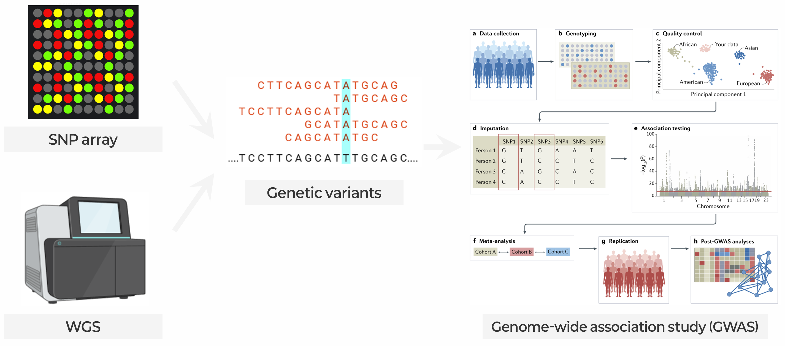

::: {.callout-note collapse="true"}
## 🎯 Learning objectives

By the end of this chapter you should be able to:

-   Name the main classes of human genetic variation and which platform detects which
-   Explain why a variant call is a probability, not an observation
-   Read a Manhattan plot, a QQ plot, and a regional association plot
-   ⚠️ Explain why a GWAS hit is a *region*, not a variant (LD) — and why the nearest gene is often the wrong gene
-   Interpret a polygenic risk score honestly, including what it cannot do
-   Recognise when a genetic result is being oversold
:::

> 🤔 **Motivating question**\
> Any two people differ at roughly 4–5 million positions in their genome\
> → Which of those differences cause disease?



💡 The main text of each section = the basics you need. **🔍 Going further** boxes = deeper material to open when you are curious

------------------------------------------------------------------------

# 1. Human Genetic Variation 🧬 {#w2-s1}

> 🔑 **Core idea** — every genome differs from the reference at millions of sites. Variants differ in size, frequency and origin → each kind needs a different technology and study design

## 1) Types of variation {#w2-s1-1}

A typical human genome, compared to the reference (🔗 [W1 §2.3](w1_intro.qmd#w1-s2-3)):

-   **\~4–5 million** single nucleotide variants (SNVs) and short indels
-   **\~20,000–25,000** structural variants (SVs)
-   ⚠️ SVs are far fewer — but together they affect **more base pairs** than all SNVs combined → count and impact point in opposite directions, and this decides which technology you need

{fig-align="center"}

### ① SNVs and short indels {#w2-s1-1-1}

-   **SNV** — one base changed
-   **Indel** — a short insertion or deletion
-   What most people mean by "a variant" → arrays, exomes and standard short-read pipelines detect them well

💡 **SNP** (*polymorphism*) = common variants; **SNV** = any single-base change, including somatic and rare ones. Usage is not consistent across the literature

### ② Structural variants and copy number {#w2-s1-1-2}

-   **SV** = anything larger than \~50 bp — deletions, duplications, insertions, inversions, translocations
-   **CNV** (copy number variant) = the subset that changes dosage
-   ⚠️ **Short reads detect SVs poorly** → the single strongest argument for long reads (🔗 [W1 §2.1③](w1_intro.qmd#w1-s2-1-3))

::: {.callout-note collapse="true" icon=false}
## 🔍 Going further — why short reads miss SVs

-   A 150 bp read cannot span a 10 kb deletion
-   → SV calling from short reads = inference from indirect signals: abnormal read-pair distances, coverage drops, split reads
-   → high false positive rates
:::

### ③ Tandem repeats {#w2-s1-1-3}

-   Short sequences repeated head-to-tail; the number of copies varies between individuals
-   Expansions cause Huntington disease, fragile X, and a growing list of neurological disorders
-   ⚠️ Almost invisible to standard short-read pipelines → their contribution to common disease is only now being assessed systematically

::: {.callout-warning collapse="true"}
## Every technology has a blind spot

"No significant variants in gene X" honestly means: **no variants of the classes this assay can detect**

A negative exome result says nothing about:

-   intronic variants
-   structural variants
-   repeat expansions
:::

## 2) Allele frequency: common vs. rare {#w2-s1-2}

-   **Allele frequency** — the proportion of chromosomes in a population carrying a given allele
-   **Common** = minor allele frequency (MAF) above 1–5% / **Rare** = below
-   **Frequency and effect size are inversely related** — strongly harmful variants are removed by selection → this one number determines almost everything about study design

{fig-align="center"}

💡 **Reference resource** — [gnomAD](https://gnomad.broadinstitute.org/): allele frequencies from hundreds of thousands of exomes and tens of thousands of genomes, by ancestry → "is this variant rare?" always needs *in which population*

::: {.callout-note collapse="true" icon=false}
## 🔍 Going further — why the inverse relation is no accident, and a history of the field

-   A variant both common *and* highly damaging would already have been eliminated by selection — or found decades ago
-   The figure is also a history of the field:
    -   **1980s–90s** family linkage studies → the top-left corner (Mendelian disease)
    -   **2007 onwards** GWAS → the bottom-right (common variants, tiny effects)
    -   **The middle** → needed dense imputation *and* biobank-scale samples; still being filled in
:::

## 3) Germline vs. somatic {#w2-s1-3}

-   **Germline** — inherited; present in every cell
-   **Somatic** — acquired during life; present in only a subset of cells (e.g. a tumour)
-   ⚠️ Tumour sequencing needs far greater depth **and** a matched normal sample from the same person

::: {.callout-note collapse="true" icon=false}
## 🔍 Going further — side by side, and why tumours need depth

|   | Germline | Somatic |
|------------------------|------------------------|------------------------|
| Present in | Every cell | A subset of cells |
| Inherited | Yes | No |
| Allele fraction | \~0.5 or \~1.0 | Anything from \<0.01 to 1.0 |
| Control needed | Reference genome | **Matched normal tissue from the same person** |
| Typical depth | 30× | 100–500×, sometimes more |

-   **Germline caller** — expects clean 50/50 or 100/0 allele fractions
-   **Somatic caller** — must separate a real mutation in 3% of cells from a sequencing error in 3% of reads
-   → hence the depth and the matched normal
:::

------------------------------------------------------------------------

# 2. From Reads to Variants 🔬 {#w2-s2}

> 🔑 **Core idea** — a variant list (VCF) is not a list of facts but a list of **inferences** from reads, each with its own confidence. Which variants you can see at all depends on the platform

## 1) The conceptual pipeline {#w2-s2-1}

```
FASTQ  →  align to reference  →  BAM
       →  call variants per sample
       →  joint genotyping across the cohort
       →  quality filtering
       →  VCF
```

-   **Joint calling** — analyses all samples together rather than one at a time
-   **Filtering** — callers produce far more candidates than are real → this is where most of the judgement lives
-   ⚠️ Different filter settings → meaningfully different variant sets from identical data

::: {.callout-note collapse="true" icon=false}
## 🔍 Going further — what joint calling and filtering decide

-   **Joint calling** distinguishes "homozygous reference here" from "no coverage here" → a distinction invisible in a single-sample VCF (🔗 [W1 §2.2③](w1_intro.qmd#w1-s2-2-3))
-   **Filtering criteria** — coverage, strand balance, mapping quality, position within the read
:::

## 2) ⚠️ Variant calls are probabilities {#w2-s2-2}

-   A VCF looks like a list of facts → it is a list of **inferences**, each with a confidence
-   The confidence varies enormously across the genome: ✅ high in unique, well-covered sequence / ⚠️ falls sharply in repetitive and hard-to-read regions
-   → "Accuracy" is not one number. **It is a map**

::: {.callout-warning collapse="true"}
## Where accuracy falls sharply

-   Repetitive and segmentally duplicated regions
-   GC-extreme regions with poor capture or amplification
-   Homopolymer runs (indel errors)
-   Highly polymorphic loci such as HLA — reads from divergent haplotypes align badly

→ Benchmarking resources such as [Genome in a Bottle](https://www.nist.gov/programs-projects/genome-bottle) exist precisely because "accuracy" is not one number
:::

## 3) Choosing a platform {#w2-s2-3}

-   **WGS** (whole genome) — \~100% of the genome; finds new variants anywhere, including non-coding; highest cost
-   **WES** (whole exome) — the coding part only (\~1–2%); medium cost → rare disease, clinical panels
-   **Array** — pre-selected sites only (\~0.02%); cannot find new variants; very cheap → GWAS, biobanks

{fig-align="center"}

::: {.callout-note collapse="true" icon=false}
## 🔍 Going further — WGS vs. WES vs. array in detail

|   | WGS | WES | Array |
|------------------|------------------|------------------|------------------|
| Genome covered | \~100% | \~1–2% (coding) | \~0.02% (selected sites) |
| Detects novel variants | ✅ | ✅ (coding only) | ❌ |
| Structural variants | Partially (well with long reads) | Poorly | Large CNVs only |
| Non-coding regulatory variants | ✅ | ❌ | Via imputation only |
| Relative cost per sample | High | Medium | Very low |
| Typical use | Deep characterization, rare disease, SVs | Rare disease, clinical panels | GWAS, biobanks |
:::

::: {.callout-tip collapse="true"}
## Why arrays still dominate GWAS

An array measures only pre-selected sites → cannot discover anything new. Still the workhorse of population genetics:

-   GWAS needs **hundreds of thousands of samples** far more than it needs complete genomes
-   The sites an array misses can be recovered statistically

→ which brings us to imputation
:::

## 4) Imputation {#w2-s2-4}

-   Nearby variants are inherited together in blocks ([§3.6](#w2-s3-6)) → measuring one tells you a lot about its neighbours
-   **Imputation** = genotypes at 500,000 array sites + a reference panel of densely sequenced genomes → statistically infer genotypes at tens of millions of unmeasured sites
-   ⚠️ An imputed genotype is a **prediction**, not a measurement

::: {.callout-note collapse="true" icon=false}
## 🔍 Going further — reference panels and quality scores

-   **Reference panels** — 1000 Genomes, HRC, TOPMed. Larger and more diverse → better imputation, especially for rarer variants
-   **Quality score** — INFO or *r*². Conventionally variants below 0.3–0.8 are dropped
:::

::: {.callout-warning collapse="true"}
## Imputation quality is not uniform

-   ✅ **Works well** — common variants, in populations well represented in the reference panel
-   ⚠️ **Works poorly** — rare variants; ancestries under-represented in the panel, which historically has meant most of the world

→ Treating predictions as measurements is how spurious associations enter the literature

🗺️ **Reference bias** in its most consequential form (🔗 [W1 §2.3③](w1_intro.qmd#w1-s2-3-3))
:::

------------------------------------------------------------------------

# 3. Genome-Wide Association Studies 📈 {#w2-s3}

> 🔑 **Core idea** — GWAS asks, for each of millions of variants, whether genotype associates with a trait. Ancestry can fake associations, and a hit marks a **region**, not a single variant

## 1) Study designs {#w2-s3-1}

The core logic is the same in every design: **for each variant, ask whether genotype associates with phenotype — repeat several million times**

| Design | Outcome | Notes |
|------------------------|------------------------|------------------------|
| **Case–control** | Binary (disease / no disease) | Effect reported as odds ratio |
| **Quantitative trait** | Continuous (BMI, blood pressure, lipid level) | Usually better powered per sample |
| **Biobank / PheWAS** | Thousands of phenotypes at once | One genotype set, many outcomes ([§6](#w2-s6)) |

## 2) Population structure and ancestry {#w2-s3-2}

### ① PCA on genotypes {#w2-s3-2-1}

-   Allele frequencies differ systematically between populations → PCA on a genotype matrix recovers ancestry almost perfectly
-   → the top PCs (principal components) = the standard way to describe and adjust for ancestry

{fig-align="center"}

### ② Ancestry as a confounder {#w2-s3-2-2}

🔗 [W1 §4.3](w1_intro.qmd#w1-s4-3)'s confounding problem, in its classic genetic form:

-   Cases and controls differ in ancestry → **every variant whose frequency differs between those ancestries shows an association** — with no causal relationship at all
-   ✅ Standard defence: include the top \~10 genotype PCs as covariates, **or** use a mixed model that accounts for genetic relatedness directly
-   ⚠️ Neither is perfect — residual structure (especially fine-scale structure within a country) remains a live problem

::: {.callout-warning collapse="true"}
## The Eurocentric bias of human genetics

A large majority of GWAS participants to date are of European ancestry, far out of proportion to the global population. The consequences compound:

-   Reference panels impute non-European genomes worse
-   Discovered associations are tagged by European LD patterns → do not transfer
-   Polygenic scores lose most of their accuracy across ancestries ([§5.3③](#w2-s5-3-3))
-   Clinical variant databases misclassify variants that are common and benign in under-studied populations

**Not only an equity problem — a validity problem.** A science built on one population does not generalize, and we cannot tell how badly until we test

💡 [GWAS Diversity Monitor](https://gwasdiversitymonitor.com/) for the current numbers
:::

**Try it** — [Confounding and batch effects ↗](https://kkonoo.github.io/edu_sims/sims/confounding/?lang=en){target="_blank"}

::: {.column-page}
```{=html}
<iframe src="https://kkonoo.github.io/edu_sims/sims/confounding/?embed=1&lang=en" title="Confounding and batch effects" loading="lazy"
        style="width: 100%; height: 1300px; border: 0;"></iframe>
```
:::

## 3) The association test {#w2-s3-3}

For each variant independently, fit something close to:

$$
\text{phenotype} \sim \text{genotype} + \text{age} + \text{sex} + \text{PC}_1 + \dots + \text{PC}_{10}
$$

-   Genotype coded **0/1/2** — the count of the effect allele → assumes an **additive model**
-   Age, sex and the top ancestry PCs are adjusted for as covariates

::: {.callout-note collapse="true" icon=false}
## 🔍 Going further — the additive assumption and modern mixed models

-   The additive model is usually reasonable, and almost always assumed
-   ⚠️ But it does mean recessive effects are detected inefficiently
-   **Modern practice** — linear mixed models (BOLT-LMM, SAIGE, REGENIE):
    -   handle relatedness and population structure jointly
    -   better calibrated for the extremely unbalanced case-control ratios typical of biobanks
:::

## 4) Reading the two standard figures {#w2-s3-4}

### ① Manhattan plot {#w2-s3-4-1}

{fig-align="center"}

-   Each point = one variant. Neighbouring variants are correlated → a real signal forms a **tower**
-   ✅ **Are there towers, and how wide are they?** A genuine signal has a shoulder of supporting variants
-   ⚠️ Isolated single points above the line = usually artifacts, not findings

::: {.callout-note collapse="true" icon=false}
## 🔍 Going further — two more things to check

-   **Which chromosomes?** → a hit at chr6 \~30 Mb is the HLA region, which behaves unlike anywhere else
-   **Is the noise floor flat?** → a rising baseline suggests inflation. Check the QQ plot
:::

### ② QQ plot {#w2-s3-4-2}

-   Observed vs. expected p-values. Under the null (no true association) → points follow the diagonal
-   **λ (genomic inflation factor)** — λ ≈ 1 → calibrated / λ \> 1.1 → a problem

{fig-align="center"}

::: {.callout-note collapse="true" icon=false}
## 🔍 Going further — what λ measures, and what inflates it

-   λ = median observed test statistic ÷ its expected value
-   λ \> 1.1 → unmodelled population structure, cryptic relatedness, or technical batch effects
:::

::: {.callout-tip collapse="true"}
## Always ask for the QQ plot

A Manhattan plot but no QQ plot is worth noticing:

-   A Manhattan plot cannot tell you whether the p-values are calibrated
-   An inflated study produces a **beautiful Manhattan plot full of nothing**
:::

## 5) Where 5×10⁻⁸ comes from {#w2-s3-5}

-   The genome-wide significance threshold — not arbitrary
-   Millions of variants, but correlated in blocks → \~**one million effectively independent** common variants in European-ancestry genomes
-   Bonferroni correction:

$$
\alpha = \frac{0.05}{10^6} = 5 \times 10^{-8}
$$

::: {.callout-note collapse="true" icon=false}
## 🔍 Going further — two implications students routinely miss

-   It is a **Bonferroni** correction, not FDR. GWAS demands near-certainty per hit because follow-up costs are enormous (🔗 [W1 §4.2](w1_intro.qmd#w1-s4-2))
-   ⚠️ It was calibrated for **European** LD structure. African-ancestry genomes have shorter LD blocks → more independent tests → a stricter threshold is appropriate. An adjustment often not made
:::

## 6) Linkage disequilibrium {#w2-s3-6}

-   **LD** = alleles at nearby loci travel together non-randomly — the footprint of chromosomes being inherited in segments, broken up gradually by recombination
-   ✅ Makes GWAS possible: genotype 500,000 sites → effectively survey millions, because each measured variant tags its neighbours
-   ⚠️ Makes GWAS hard to interpret: a signal appears → **every variant in the block shows it** → the statistic cannot tell the causal one from its correlated neighbours

------------------------------------------------------------------------

# 4. From Association to Function 🔎 {#w2-s4}

> 🔑 **Core idea** — a GWAS hit is a starting point, not an answer. The top variant is usually not the cause, most hits lie outside protein-coding sequence, and the nearest gene is often the wrong gene

## 1) The lead SNP is usually not causal {#w2-s4-1}

{fig-align="center"}

-   **Lead SNP** — the variant with the smallest p-value = the top of the tower
-   = the one that happened to be best measured and best tagged, **not necessarily the cause**
-   ⚠️ Under realistic conditions the causal variant is frequently *not* the lead SNP

## 2) Fine-mapping and credible sets {#w2-s4-2}

-   **Fine-mapping** — for each variant in the region: how likely is it to be the causal one?
-   Output = a **credible set** — the smallest set of variants containing the causal one with, say, 95% probability
-   → honest about uncertainty in a way a single lead SNP is not

::: {.callout-note collapse="true" icon=false}
## 🔍 Going further — how large is a credible set?

-   Formally: the posterior probability that each variant is causal, given the association statistics and the local LD structure
-   **Favourable case** (strong signal, weak local LD, diverse cohort) → 1–5 variants
-   **Unfavourable case** → hundreds. Itself informative: *this locus is not resolvable with current data*
-   **Cross-ancestry fine-mapping** helps substantially — LD patterns differ between populations, so the intersection is narrower
:::

## 3) ⚠️ Two persistent errors {#w2-s4-3}

-   ❌ "The hit is in gene X" → \~90% of GWAS hits lie **outside protein-coding sequence**
-   ❌ "So the causal gene is the nearest one" → often wrong; enhancers can skip over genes to reach a distant target

::: {.callout-warning collapse="true"}
## "The hit is in gene X"

**\~90% of GWAS associations lie outside protein-coding sequence** — in enhancers, promoters, untranslated regions

→ which is why W3 (Epigenomics) exists as a chapter

A non-coding hit does not mean a weak finding. It means **the mechanism is regulatory**
:::

::: {.callout-warning collapse="true"}
## "So the causal gene is the nearest one"

Enhancers routinely skip over intervening genes to reach their target

**The canonical example — the *FTO* obesity locus:**

-   associated variants sit inside an intron of *FTO*
-   functional work showed the causal effect operates on *IRX3* and *IRX5*
-   hundreds of kilobases away

→ The nearest gene is a reasonable **prior**, not a conclusion
:::

## 4) Variant to gene: the toolkit {#w2-s4-4}

-   **eQTL mapping** — which variants associate with the expression of which genes?
-   **Colocalization** — do the GWAS and eQTL signals share the same causal variant?
-   **CRISPR perturbation** — does editing the element change the gene? → the strongest evidence

💡 [Open Targets Genetics](https://genetics.opentargets.org/) aggregates most of these into a single per-locus view. A good first stop for any hit

::: {.callout-note collapse="true" icon=false}
## 🔍 Going further — the full toolkit and its limits

| Approach | Question | Limitation |
|------------------------|------------------------|------------------------|
| **eQTL mapping** | Which variants associate with expression of which genes? | Tissue- and cell-type-specific; needs the right tissue |
| **Colocalization** | Do the GWAS and eQTL signals share the same causal variant? | Statistically distinguishes shared cause from coincidence — but low power |
| **TWAS** | Which genes' predicted expression associates with the trait? | Efficient screen; does not establish causality |
| **Chromatin contact** | Which promoter physically contacts this enhancer? | Contact ≠ function (🔗 [W3 §4.3](w3_epigenomics.qmd#w3-s4-3)) |
| **CRISPR perturbation** | Does editing this element change the gene? | The strongest evidence; low throughput |
:::

------------------------------------------------------------------------

# 5. Heritability and Prediction 🧮 {#w2-s5}

> 🔑 **Core idea** — common traits are shaped by thousands of variants with tiny effects. A polygenic risk score adds them up → it stratifies populations but does not diagnose individuals

## 1) Twin heritability vs. SNP heritability {#w2-s5-1}

-   **Heritability (h²)** — the proportion of phenotypic variance in a population attributable to genetic variance
-   ⚠️ A **population** quantity, not an individual one. "Height is 80% heritable" says nothing about how much of *your* height is genetic
-   ⚠️ **Context-dependent** — rises when the environment is uniform, falls when it varies → the same trait can have different heritability in different populations or eras
-   **Twin h²** (comparing twins) \> **SNP h²** (only what common SNPs tag)

::: {.callout-note collapse="true" icon=false}
## 🔍 Going further — three ways to estimate h²

| Estimate | From | Typically |
|------------------------|------------------------|------------------------|
| **Twin h²** | Comparing MZ and DZ twin similarity | Highest; includes all genetic variation, and inflates if shared-environment assumptions fail |
| **SNP h²** | Genome-wide relatedness among unrelated individuals | Lower; captures only what common SNPs tag |
| **h² from genome-wide significant hits** | Summing effects of significant loci | Lowest by far |
:::

## 2) Missing heritability {#w2-s5-2}

-   Height: twin studies \~80% → SNP-based estimates \~50% → genome-wide significant loci when GWAS began: a few percent
-   That gap = the **missing heritability problem**
-   Much of it is now explained by **many more, smaller effects** below the detection threshold → **polygenicity**: common traits are influenced by thousands to tens of thousands of variants

::: {.callout-note collapse="true" icon=false}
## 🔍 Going further — where the heritability went, and the omnigenic model

The gap drove a decade of work. Much of it is now accounted for:

-   **Many more, smaller effects** — sample sizes into the millions → thousands of loci appeared. The variants were always there, below the detection threshold
-   **Rare variants** poorly tagged by arrays
-   **Overestimated twin heritability** — shared environment misattributed to genes

**Polygenicity** — most of those variants have effects too small to ever be individually meaningful

**The omnigenic model** pushes this further:

-   in the relevant cell type, essentially any expressed gene can nudge a complex trait through the regulatory network
-   → architecture dominated by a diffuse periphery rather than a core set of pathway genes
:::

## 3) Polygenic risk scores {#w2-s5-3}

### ① How a PRS is built {#w2-s5-3-1}

$$
\text{PRS}_i = \sum_{j} \hat{\beta}_j \cdot g_{ij}
$$

-   Each variant's effect size $\hat{\beta}_j$ (from a large external GWAS) × that person's genotype $g_{ij}$, summed
-   → one number per person: a weighted sum of risk alleles across the genome

::: {.callout-note collapse="true" icon=false}
## 🔍 Going further — the methodological work

-   handling LD so correlated variants are not counted repeatedly
-   shrinking noisy effect estimates
-   → the job of LDpred2, PRS-CS, lassosum
:::

### ② What the numbers mean {#w2-s5-3-2}

{fig-align="center"}

-   AUC (how well the score separates cases from controls) \~0.65 = typical of a **good** PRS for a common complex disease
-   It also means the distributions overlap almost entirely — most cases and most controls have unremarkable scores
-   → **A PRS is a population-level risk stratifier, not a diagnostic test**

::: {.callout-warning collapse="true"}
## How PRS performance gets oversold

Three moves to watch for:

-   **Extreme-decile contrasts** — "top 10% have 7-fold higher risk than the bottom 10%" describes the same score as "AUC 0.67". Only one sounds actionable
-   **Relative risk without absolute risk** — threefold higher risk of a disease with 0.1% baseline prevalence is 0.3%
-   **Evaluation in the discovery population** — performance always drops in an independent cohort, and drops further across ancestries
:::

### ③ ⚠️ Portability {#w2-s5-3-3}

-   A score derived in one ancestry, applied to another → accuracy degrades substantially — commonly only a fraction of the original performance is retained in African-ancestry individuals
-   ⚠️ Deploying European-derived PRS clinically without addressing this would **systematically widen health disparities**

::: {.callout-note collapse="true" icon=false}
## 🔍 Going further — why scores do not transfer

The causes are cumulative:

-   different allele frequencies
-   different LD patterns → tag SNPs no longer tag
-   different effect sizes
-   different environmental context

→ The single most important open problem in the clinical translation of PRS
:::

------------------------------------------------------------------------

# 6. Genomics in the Clinic 🏥 {#w2-s6}

> 🔑 **Core idea** — genetics reaches the clinic in three ways: reading tumour genomes, testing causation with genotype as an instrument (Mendelian randomization), and picking drug targets that are causal for the disease

## 1) Cancer genomics in brief {#w2-s6-1}

Cancer is a **somatic** genetic disease → different questions:

-   **Driver vs. passenger** — a tumour genome carries thousands of mutations; a handful drive proliferation, the rest are bystanders
-   **Mutational signatures** — different mutagenic processes (UV, tobacco, …) leave characteristic patterns
-   **TMB and MSI** (tumour mutational burden, microsatellite instability) — biomarkers that predict response to immune checkpoint blockade

::: {.callout-note collapse="true" icon=false}
## 🔍 Going further — how each is used

-   **Drivers** — distinguishing them is a statistical problem: drivers recur across patients more often than the background mutation rate predicts
-   **Signatures** — UV, tobacco, APOBEC, mismatch repair deficiency. Decomposing a tumour's spectrum into [COSMIC signatures](https://cancer.sanger.ac.uk/signatures/) can reveal aetiology and sometimes a therapeutic vulnerability
-   **TMB and MSI** — both index how many neoantigens a tumour presents; both predict checkpoint-blockade response well enough to have supported tissue-agnostic regulatory approvals
:::

## 2) Mendelian randomization in one page {#w2-s6-2}

-   **The problem** — observational epidemiology cannot separate causation from confounding and reverse causation
-   **The instrument = genetic variants** — alleles are assigned at conception, not influenced by lifestyle or disease status → an association between a *genetically predicted* exposure and an outcome is much harder to explain by confounding
-   ✅ Most convincing where it confirms and quantifies causal roles that trials later validated — e.g. LDL cholesterol in coronary disease
-   ⚠️ Weak spot: **pleiotropy** (one variant affecting many traits)

::: {.callout-note collapse="true" icon=false}
## 🔍 Going further — three required assumptions

1.  The variant genuinely affects the exposure
2.  It is not associated with confounders of the exposure–outcome relationship
3.  ⚠️ It affects the outcome **only** through the exposure — the one that fails most often, because of **pleiotropy**

⚠️ MR is least convincing where assumption ③ is doubtful
:::

## 3) 💊 Genetics for drug discovery {#w2-s6-3}

-   Most drug candidates fail in clinical development — commonly from lack of efficacy: **the target was not causal for the disease**
-   Genetics gives evidence on exactly that question → targets with supporting human genetic evidence are **roughly twice as likely to succeed**
-   e.g. *PCSK9* loss-of-function carriers → low LDL, low cardiovascular risk → anticipated PCSK9 inhibitors

::: {.callout-note collapse="true" icon=false}
## 🔍 Going further — impact on industry, and another example

-   That finding (from analyses of development pipelines) reorganized target selection across the pharmaceutical industry
-   → a large part of why GWAS continues to be funded at scale
-   **Retrospective validation**, another case: *HMGCR* variants → recapitulate the effects of statins
:::

------------------------------------------------------------------------

# 📝 Summary

-   A typical genome differs from the reference at 4–5 million sites. SVs are fewer but affect more bases, and short reads detect them poorly
-   Allele frequency and effect size are inversely related → that relationship dictates study design
-   A VCF is a set of **probabilistic inferences**; reliability varies by genomic region
-   Arrays + imputation power GWAS because sample size matters more than completeness. ⚠️ An imputed genotype is a prediction, and its quality depends on the reference panel's ancestry
-   ⚠️ Ancestry is the classic confounder → PCs or mixed models are mandatory. The field's European skew is a **validity** problem, not only an equity one
-   5×10⁻⁸ = Bonferroni for \~1 million independent common variants, calibrated on European LD
-   ⚠️ LD makes a GWAS hit a **region**. The lead SNP is usually not causal, \~90% of hits are non-coding, and the nearest gene is often the wrong gene
-   Fine-mapping → credible sets. eQTL and colocalization → genes. CRISPR → confirmation
-   Complex traits are highly polygenic (missing heritability = mostly small effects below the threshold). ⚠️ A PRS with AUC 0.65 stratifies populations but does not diagnose individuals, and transfers poorly across ancestries
-   Human genetic evidence roughly doubles the probability that a drug target succeeds

------------------------------------------------------------------------

# 🔑 Key terms

| Term | One-line meaning |
|------------------------------------|------------------------------------|
| SNV / SNP | One base changed relative to reference |
| Structural variant | Variant larger than \~50 bp |
| Copy number variant | Region present in abnormal dosage |
| Allele frequency (MAF) | Proportion of chromosomes carrying an allele |
| Germline / somatic | Inherited vs. acquired during life |
| VCF | The variant list — a set of inferences, not facts |
| Imputation | Statistically inferring unmeasured genotypes |
| Linkage disequilibrium | Non-random association of nearby alleles |
| GWAS | Testing millions of variants against a phenotype |
| Lead SNP | Variant with the smallest p-value at a locus |
| Fine-mapping | Estimating which variant in a region is causal |
| eQTL | Variant associated with a gene's expression |
| Heritability (h²) | Share of population phenotypic variance that is genetic |
| Polygenicity | Trait influenced by very many small-effect variants |
| Polygenic risk score | Weighted sum of risk alleles across the genome |

::: {.callout-note collapse="true" icon=false}
## 🔍 Going further — advanced terms

| Term | One-line meaning |
|------------------------------------|------------------------------------|
| Indel | A short insertion or deletion |
| Tandem repeat | Short sequence repeated head-to-tail; copy number varies between people |
| Joint calling | Calling variants across all samples together, not one at a time |
| Reference panel | Densely sequenced genomes used for imputation (1000 Genomes, HRC, TOPMed) |
| Genomic inflation (λ) | Median test statistic ÷ its null expectation |
| 5×10⁻⁸ | Genome-wide significance — Bonferroni for \~1 million independent common variants |
| Credible set | Smallest variant set containing the causal one at given probability |
| Colocalization | Testing whether two signals share a causal variant |
| TWAS | Testing whether genes' predicted expression associates with a trait |
| Missing heritability | Gap between twin-based heritability and what significant loci explain |
| Portability | How well a PRS keeps its accuracy in another ancestry |
| Mendelian randomization | Using genotype as an instrument for causal inference |
| Pleiotropy | One variant affecting many traits |
| Driver / passenger | Mutations that drive tumour proliferation / bystanders |
| Mutational signature | Characteristic mutation pattern left by a mutagenic process (UV, tobacco, APOBEC…) |
:::

------------------------------------------------------------------------

# ➕ References

### Variation and variant calling

[gnomAD browser](https://gnomad.broadinstitute.org/) · [Genome in a Bottle](https://www.nist.gov/programs-projects/genome-bottle)\
1000 Genomes Project Consortium. [*A global reference for human genetic variation.*](https://doi.org/10.1038/nature15393) Nature. 2015.\
Collins RL, et al. [*A structural variation reference for medical and population genetics.*](https://pubmed.ncbi.nlm.nih.gov/?term=A+structural+variation+reference+for+medical+and+population+genetics) Nature. 2020.

### GWAS

[GWAS Catalog (EMBL-EBI)](https://www.ebi.ac.uk/gwas/) · [GWAS Diversity Monitor](https://gwasdiversitymonitor.com/)\
Uffelmann E, et al. [*Genome-wide association studies.*](https://doi.org/10.1038/s41576-019-0127-1) Nat Rev Methods Primers. 2021.\
Visscher PM, et al. [*5 years of GWAS discovery: biology, function, translation.*](https://pubmed.ncbi.nlm.nih.gov/?term=5+years+of+GWAS+discovery%3A+biology%2C+function%2C+translation) Am J Hum Genet. 2017.\
Martin AR, et al. [*Clinical use of current polygenic risk scores may exacerbate health disparities.*](https://pubmed.ncbi.nlm.nih.gov/?term=Clinical+use+of+current+polygenic+risk+scores+may+exacerbate+health+disparities) Nat Genet. 2019.

### From variant to function

[Open Targets Genetics](https://genetics.opentargets.org/)\
Schaid DJ, Chen W, Larson NB. [*From GWAS to causal variants and genes.*](https://pubmed.ncbi.nlm.nih.gov/?term=From+GWAS+to+causal+variants+and+genes) Nat Rev Genet. 2018.\
Claussnitzer M, et al. [*FTO obesity variant circuitry and adipocyte browning in humans.*](https://pubmed.ncbi.nlm.nih.gov/?term=FTO+obesity+variant+circuitry+and+adipocyte+browning+in+humans) N Engl J Med. 2015.\
GTEx Consortium. [*The GTEx Consortium atlas of genetic regulatory effects across human tissues.*](https://doi.org/10.1126/science.aaz1776) Science. 2020.

### Heritability, polygenicity, PRS

Boyle EA, Li YI, Pritchard JK. [*An expanded view of complex traits: from polygenic to omnigenic.*](https://pubmed.ncbi.nlm.nih.gov/?term=An+expanded+view+of+complex+traits%3A+from+polygenic+to+omnigenic) Cell. 2017.\
Choi SW, Mak TS, O'Reilly PF. [*Tutorial: a guide to performing polygenic risk score analyses.*](https://pubmed.ncbi.nlm.nih.gov/?term=Tutorial%3A+a+guide+to+performing+polygenic+risk+score+analyses) Nat Protoc. 2020.\
[PGS Catalog](https://www.pgscatalog.org/)

### Clinical genomics

[COSMIC mutational signatures](https://cancer.sanger.ac.uk/signatures/)\
Nelson MR, et al. [*The support of human genetic evidence for approved drug indications.*](https://pubmed.ncbi.nlm.nih.gov/?term=The+support+of+human+genetic+evidence+for+approved+drug+indications) Nat Genet. 2015.\
Davies NM, Holmes MV, Davey Smith G. [*Reading Mendelian randomisation studies.*](https://pubmed.ncbi.nlm.nih.gov/?term=Reading+Mendelian+randomisation+studies) BMJ. 2018.
