::: {.callout-note collapse="true"}
## 🎯 Learning objectives

By the end of this chapter you should be able to:

-   Name the four layers of the epigenome and the assay that measures each
-   ⚠️ Explain why there is no fixed order among those layers
-   Walk through each assay as principle → pre-processing (QC, statistical tests) → results
-   Say why ATAC-seq needs accessibility but ChIP-seq does not
-   Read histone marks as combinations (active promoter, active enhancer, repressed)
-   Read a genome browser track panel and say what kind of element you are looking at
-   ⚠️ Recognize cell-type composition as the dominant confounder in tissue methylation studies
-   Explain why epigenomics is the bridge from a non-coding GWAS hit to a mechanism
:::

> 🤔 **Motivating question**\
> Every cell in your body carries the same genome\
> → So why do a neuron and a hepatocyte look so different? And why does that matter for interpreting the 90% of GWAS hits that fall outside genes?

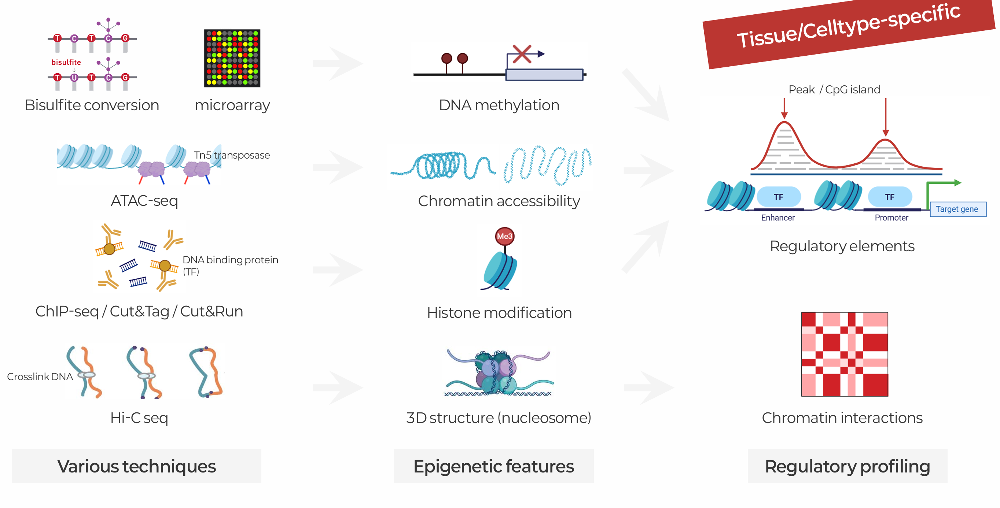

💡 The main text of each section = the basics you need. **🔍 Going further** boxes = deeper material to open when you are curious

------------------------------------------------------------------------

# 1. What the Epigenome Is 🎛️ {#w3-s1}

> 🔑 **Core idea** — the genome is the same in every cell. The epigenome decides which parts of it are read → it differs by cell type, and that difference is what makes a neuron a neuron

-   **Genome** — a fixed text
-   **Epigenome** — everything determining which parts of that text are read, in this cell, right now

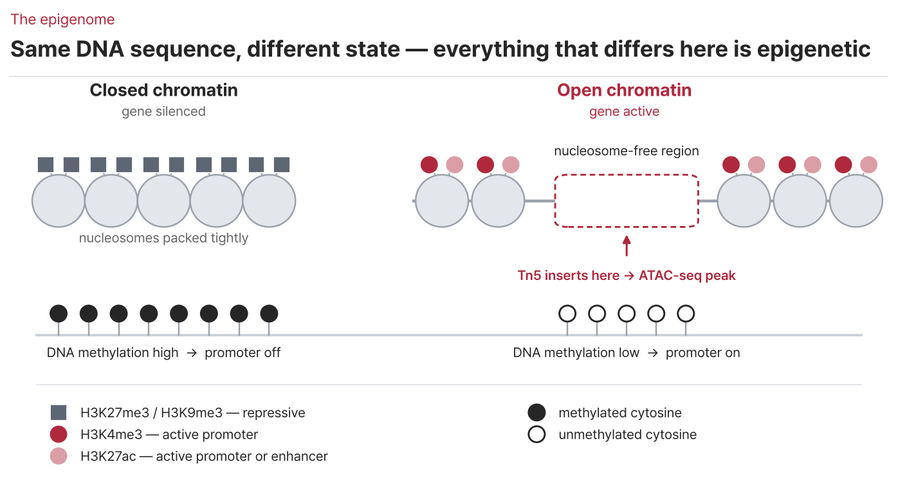{fig-align="center"}

## 1) Four layers, four assays {#w3-s1-1}

| Layer | What it is | Standard assay | Section |
|------------------|------------------|------------------|------------------|
| **Chromatin accessibility** | How physically open the DNA is | ATAC-seq | [§2](#w3-s2) |
| **Histone modification** | Chemical marks on histone tails | ChIP-seq, CUT&RUN | [§3](#w3-s3) |
| **3D organization** | Which regions physically contact which | Hi-C, Micro-C | [§4](#w3-s4) |
| **DNA methylation** | Methyl group on cytosine, usually at CpG | Bisulfite sequencing, EPIC array | [§5](#w3-s5) |

## 2) Same genome, different cell {#w3-s1-2}

-   A neuron and a hepatocyte differ in essentially every one of these layers
-   → those differences *are* what make them different cells
-   ⚠️ The epigenome differs **by cell type** — not one per person

::: {.callout-important collapse="true"}
## One epigenome per cell type, not one per person

-   A **genome sequence** — the same whichever tissue you take
-   An **epigenome** — different in every cell type

→ Every epigenomic measurement is specific to the cells you happened to assay\
→ Assay a tissue, and you measured an **average over whatever mixture it contained**

This single fact is behind the cell-composition problem in [§5.3](#w3-s5-3) and most of the field's reproducibility problems
:::

## 3) ⚠️ The four layers have no order {#w3-s1-3}

-   Which layer comes first? Does methylation close the chromatin, or does closed chromatin get methylated?
-   **The honest answer — the layers reinforce each other. Causality runs both ways**
-   ⚠️ No ordering carries meaning — including this chapter's. It is an arrangement for teaching only

::: {.callout-note collapse="true" icon=false}
## 🔍 Going further — the loops between layers

```
   CpG methylation → MeCP2 / MBD proteins → NuRD, HDAC → compaction
   H3K9me3 → HP1 → recruits DNMTs → methylation
   H3K36me3 → recruits DNMT3B
        ↑↓  the same loop, read in either direction
   TF binding → recruits TET → demethylation → more TF binding
   Pioneer factors (FOXA1, GATA, OCT4/SOX2)
        → bind nucleosomal / closed DNA first
        → recruit remodelers → open it
```

-   "Is TF binding a cause or a consequence of accessibility?" is an **open question in the field**, not a settled fact
-   **This chapter's ordering principle: regulatory logic** — find where the DNA is open (§2) → what kind of element sits there (§3) → which promoter it reaches (§4) → finally the DNA-level layer, methylation (§5). Methylation comes last because it has its own distinct measurement problems
:::

## 4) What is and is not heritable {#w3-s1-4}

"Epigenetic" carries baggage — two very different claims get conflated:

-   ✅ **Mitotic heritability** — a methylation pattern copied to daughter cells at division. Well established; the basis of cell identity
-   ⚠️ **Transgenerational epigenetic inheritance** — a mark acquired by a parent passed to offspring and grandchildren. In mammals: contested
-   💡 When you read "epigenetic inheritance" → check which claim is being made

::: {.callout-note collapse="true" icon=false}
## 🔍 Going further — why transgenerational inheritance is contested in mammals

-   Real in plants and *C. elegans*
-   In mammals: contested, mechanism unclear
-   The reason = within one generation, DNA methylation is almost completely erased and rewritten **twice** → **epigenetic reprogramming**
    -   ① **The early embryo, right after fertilisation** — the genome from the sperm is stripped fast (active demethylation by TET3). The genome from the egg is stripped slowly, division by division (passive dilution). Both are then re-methylated around implantation. ⚠️ Imprinted regions are spared this time
    -   ② **Primordial germ cells (PGCs)** — the cells that will become the next generation's sperm and eggs. Here almost everything is erased, imprints included → rewritten by sex as the gametes form
-   → A mark a parent acquired during life has to escape both resets to reach the child → hard to achieve, hence contested

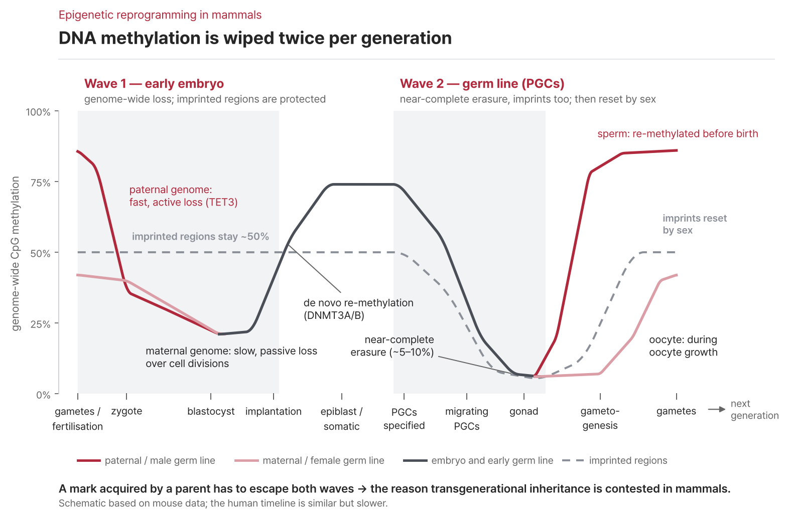{fig-align="center"}
:::

------------------------------------------------------------------------

# 2. Chromatin Accessibility: ATAC-seq 🔓 {#w3-s2}

> 🔑 **Core idea** — ATAC-seq finds where DNA is **open**. No antibody, no target chosen in advance → the natural first map of a cell type's regulatory regions

## 1) The principle {#w3-s2-1}

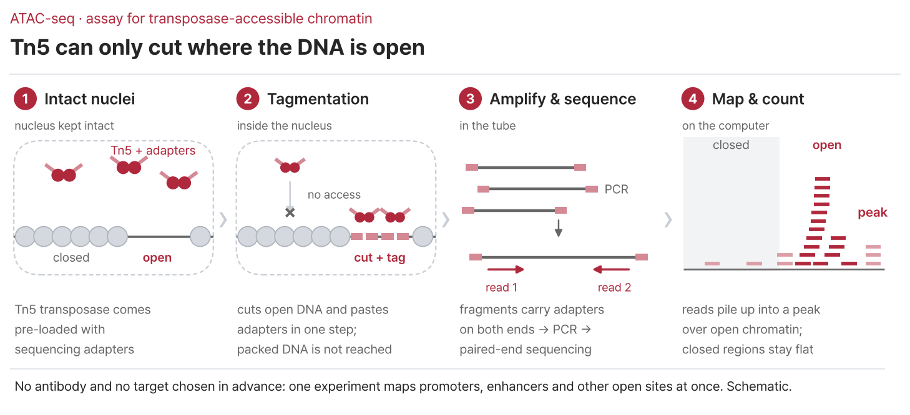{fig-align="center"}

-   **ATAC-seq** — a hyperactive Tn5 transposase (a DNA-cutting enzyme), preloaded with sequencing adapters
-   Tn5 inserts preferentially where DNA is **not wrapped in nucleosomes** (the histone spools) — i.e. where regulatory proteins are actively holding chromatin open
-   Fragmentation and adapter attachment in **one step** (tagmentation) → fast protocol, works from few cells
-   → only fragments from open regions get sequenced → where reads pile up = open chromatin

::: {.callout-important collapse="true"}
## Accessibility is a genuine prerequisite — for this assay only

-   ATAC is performed on **intact nuclei**. Tn5 must physically reach the DNA *in situ*
-   → closed chromatin is invisible to ATAC by construction

In ChIP ([§3.2](#w3-s3-2)), by contrast, chromatin is **fragmented before** the antibody ever meets it. This difference in order is why ATAC and ChIP see different things. Worth holding onto — it is often stated backwards
:::

::: {.callout-tip collapse="true"}
## The easiest epigenomic assay to run

-   **No antibody** → no antibody-quality problem, no target chosen in advance
-   Works from few cells (hundreds to \~50,000) with a short protocol
-   One experiment → promoters, active enhancers, and TF-bound sites, all at once — a first-pass regulatory map, with no prior hypothesis about which factor to pull down
:::

## 2) Pre-processing and analysis {#w3-s2-2}

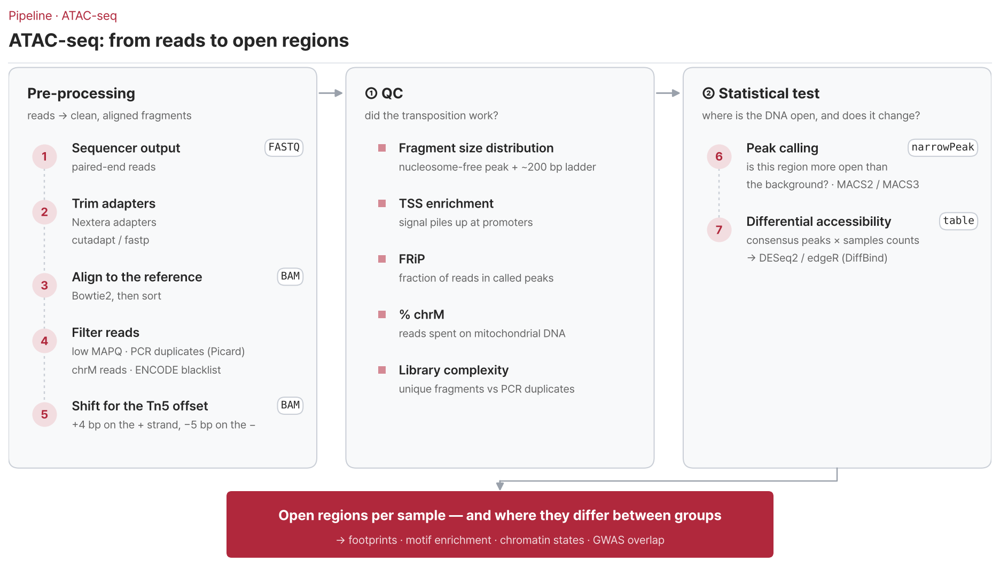{fig-align="center"}

-   The flow = align reads → filter → call peaks → a sample × peak count matrix → compare groups
-   Two steps specific to ATAC:
    -   **Remove chrM reads** — mtDNA has no nucleosomes → Tn5 attacks it heavily (🔗 ①)
    -   **Correct the Tn5 position (+4 / −5 bp)** — Tn5 inserts into the two strands 9 bp apart → read ends must be shifted to the true insertion site. Needed for footprinting ([§2.3②](#w3-s2-3-2))
-   Remove the **ENCODE blacklist** — regions that give abnormally high signal in any experiment. Applies to ChIP-seq just the same (🔗 [§3.3①](#w3-s3-3-1))

### ① QC {#w3-s2-2-1}

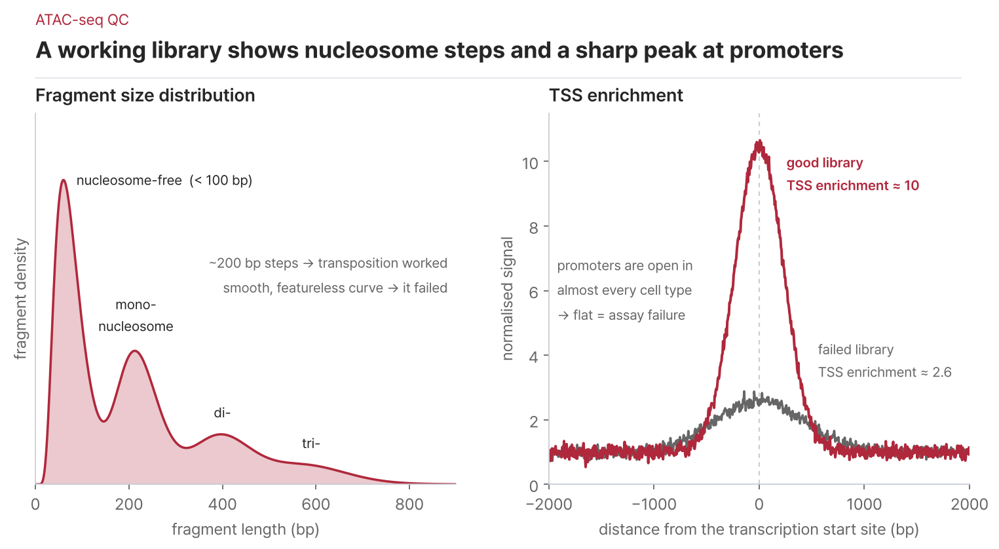{fig-align="center"}

-   **Fragment size distribution** — ✅ a ladder: a nucleosome-free peak, then steps every \~200 bp. ❌ A smooth, featureless curve → failed
-   **TSS enrichment** — ✅ a peak at transcription start sites (TSS). ❌ Flat → the assay failed
-   **FRiP** (fraction of reads in peaks) — the share of reads falling in peaks. Low → much background

::: {.callout-note collapse="true" icon=false}
## 🔍 Going further — reading the QC numbers in detail

-   **Fragment size distribution**
    -   ✅ A nucleosome-free peak below \~100 bp, then \~200 bp periodicity from mono-, di-, tri-nucleosomes
    -   ❌ A smooth, featureless curve → the transposition failed
-   **TSS enrichment**
    -   Promoters are open in essentially every cell type → a peak at TSSs is a **minimum expectation**, not a finding
    -   ❌ A flat TSS profile → the assay failed. Not unusual biology
-   **Mitochondrial fraction**
    -   mtDNA has no nucleosomes → Tn5 attacks it enthusiastically
    -   Protocols with no step to reduce mtDNA can waste well over half the reads on chrM; Omni-ATAC and similar improvements reduce this
:::

### ② Statistical tests {#w3-s2-2-2}

-   **Peak calling** — are there significantly more reads here than in the surrounding background? → MACS2/MACS3. Same principle as for ChIP-seq (🔗 [§3.3②](#w3-s3-3-2)), except ATAC has no input, so only the local background is used
-   **Differential accessibility** — merge all samples' peaks into a consensus set → a sample × peak count matrix → the same count models as RNA-seq (DESeq2, edgeR, DiffBind; 🔗 [W4 §5](w4_transcriptomics.qmd#w4-s5))
-   ⚠️ Do not compare the **number of peaks** between groups → the number depends on sequencing depth and QC. Compare counts over one shared peak set

## 3) Results: open chromatin and footprints {#w3-s2-3}

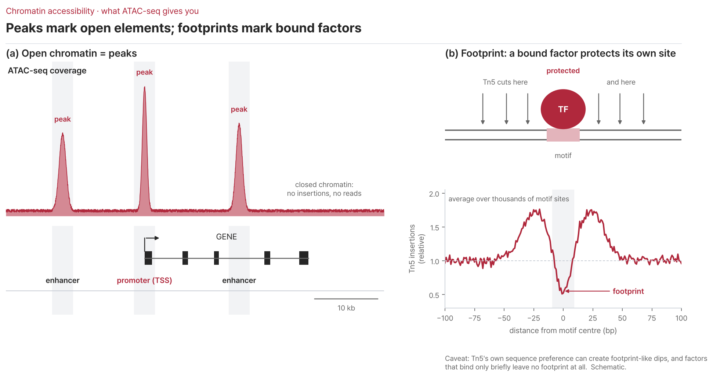{fig-align="center"}

### ① Open chromatin {#w3-s2-3-1}

-   A peak = somewhere Tn5 could get in → promoters, active enhancers, TF-bound sites, insulators
-   ⚠️ What it does **not** tell you: *which kind* of element you found — a promoter, an enhancer, an insulator, or a repressed-but-primed element? → [§3](#w3-s3)

### ② Footprints {#w3-s2-3-2}

-   A bound transcription factor protects its own site from Tn5 → a small dip (a **footprint**) inside a larger accessible region
-   In principle: locate specific factors without ChIP
-   ⚠️ In practice, unreliable for many factors → treat footprint-based factor calls as **hypotheses**

::: {.callout-note collapse="true" icon=false}
## 🔍 Going further — why footprints mislead

-   Tn5 has its own **sequence insertion bias** that mimics footprints
-   Factors with short residence times leave no protection at all
:::

------------------------------------------------------------------------

# 3. Histone Modifications: ChIP-seq and CUT&RUN 🧵 {#w3-s3}

> 🔑 **Core idea** — you have an open region. What kind of element is it? → a **combination** of histone marks tells you

## 1) Kinds of histone mark {#w3-s3-1}

Dozens exist. Six do most of the work in genomics:

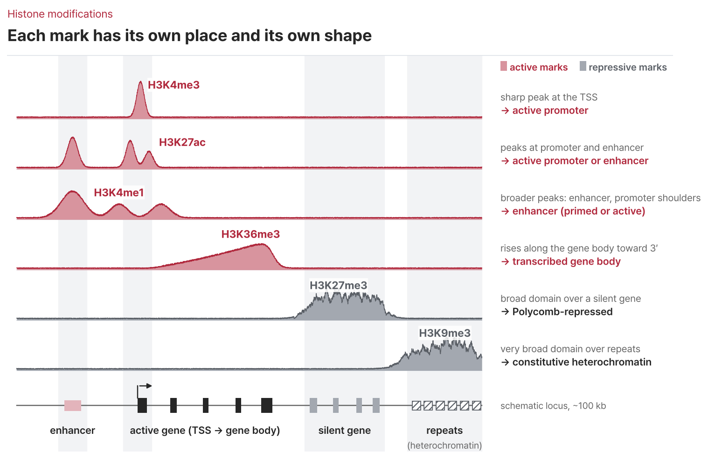{fig-align="center"}

| Mark | Indicates | Shape of signal |
|------------------------|------------------------|------------------------|
| **H3K4me3** | Active promoter | Peak at the TSS |
| **H3K27ac** | Active promoter **or** enhancer | Peaks at promoters and enhancers |
| **H3K4me1** | Enhancer — primed or active | Broad peak at enhancers |
| **H3K36me3** | Transcribed gene | Rises along the gene body toward 3′ |
| **H3K27me3** | Polycomb-repressed | Broad domain covering genes |
| **H3K9me3** | Constitutive heterochromatin | Very broad domain covering repeats |

-   ⚠️ No single mark identifies an element → read them in combination ([§3.4](#w3-s3-4))

## 2) The principle {#w3-s3-2}

### ① The core idea {#w3-s3-2-1}

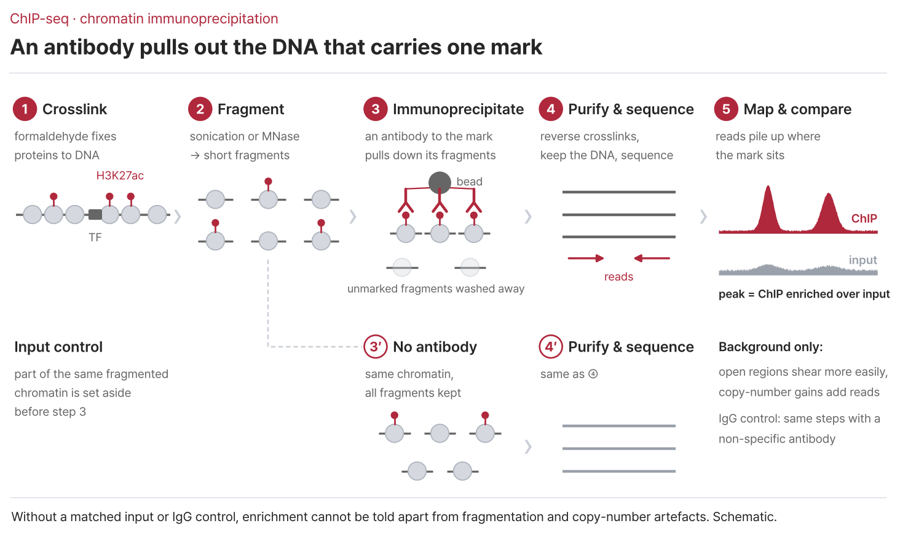{fig-align="center"}

-   **ChIP-seq** (chromatin immunoprecipitation sequencing) — use an antibody against one histone mark (or protein) to pick out only the DNA fragments carrying it, then sequence them
-   Steps: crosslink (formaldehyde) → fragment the chromatin (sonication or MNase) → immunoprecipitate (IP) with the antibody → reverse crosslinks, purify DNA → sequence
-   → where reads pile up = where the mark is
-   ⚠️ **Antibody quality** — ChIP-seq is an antibody experiment. Antibody specificity for histone modifications is variable and **lot-dependent** → a wet-lab problem that no analysis can repair

::: {.callout-important collapse="true"}
## ChIP does not require accessibility

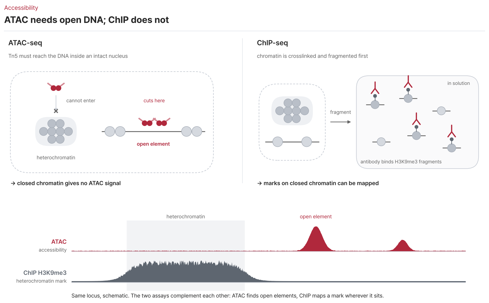{fig-align="center"}

-   **ATAC** — nuclei intact → Tn5 must reach the DNA *in situ* → accessibility IS required
-   **ChIP** — crosslink, then fragment the chromatin first → the antibody meets FRAGMENTS in solution → accessibility is NOT required
-   → This is exactly why ChIP can map **H3K9me3 and H3K27me3**. These two marks label the most tightly closed chromatin in the nucleus → regions ATAC cannot see at all
-   💡 The two assays are complementary, not redundant. Often explained backwards — watch for it
:::

### ② Input / IgG controls {#w3-s3-2-2}

-   **Input** — the same chromatin, fragmented the same way, sequenced directly without an antibody
-   **IgG** — the same IP done with a non-specific antibody that has no target
-   ⚠️ Without a control → you cannot tell enrichment from artifact
-   → A peak = where ChIP is significantly higher **than the control** ([§3.3②](#w3-s3-3-2))

::: {.callout-note collapse="true" icon=false}
## 🔍 Going further — why the control is needed

-   Chromatin does not fragment uniformly:
    -   open regions shear more easily
    -   copy number varies
-   Input is the standard for ChIP-seq. IgG yields few reads, so its background estimate is unstable → used mainly for low-background CUT&RUN and CUT&Tag ([§3.5](#w3-s3-5))
:::

## 3) Pre-processing and analysis {#w3-s3-3}

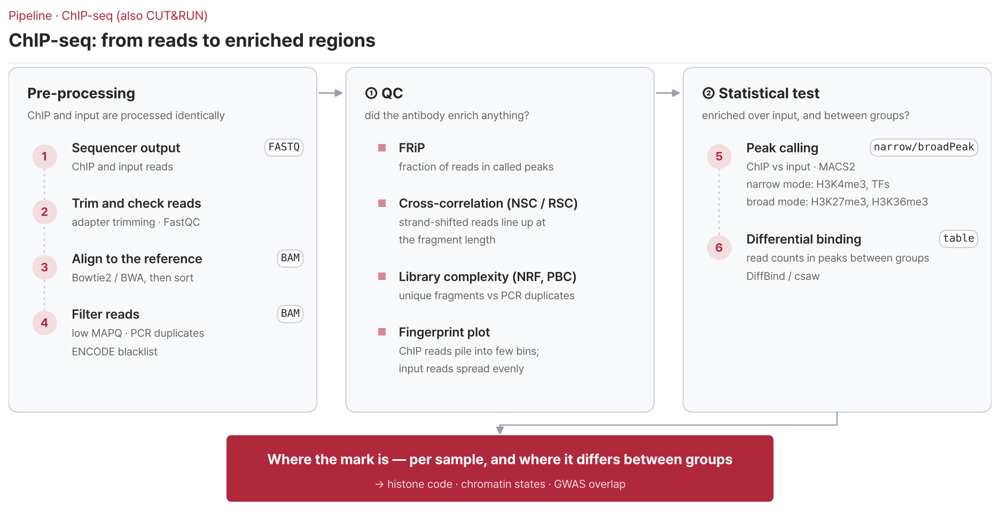{fig-align="center"}

-   Process ChIP and input identically → compare them at peak calling
-   CUT&RUN and CUT&Tag ([§3.5](#w3-s3-5)) follow almost the same flow

### ① QC {#w3-s3-3-1}

-   **FRiP** (fraction of reads in peaks) — the share of all reads that fall in peaks. Low FRiP → weak IP
-   **Cross-correlation** (NSC / RSC) — whether reads on the two strands pile up one fragment length apart, as expected
-   **Library complexity** — distinct fragments vs. PCR duplicates
-   ⚠️ Remove the **ENCODE blacklist** — regions that give abnormally high signal in any experiment and any cell → a classic source of fake peaks unrelated to real enrichment

::: {.callout-note collapse="true" icon=false}
## 🔍 Going further — what the blacklist is

-   Centromeres, telomeres, satellite repeats, rDNA and the like — repeats present in far more copies in real genomes than in the reference → reads pile up in one place
-   ENCODE collected the regions that spike across many input and ChIP datasets and released them → remove reads or peaks in these regions before analysis
-   Applies equally to ATAC-seq ([§2.2](#w3-s2-2)) and CUT&RUN
:::

### ② Statistical test: peak calling {#w3-s3-3-2}

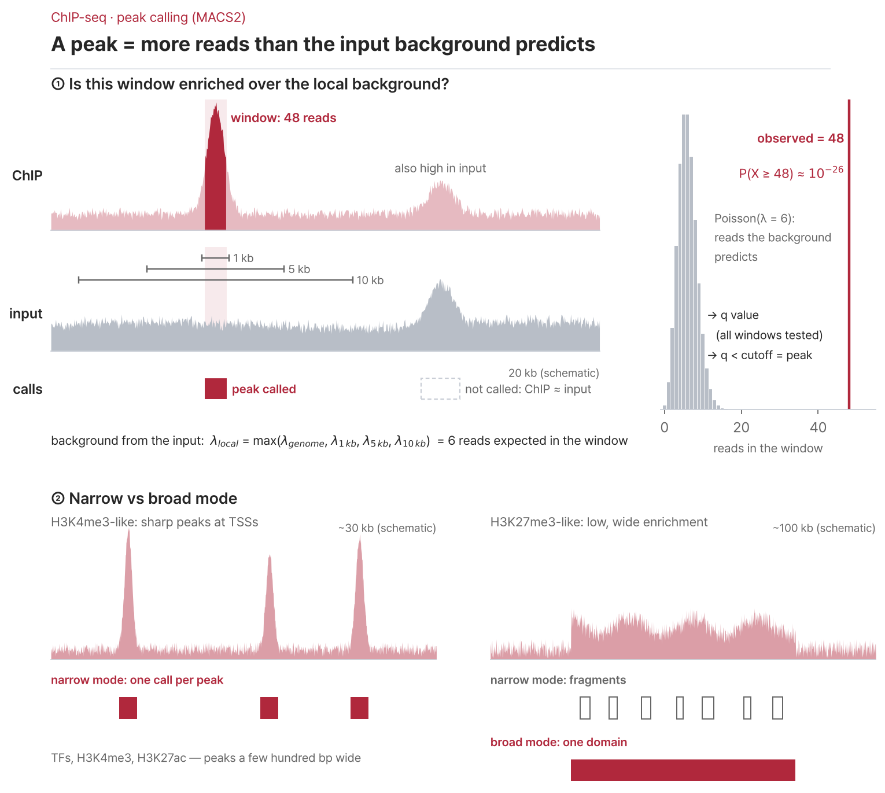{fig-align="center"}

-   **Peak calling** — compare signal to control → identify regions of significant enrichment ("peaks"). MACS2 and successors are standard
-   The principle (MACS2): estimate the local background level λ from the input → in each window, is the ChIP read count far above what Poisson(λ) predicts? → p-value → multiple-testing correction (q-value) → peak
-   → A bump that is equally present in the input is not a peak
-   Parameters matter: **narrow** mode for point-source marks (H3K4me3), **broad** mode for domains (H3K27me3)
-   **Comparing groups** — differential binding (DiffBind, csaw): a sample × peak count matrix → the same count models as RNA-seq (🔗 [W4 §5](w4_transcriptomics.qmd#w4-s5))

## 4) Results: the histone code — reading combinations {#w3-s3-4}

-   **Histone code** — the idea that a **combination** of marks, not any single one, tells you what kind of element sits there and what state it is in (Strahl & Allis, 2000)

| Combination | Element |
|------------------------------------|------------------------------------|
| H3K4me3 + H3K27ac | **Active promoter** |
| H3K4me1 + H3K27ac | **Active enhancer** |
| H3K4me1 alone | Primed enhancer |
| H3K4me3 + H3K27me3 | Bivalent promoter |
| H3K27me3 | Polycomb-repressed |
| H3K36me3 | Transcribed gene body |

::: {.callout-note collapse="true" icon=false}
## 🔍 Going further — primed and bivalent elements

-   H3K4me1 alone → **primed enhancer** — poised, not firing
-   H3K4me3 + H3K27me3 → **bivalent** — developmental genes held ready in stem cells
:::

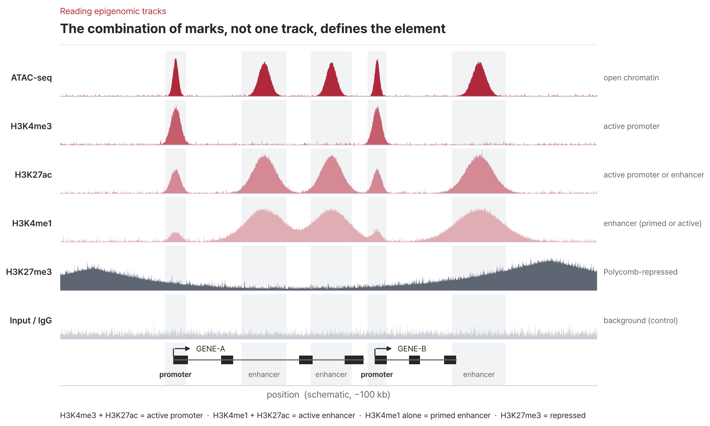{fig-align="center"}

The single most common figure in the epigenomics literature. Work top to bottom, then across:

1.  **ATAC peak?** → something is open here ([§2](#w3-s2))
2.  **H3K4me3 dominant?** → promoter. **H3K4me1 dominant?** → enhancer
3.  **H3K27ac on top?** → the element is **active in this cell type**, not merely present
4.  **H3K27me3 domain?** → repressed, regardless of what else is there
5.  **Compare to input** — if the "peak" is also in input, it is not a peak

💡 This combination reading, applied automatically across the whole genome = chromatin states (🔗 [§6.2](#w3-s6-2))

## 5) CUT&RUN and CUT&Tag {#w3-s3-5}

-   The problem with ChIP: many cells needed, lots of background
-   **The fix** — tether the cleaving enzyme (MNase, or Tn5) directly to the antibody → only the targeted region is released or tagged
-   → far higher signal-to-noise, from **thousands** of cells rather than millions
-   This is what made single-cell chromatin profiling practical (🔗 W5)

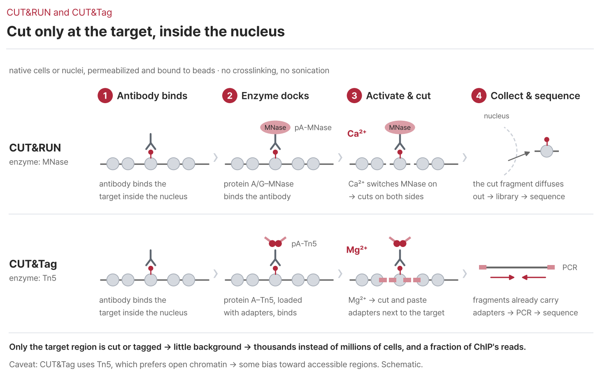{fig-align="center"}

|   | ChIP-seq | CUT&RUN | CUT&Tag |
|------------------|------------------|------------------|------------------|
| Sample handling | Crosslink, then fragment all chromatin | Unfixed; reaction inside the nucleus | Unfixed; reaction inside the nucleus |
| Cutting / tagging | Sonication / MNase | pA-MNase on the antibody cuts only around the target | pA-Tn5 on the antibody inserts adapters only around the target |
| Cells needed | Millions | Tens to hundreds of thousands (down to thousands) | Thousands to hundreds of thousands; single cells possible |
| Sequencing depth | Tens of millions of reads | \~1/10 of ChIP | \~1/10 of ChIP or less |
| Control | Input essential | IgG (sometimes skipped, background is low) | IgG (sometimes skipped, background is low) |
| Watch out for | High background, antibody quality | Over-digestion by MNase | Tn5's preference for open chromatin → suppressed by high-salt washes |

-   Analysis follows almost the same ChIP-seq flow ([§3.3](#w3-s3-3)). Because background is so low, dedicated peak callers such as SEACR are also used

------------------------------------------------------------------------

# 4. The 3D Genome: Hi-C 🔗 {#w3-s4}

> 🔑 **Core idea** — you have an active enhancer. Which promoter does it actually regulate? Hi-C shows which regions physically touch — ⚠️ but contact ≠ function

## 1) The principle {#w3-s4-1}

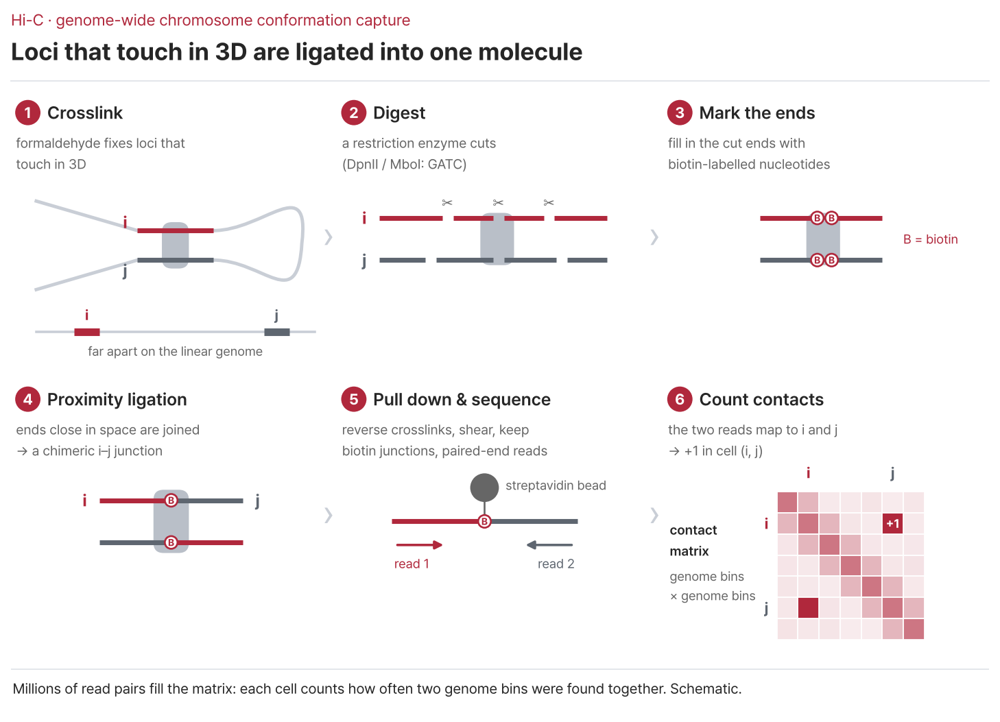{fig-align="center"}

-   **Hi-C** — crosslink chromatin → cut with a restriction enzyme → label the ends with biotin → ligate ends that are close in space (**proximity ligation**) → pull down biotinylated junctions → paired-end sequencing
-   The two ends of one read pair map to two different places in the genome → one piece of evidence that those two places touched in the nucleus
-   Output: a matrix of contact frequencies between every pair of genomic bins (stretches of the genome)

::: {.callout-note collapse="true" icon=false}
## 🔍 Going further — the 3C family compared

All use the same principle, proximity ligation. The difference = **which contacts they ask about**

| Method | Question asked | Scope |
|------------------|------------------------------------|------------------|
| **3C** | Do these two sites touch? | One vs one |
| **4C** | What does this one site (the viewpoint) touch? | One vs all |
| **5C** | Contacts among sites within a chosen region | Many vs many |
| **Hi-C** | Every pair across the genome | All vs all |
| **Micro-C** | Like Hi-C, but cut to single nucleosomes with MNase | All vs all, higher resolution |
| **Capture Hi-C** | Chosen sites (e.g. all promoters) vs everything else | Many vs all |
| **HiChIP / ChIA-PET** | Only contacts mediated by one protein (H3K27ac, CTCF, …) | Hi-C + ChIP |
:::

## 2) Pre-processing and analysis {#w3-s4-2}

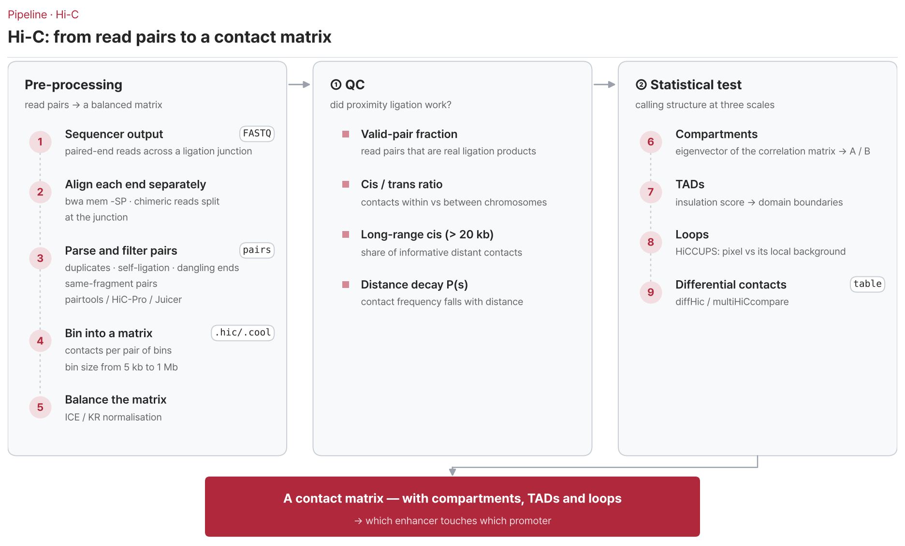{fig-align="center"}

-   The flow: align the two ends of each read separately → keep only valid pairs → group them into bins of a chosen size to make the matrix → normalise (ICE, KR balancing)
-   ⚠️ **Resolution = bin size**. Sequencing depth sets how small the bins can be. Compartments show up with few reads; kilobase-scale loops need billions of read pairs

### ① QC {#w3-s4-2-1}

-   **Valid-pair fraction** — what remains after removing self-ligations, dangling ends, and pairs within one fragment
-   **Cis/trans ratio** — most contacts should fall within one chromosome. Many trans contacts → suspect random ligation
-   **Long-range cis fraction** — the share of cis contacts more than 20 kb apart
-   **Distance-decay curve P(s)** — contact probability should fall smoothly with distance

### ② Statistical tests {#w3-s4-2-2}

-   ⚠️ Nearby sites always contact each other more → always compare against the **expected value for that distance** (observed / expected)
-   **Compartments** — correlation matrix of the map → the sign of the first eigenvector separates A from B
-   **TADs** — insulation score: where contacts crossing a position suddenly drop = a boundary
-   **Loops** — HiCCUPS and similar: is one pixel significantly brighter than its neighbours (the local background)?
-   **Comparing groups** — diffHic, multiHiCcompare

## 3) Results: the Hi-C contact matrix {#w3-s4-3}

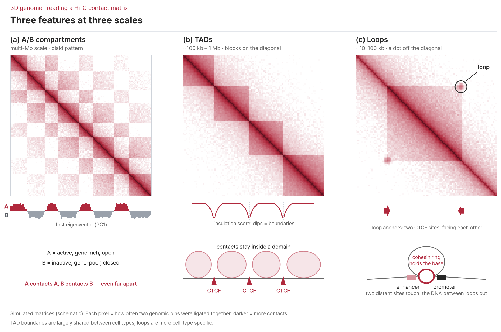{fig-align="center"}

-   **A/B compartments** — megabase scale. Active (A) chromatin contacts A, inactive (B) contacts B → the checkerboard in the matrix
-   **TADs** (topologically associating domains) — sub-megabase blocks with frequent internal contacts and sharp, CTCF-bound boundaries. Boundaries are **largely conserved across cell types**
-   **Loops** — point contacts between two specific sites (CTCF pairs, enhancer–promoter) → bright dots off the diagonal. Enhancer–promoter loops are **not** conserved across cell types. Yet these are the loops you actually need for variant interpretation

::: {.callout-warning collapse="true"}
## Contact is not function

-   A loop says two regions are near each other
-   It does not say the enhancer regulates that promoter
-   → Perturbation experiments (CRISPRi on the element) are what establish function
:::

------------------------------------------------------------------------

# 5. DNA Methylation 🔵 {#w3-s5}

> 🔑 **Core idea** — the DNA-level layer, and the one most used in clinical and epidemiological work. Its biggest trap = **cell-type composition**

-   Methyl group on the 5-carbon of cytosine, overwhelmingly at **CpG** dinucleotides (a C followed by a G)
-   \~70–80% of genomic CpGs are methylated
-   The exceptions (unmethylated CpGs) cluster in **CpG islands** — at most promoters, usually unmethylated when the gene is active

## 1) The principle {#w3-s5-1}

Two routes: **bisulfite sequencing**, or a fixed panel of CpGs on an **array**

### ① Bisulfite sequencing {#w3-s5-1-1}

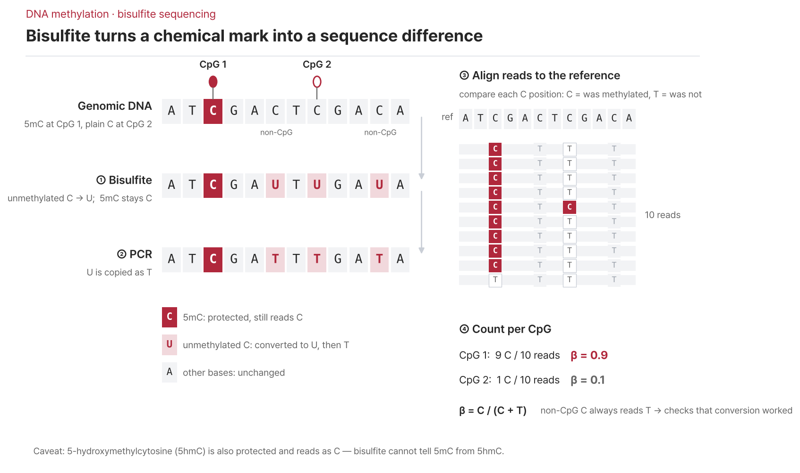{fig-align="center"}

-   Sodium bisulfite converts unmethylated C → U (read as T); methylated C is protected and still reads as C
-   → sequence, compare to reference: a C that stayed C was methylated
-   **WGBS** — every CpG, single-base resolution. Expensive. **RRBS** — enzymatic digestion enriches CpG-dense regions. Far cheaper, but covers only a biased subset of CpGs

::: {.callout-note collapse="true" icon=false}
## 🔍 Going further — the limits of bisulfite, and alternatives

-   WGBS needs deep coverage because sequence complexity drops after conversion

⚠️ Two limitations of bisulfite:

-   It **degrades DNA**
-   It **cannot distinguish 5mC from 5-hydroxymethylcytosine (5hmC)** — abundant in brain, different biology

Alternatives: **EM-seq** (enzymatic conversion, no degradation); **long-read platforms** call modifications directly from raw signal, with no conversion at all (🔗 [W1 §2.1③](w1_intro.qmd#w1-s2-1-3))
:::

### ② Arrays {#w3-s5-1-2}

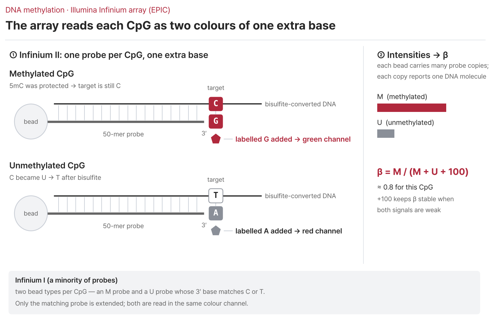{fig-align="center"}

-   Illumina **EPIC** — a fixed panel of CpG sites, on the order of 850,000 for v1 (\~3% of all CpGs), enriched for promoters, enhancers, and known disease loci
-   The principle: bisulfite-converted DNA binds a probe fixed for each CpG → fluorescence shows whether the site stayed C (methylated) or became T (unmethylated) → methylated signal M, unmethylated signal U → β (this M is a signal intensity, not the M value below)
-   Same trade-off as genotyping arrays (🔗 [W2 §2.1](w2_genomics.qmd#w2-s2-1)):
    -   ❌ Cannot discover anything outside the panel
    -   ✅ Cheap enough to run on thousands of samples → almost all large epidemiological methylation studies use them

## 2) Pre-processing and analysis {#w3-s5-2}

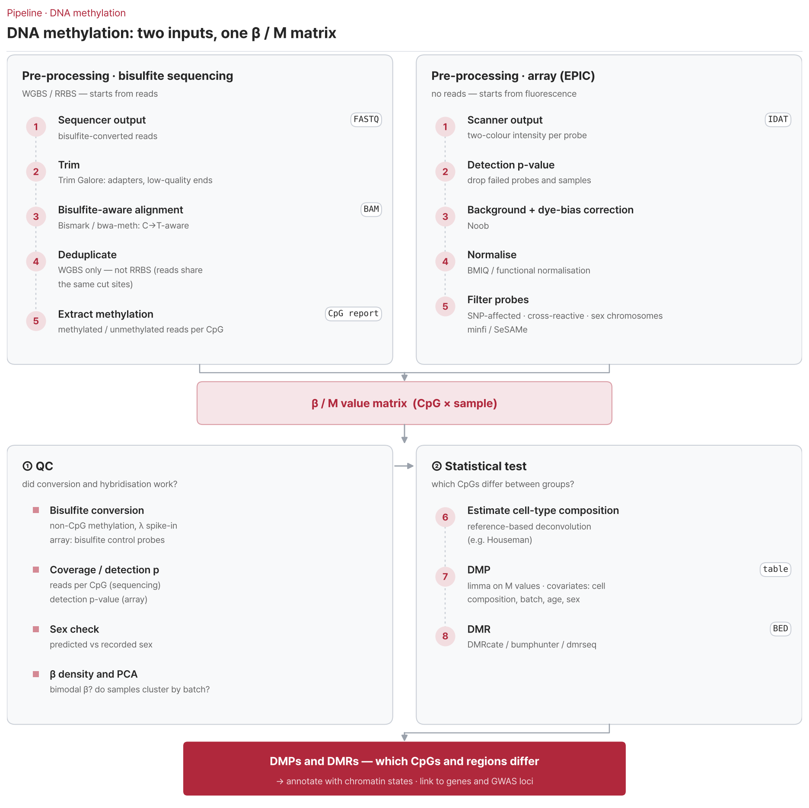{fig-align="center"}

-   Either route ends in the same thing = a **CpG × sample matrix of β values (M values)**

**β values and M values**

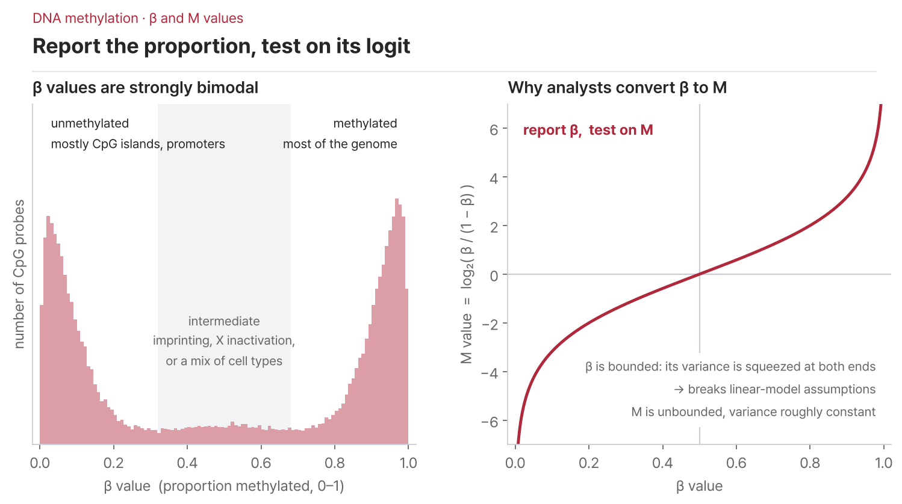{fig-align="center"}

-   **β value** — the intuitive quantity: proportion of DNA molecules methylated at a site, 0 to 1
-   **M value** — its logit transform, which behaves better in statistical tests
-   💡 **The convention — test on M values, report and plot β values**

::: {.callout-note collapse="true" icon=false}
## 🔍 Going further — why transform β?

$$
\beta = \frac{M}{M + U + \alpha}
$$

-   **M value** = $\log_2(\beta / (1-\beta))$
-   β is **bounded** at 0 and 1 → variance is compressed near both ends. Most CpGs sit exactly there
-   → violates linear model assumptions
-   M is unbounded and roughly homoscedastic
-   ⚠️ A paper running t-tests directly on β at CpGs with β ≈ 0.02 is doing something statistically dubious
:::

### ① QC {#w3-s5-2-1}

-   **Bisulfite conversion efficiency** — Cs outside CpGs are almost never methylated → if they still read as C after conversion, the conversion failed. Usually should be ≥ 99%
-   **Coverage** (sequencing) / **detection p-value** (array) — use only CpGs with enough signal
-   **Probe filters** (array) — drop probes overlapping SNPs, cross-reactive probes that bind several places, and sex-chromosome probes
-   **Sex check, β distribution, PCA** — catch sample swaps and batch effects

### ② Statistical tests: DMPs and DMRs {#w3-s5-2-2}

Which CpGs differ between groups? → check the unit (DMP vs. DMR) and the cell mix ([§5.3](#w3-s5-3))

-   **DMP** (differentially methylated position) — a single CpG differing between groups. A regression on M values for each CpG (limma)
-   **DMR** (differentially methylated region) — a run of adjacent CpGs changing together. DMRcate, bumphunter, dmrseq
-   ✅ DMRs are more believable — neighbouring CpGs are biologically correlated → a consistent regional shift is harder to produce by chance or by one bad probe
-   ⚠️ A lone significant CpG in an otherwise flat region deserves suspicion
-   ⚠️ Covariates: cell composition ([§5.3](#w3-s5-3)), batch, age, sex

## 3) ⚠️ Cell-type composition {#w3-s5-3}

The most important subsection in the chapter

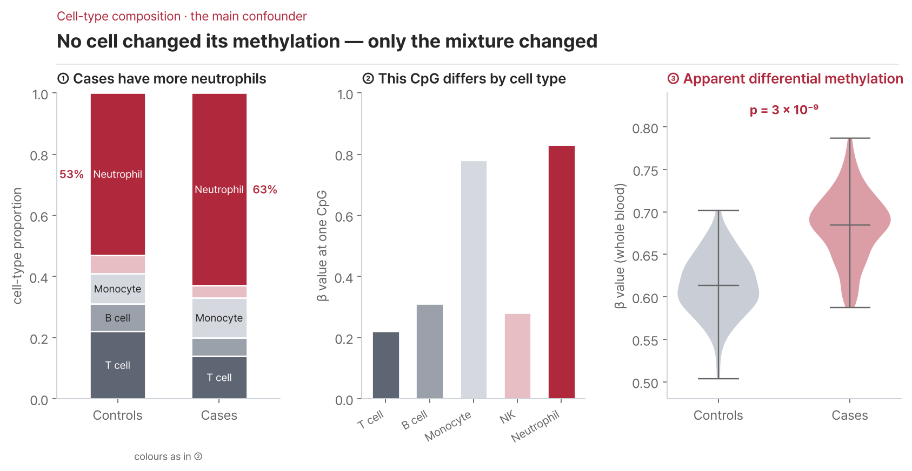{fig-align="center"}

-   Methylation differs enormously **between cell types** — far more than between individuals or disease states within one cell type
-   → if cases and controls differ even slightly in cell mixture, thousands of CpGs appear "differentially methylated", **even though nothing changed in any individual cell**
-   ✅ Measure or estimate the cell composition, and adjust for it

::: {.callout-warning collapse="true"}
## Cell composition is the dominant confounder

Not hypothetical. Disease, infection, medication, age, and smoking all shift blood cell proportions

→ A blood methylation study that does not adjust for cell composition is, to a first approximation, **a study of cell counts**

**What to do:**

-   ✅ Measure cell counts directly if possible (CBC, flow cytometry) → include as covariates
-   ✅ Otherwise **reference-based deconvolution** (Houseman method and successors) → estimate proportions from the methylation data itself, then adjust
-   ✅ Reference-free methods (RefFreeEWAS, ReFACTor, SVA) for tissues without reference panels — at the cost of possibly removing real signal too
-   ✅ **State exactly what you did.** "We adjusted for cell composition" with no detail is not enough

🔗 This continues the confounding thread from [W1 §4.3](w1_intro.qmd#w1-s4-3), which runs across chapters. It returns in [W4 §7.2](w4_transcriptomics.qmd#w4-s7-2) as bulk tissue deconvolution, and in [W5 §6.3](w5_singlecell.qmd#w5-s6-3) as differential abundance
:::

## 4) Epigenetic clocks ⏳ {#w3-s5-4}

-   **Epigenetic clock** — a few hundred CpGs whose methylation changes with age → predicts age to within a few years
-   **Age acceleration** — the residual: predicted minus chronological age. How much older or younger someone looks epigenetically than their birth certificate says
-   Associated with mortality, cardiovascular disease, and a long list of exposures

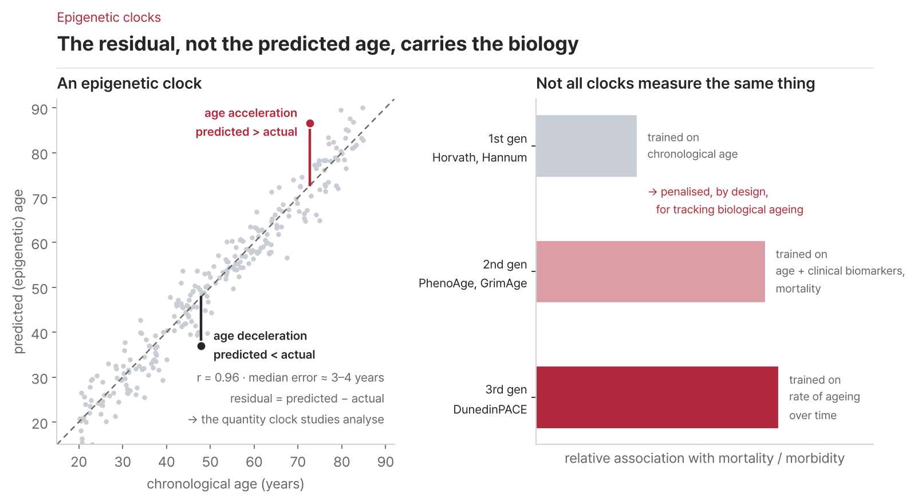{fig-align="center"}

::: {.callout-warning collapse="true"}
## Three things to check before believing a clock result

**① Which clock?**

-   **1st generation** (Horvath, Hannum) — trained to predict *chronological* age → any sign of biological ageing counts as prediction error, so training **penalises** it
-   **2nd generation** (PhenoAge, GrimAge) — trained against clinical biomarkers and mortality → predict health outcomes considerably better
-   → not interchangeable; results do not transfer between them

**② Cell composition again** — blood clock signals are partly driven by immune cell proportions shifting with age. Adjusted or not?

**③ Association, not mechanism** — age acceleration is a biomarker. Nothing about a clock says whether methylation *causes* ageing or merely records it
:::

::: {.callout-note collapse="true" icon=false}
## 🔍 Going further — how a clock is built

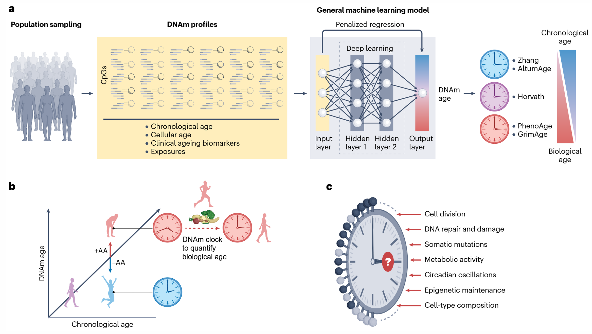{fig-align="center"}

-   Take a few hundred CpGs whose methylation changes with age → fit a **penalised regression** against chronological age → a predictor accurate to within a few years
:::

------------------------------------------------------------------------

# 6. Putting It Together: Downstream Analysis 🏥 {#w3-s6}

> 🔑 **Core idea** — epigenomics turns a non-coding GWAS hit into a mechanism you can test — **provided you have data from the right cell type**

## 1) Transcription factor motif analysis {#w3-s6-1}

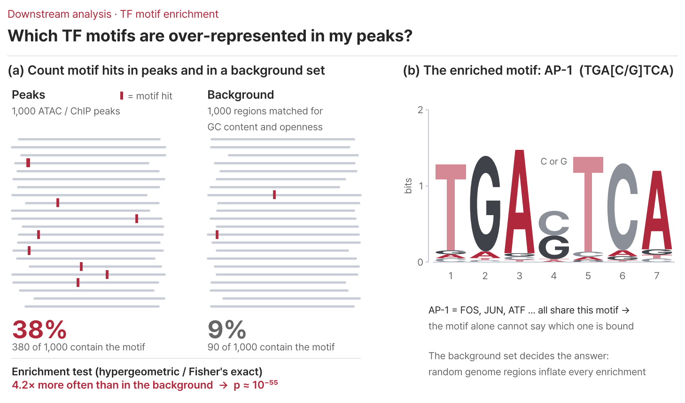{fig-align="center"}

-   Given a set of peaks → which TF binding motifs (the short DNA sequence a TF recognises) are over-represented relative to a background set?
-   Tools: HOMER, MEME suite, chromVAR (single-cell)
-   ⚠️ The background set decides the answer, and related TFs share near-identical motifs → read results with care

::: {.callout-note collapse="true" icon=false}
## 🔍 Going further — two chronic problems

-   **Background choice determines the answer.** GC-matched, accessibility-matched background is essential. Random genomic regions inflate everything
-   **Motif similarity.** Family members are indistinguishable — "the AP-1 motif" does not tell you FOS vs. JUN vs. a dozen relatives
:::

## 2) Chromatin states and reference atlases {#w3-s6-2}

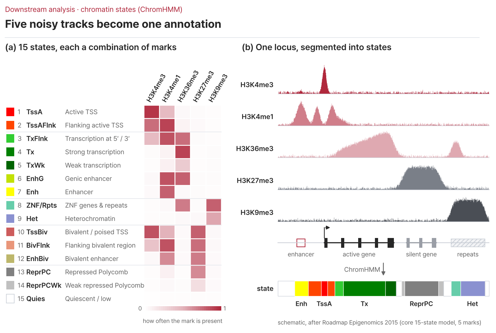{fig-align="center"}

-   **Chromatin state** — several mark tracks combined into one label per genomic segment ("active TSS", "enhancer", "heterochromatin")
-   **ChromHMM** — learns recurring combinations of marks, labels every genomic segment with a state → five noisy tracks become one interpretable annotation
-   Roadmap's reference model = the **15-state** model learned from five marks (H3K4me3, H3K4me1, H3K36me3, H3K27me3, H3K9me3). Each state has a fixed colour, so it looks the same in papers and browsers

Public atlases already hold this for hundreds of cell types:

| Resource | What it holds |
|------------------------------------|------------------------------------|
| [**ENCODE**](https://www.encodeproject.org/) | Uniformly processed ChIP, ATAC, RNA across hundreds of cell types; candidate cis-regulatory elements (cCREs) |
| [**Roadmap Epigenomics**](http://www.roadmapepigenomics.org/) | Chromatin states across 127 primary tissues and cell types |
| [**UCSC**](https://genome.ucsc.edu/) / [**WashU**](https://epigenomegateway.wustl.edu/) browsers | Where you look at all of the above over your locus |

-   🗺️ These atlases are also a **reference bias** problem (🔗 [W1 §2.3③](w1_intro.qmd#w1-s2-3-3)) — your cell type not in ENCODE? → the annotations you inherit come from something else → elements active only in your cells are **invisible**

## 3) Functional characterisation of GWAS variants {#w3-s6-3}

-   Recall: \~90% of GWAS associations are non-coding (🔗 [W2 §4.3](w2_genomics.qmd#w2-s4-3)) → a variant in intergenic space is uninterpretable alone
-   Epigenomics supplies the missing annotation, step by step:

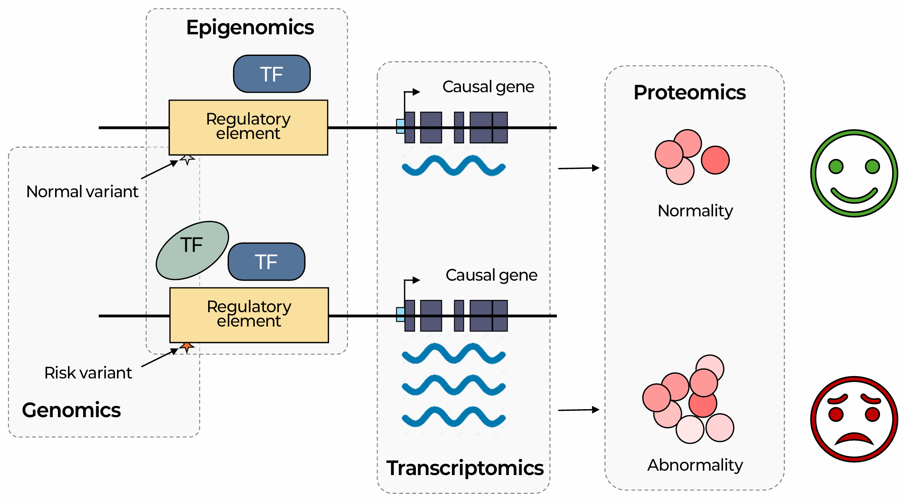

```
① GWAS signal, fine-mapped to a credible set        (W2 §4.2)
② Overlap credible-set variants with ATAC / H3K27ac
   peaks — in the disease-relevant cell type         (§2, §3)
③ Which TF motif does the risk allele disrupt?       (§6.1)
④ Which promoter does that enhancer contact?         (§4)
⑤ Does the target gene's expression change?          (eQTL, W4)
⑥ Does deleting or editing the element do anything?  (CRISPR)
```

## 4) Prioritising the most relevant cell types {#w3-s6-4}

-   An enhancer active in hepatocytes → invisible in a lymphoblastoid cell line
-   ⚠️ Choosing which ENCODE cell types to use is a **scientific decision, not a technical default**
-   **Partitioned heritability** (LDSC-SEG, stratified LD score regression) = the logic of §6.3, applied to the whole genome's signal at once rather than locus by locus
    -   Which cell types' regulatory annotations are enriched for a trait's heritability?
    -   → often the strongest available evidence about which tissue a disease lives in — microglia for Alzheimer disease, specific T cell subsets for autoimmune disease

::: {.callout-warning collapse="true"}
## The right annotation in the wrong cell type is worthless

-   Overlap your credible set with the wrong cell type's peaks → you find nothing
-   → **"no overlap" is indistinguishable from "wrong reference"**

This is why the field pushed so hard toward single-cell chromatin profiling (🔗 W5)
:::

## 5) Where epigenetics is already clinical {#w3-s6-5}

-   **Methylation-based tumour classification** — CNS tumour classifiers on methylation arrays now outperform histopathology for some entities; in routine diagnostic use
-   **Cell-free DNA** — plasma DNA methylation carries a tissue-of-origin signal → the basis of multi-cancer early detection assays
-   **Epigenetic drugs** — DNMT, HDAC and EZH2 inhibitors approved
-   **Imprinting disorders** — Prader-Willi and Angelman syndromes diagnosed by methylation testing

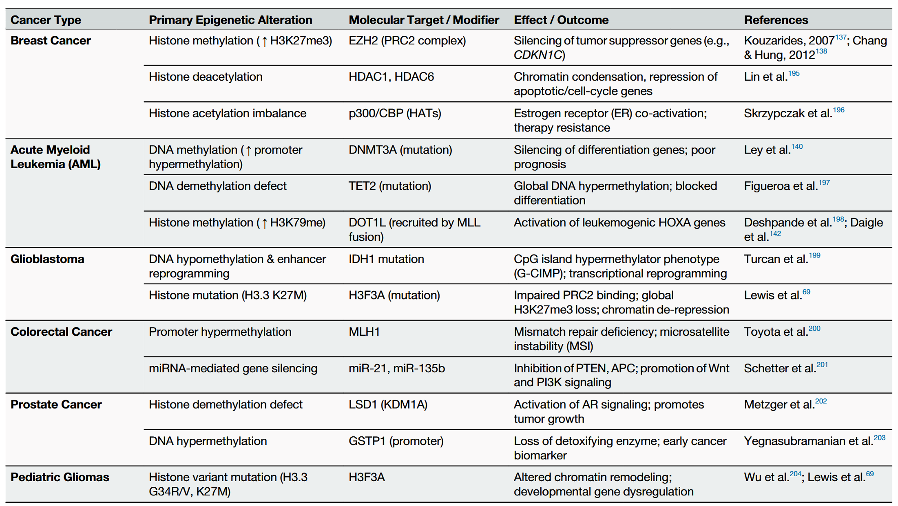{fig-align="center"}

::: {.callout-note collapse="true" icon=false}
## 🔍 Going further — approved epigenetic drugs

-   DNMT inhibitors (azacitidine, decitabine) and HDAC inhibitors → approved in haematological malignancy
-   EZH2 inhibitors → approved in specific lymphomas and sarcoma
:::

------------------------------------------------------------------------

# 📝 Summary

-   The genome is the same in every cell; the epigenome is **different in every cell type** — four measurable layers
-   ⚠️ **The four layers have no order.** They reinforce each other; this chapter's arrangement is for teaching only
-   Read every assay as **principle → pre-processing (① QC ② statistical tests) → results**
-   **ATAC-seq** — Tn5 in intact nuclei → accessibility is a genuine prerequisite. No antibody. Results = open chromatin (peaks) and footprints
-   ⚠️ **ChIP-seq works on fragmented chromatin** → accessibility is *not* required → it can map closed-chromatin marks. Needs an input control, a validated antibody, and blacklist removal
-   **The histone code** — no single mark identifies an element; **combinations do**: H3K4me3 + H3K27ac = active promoter; H3K4me1 + H3K27ac = active enhancer
-   CUT&RUN and CUT&Tag — enzyme tethered to the antibody → fewer cells, less background
-   Hi-C = a contact matrix → A/B compartments, TADs, loops. ⚠️ Contact ≠ function
-   Methylation: report β values, test on M values. A DMR is more believable than a lone DMP
-   ⚠️ **Cell-type composition is the dominant confounder** in tissue methylation studies. Measure or estimate it, and adjust
-   Epigenetic clocks: the residual (age acceleration) is the finding; 1st- and 2nd-generation clocks measure different things
-   Epigenomics turns a non-coding GWAS hit into a mechanism — **provided you have data from the right cell type**

------------------------------------------------------------------------

# 🔑 Key terms

| Term | One-line meaning |
|------------------------------------|------------------------------------|
| ATAC-seq | Tn5-based map of open chromatin |
| ChIP-seq | Mapping where a protein or mark sits on DNA |
| Input control | Sonicated chromatin without antibody |
| Peak calling | Finding regions enriched over control |
| Blacklist | Regions with abnormally high signal in any experiment, removed before analysis |
| Histone code | The idea that combinations of histone marks define an element's kind and state |
| CUT&RUN / CUT&Tag | Antibody-tethered enzyme; less background, fewer cells |
| A/B compartment | Megabase-scale split into active and inactive chromatin |
| TAD | Self-interacting genomic block with sharp boundaries |
| Loop | Point contact between two specific sites |
| CpG island | CpG-dense region, usually at promoters |
| Bisulfite conversion | Chemistry that reads unmethylated C as T |
| β value | Proportion of molecules methylated at a site |
| M value | Logit of β, used for statistical testing |
| DMP / DMR | Single CpG / region differing between groups |
| Deconvolution | Estimating cell type proportions from bulk data |
| Epigenetic clock | Methylation-based age predictor |
| Age acceleration | Predicted age minus chronological age |

::: {.callout-note collapse="true" icon=false}
## 🔍 Going further — advanced terms

| Term | One-line meaning |
|------------------------------------|------------------------------------|
| Epigenetic reprogramming | Near-complete erasure and rewriting of methylation in the early embryo and in primordial germ cells |
| Tagmentation | Tn5 cutting DNA and attaching adapters in one reaction |
| TSS enrichment | Signal at transcription start sites; core ATAC QC |
| Footprint | Protection from cleavage by a bound protein |
| FRiP | Fraction of reads falling in peaks |
| Bivalent domain | H3K4me3 + H3K27me3; poised developmental gene |
| Proximity ligation | Joining DNA ends that are close in space — the key step of Hi-C |
| ChromHMM | Segments the genome into chromatin states |
| Partitioned heritability | Which annotations carry a trait's genetic signal |
:::

------------------------------------------------------------------------

# ➕ References

### Overviews

Stricker SH, Köferle A, Beck S. [*From profiles to function in epigenomics.*](https://pubmed.ncbi.nlm.nih.gov/?term=From+profiles+to+function+in+epigenomics) Nat Rev Genet. 2017.\
Klemm SL, Shipony Z, Greenleaf WJ. [*Chromatin accessibility and the regulatory epigenome.*](https://doi.org/10.1038/s41576-018-0089-8) Nat Rev Genet. 2019.\
Zhu H, Wang G, Qian J. [*Transcription factors as readers and effectors of DNA methylation.*](https://pubmed.ncbi.nlm.nih.gov/?term=Transcription+factors+as+readers+and+effectors+of+DNA+methylation) Nat Rev Genet. 2016.\
Reik W, Dean W, Walter J. [*Epigenetic reprogramming in mammalian development.*](https://pubmed.ncbi.nlm.nih.gov/?term=Epigenetic+reprogramming+in+mammalian+development+Reik) Science. 2001.

### Chromatin accessibility

Buenrostro JD, et al. [*Transposition of native chromatin for fast and sensitive epigenomic profiling.*](https://doi.org/10.1038/nmeth.2688) Nat Methods. 2013.\
Corces MR, et al. [*An improved ATAC-seq protocol reduces background and enables interrogation of frozen tissues.*](https://doi.org/10.1038/nmeth.4396) Nat Methods. 2017. (Omni-ATAC)\
Grandi FC, et al. [*Chromatin accessibility profiling by ATAC-seq.*](https://doi.org/10.1038/s41596-022-00692-9) Nat Protoc. 2022.

### Histone modifications

Strahl BD, Allis CD. [*The language of covalent histone modifications.*](https://pubmed.ncbi.nlm.nih.gov/?term=The+language+of+covalent+histone+modifications) Nature. 2000. (histone code)\
Park PJ. [*ChIP-seq: advantages and challenges of a maturing technology.*](https://doi.org/10.1038/nrg2641) Nat Rev Genet. 2009.\
Landt SG, et al. [*ChIP-seq guidelines and practices of the ENCODE and modENCODE consortia.*](https://doi.org/10.1101/gr.136184.111) Genome Res. 2012.\
Zhang Y, et al. [*Model-based analysis of ChIP-Seq (MACS).*](https://pubmed.ncbi.nlm.nih.gov/?term=Model-based+analysis+of+ChIP-Seq+(MACS)) Genome Biol. 2008.\
Amemiya HM, Kundaje A, Boyle AP. [*The ENCODE Blacklist: identification of problematic regions of the genome.*](https://pubmed.ncbi.nlm.nih.gov/?term=The+ENCODE+Blacklist+identification+of+problematic+regions+of+the+genome) Sci Rep. 2019.\
Skene PJ, Henikoff S. [*An efficient targeted nuclease strategy for high-resolution mapping of DNA binding sites.*](https://pubmed.ncbi.nlm.nih.gov/?term=An+efficient+targeted+nuclease+strategy+for+high-resolution+mapping+of+DNA+binding+sites) eLife. 2017. (CUT&RUN)\
Kaya-Okur HS, et al. [*CUT&Tag for efficient epigenomic profiling of small samples and single cells.*](https://pubmed.ncbi.nlm.nih.gov/?term=CUT%26Tag+for+efficient+epigenomic+profiling+of+small+samples+and+single+cells) Nat Commun. 2019. (CUT&Tag)

### 3D genome

Lieberman-Aiden E, et al. [*Comprehensive mapping of long-range interactions reveals folding principles of the human genome.*](https://pubmed.ncbi.nlm.nih.gov/?term=Comprehensive+mapping+of+long-range+interactions+reveals+folding+principles+of+the+human+genome) Science. 2009. (Hi-C)\
Rao SSP, et al. [*A 3D map of the human genome at kilobase resolution reveals principles of chromatin looping.*](https://pubmed.ncbi.nlm.nih.gov/?term=A+3D+map+of+the+human+genome+at+kilobase+resolution+reveals+principles+of+chromatin+looping) Cell. 2014.\
Dekker J, Mirny L. [*The 3D genome as moderator of chromosomal communication.*](https://pubmed.ncbi.nlm.nih.gov/?term=The+3D+genome+as+moderator+of+chromosomal+communication) Cell. 2016.

### DNA methylation

Michels KB, et al. [*Recommendations for the design and analysis of epigenome-wide association studies.*](https://pubmed.ncbi.nlm.nih.gov/?term=Recommendations+for+the+design+and+analysis+of+epigenome-wide+association+studies) Nat Methods. 2013.\
Houseman EA, et al. [*DNA methylation arrays as surrogate measures of cell mixture distribution.*](https://pubmed.ncbi.nlm.nih.gov/?term=DNA+methylation+arrays+as+surrogate+measures+of+cell+mixture+distribution) BMC Bioinformatics. 2012.\
Horvath S, Raj K. [*DNA methylation-based biomarkers and the epigenetic clock theory of ageing.*](https://doi.org/10.1038/s41576-018-0004-3) Nat Rev Genet. 2018.\
Capper D, et al. [*DNA methylation-based classification of central nervous system tumours.*](https://pubmed.ncbi.nlm.nih.gov/?term=DNA+methylation-based+classification+of+central+nervous+system+tumours) Nature. 2018.

### Atlases and integration

[ENCODE](https://www.encodeproject.org/) · [Roadmap Epigenomics](http://www.roadmapepigenomics.org/) · [WashU Epigenome Browser](https://epigenomegateway.wustl.edu/)\
Roadmap Epigenomics Consortium. [*Integrative analysis of 111 reference human epigenomes.*](https://pubmed.ncbi.nlm.nih.gov/?term=Integrative+analysis+of+111+reference+human+epigenomes) Nature. 2015.\
ENCODE Project Consortium. [*Perspectives on ENCODE.*](https://pubmed.ncbi.nlm.nih.gov/?term=Perspectives+on+ENCODE) Nature. 2020.\
Finucane HK, et al. [*Heritability enrichment of specifically expressed genes identifies disease-relevant tissues and cell types.*](https://pubmed.ncbi.nlm.nih.gov/?term=Heritability+enrichment+of+specifically+expressed+genes+identifies+disease-relevant+tissues+and+cell+types) Nat Genet. 2018.
