::: {.callout-note collapse="true"}
## 🎯 Learning objectives

By the end of this chapter you should be able to:

-   Explain how RNA-seq works, and say what it measures — and what it does not
-   Choose between poly(A) selection and rRNA depletion for a given question
-   Spot a problem sample from its QC metrics
-   Explain why raw counts cannot be compared directly, and what normalisation corrects
-   Use VST and PCA to look at the samples before testing, and recognise a batch effect
-   Explain why count data needs a negative binomial model, not a t-test, and read a DESeq2 design formula
-   Read a volcano plot and an MA plot
-   Tell ORA from GSEA, and name the commonest misuses of enrichment analysis
-   ⚠️ Recognise when a "differential expression" result is really a change in cell composition
:::

> 🤔 **Motivating question**\
> Your knockout has a phenotype. RNA-seq returns 847 differentially expressed genes\
> → Which of them mean anything?

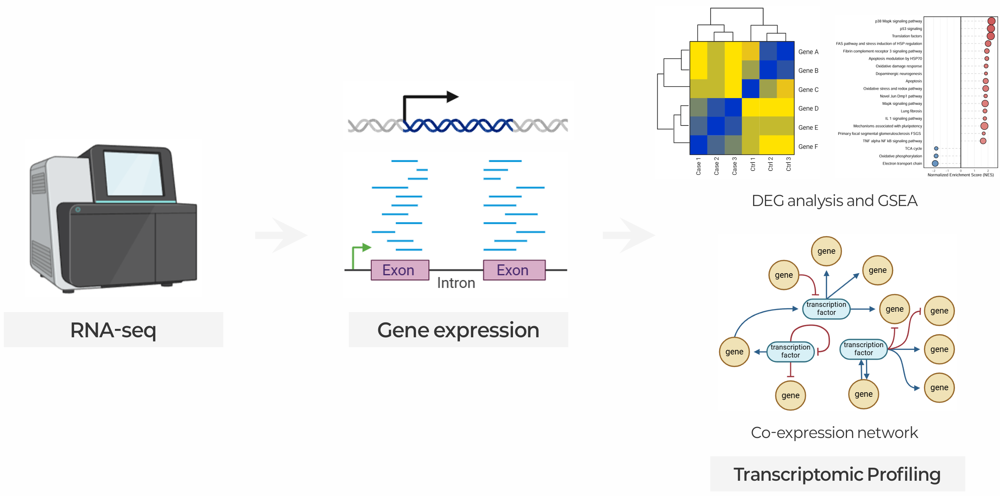

💡 The main text of each section = the basics you need. **🔍 Going further** boxes = deeper material to open when you are curious

------------------------------------------------------------------------

# 1. What RNA-seq Is 🧬 {#w4-s1}

> 🔑 **Core idea** — turn RNA into cDNA, sequence it, and count the reads for each gene → the more of an RNA was there, the higher its count

## 1) How it works {#w4-s1-1}

-   Most RNA in a cell is **rRNA** (ribosomal RNA, \~80–90%). The mRNA you want is a small part
-   mRNA ends in a **poly(A) tail** (a run of tens to hundreds of A's) → beads carrying a run of T's (oligo-dT) pull out only the mRNA = **poly(A) selection**
-   Fragment the captured RNA → copy it into cDNA (reverse transcription) → add adapters to both ends → sequence
-   Match each read to the genome (or transcriptome) and count per gene → a **genes × samples count table**
-   💡 The basic logic — more copies of an RNA in the tube → more fragments → more reads → a higher count

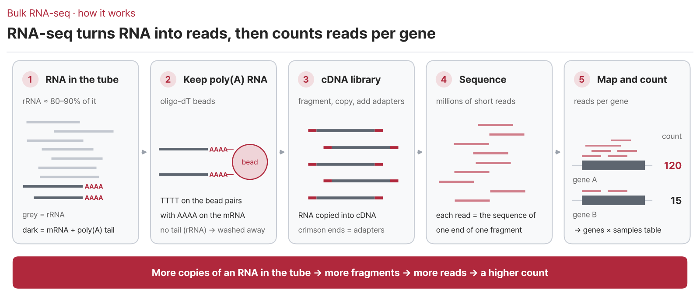{fig-align="center"}

::: {.callout-note collapse="true" icon=false}
## 🔍 Going further — RNA without a poly(A) tail

-   Histone mRNAs, many lncRNAs, circRNAs and not-yet-processed nascent RNA have no tail, or a short one
-   Degraded RNA → only the 3′ fragment that carries the tail survives
-   → if these RNAs matter, use rRNA depletion, which removes only rRNA, instead of poly(A) selection ([§2.1](#w4-s2-1))
:::

## 2) Steady-state abundance, not synthesis {#w4-s1-2}

-   RNA-seq counts the transcripts present **at the moment you lysed the sample**
-   That number = the balance of two rates: **transcription** (making) and **degradation** (breaking down)
-   ⚠️ The assay cannot separate them → a gene whose transcription doubles and a gene whose mRNA half-life doubles look **identical**

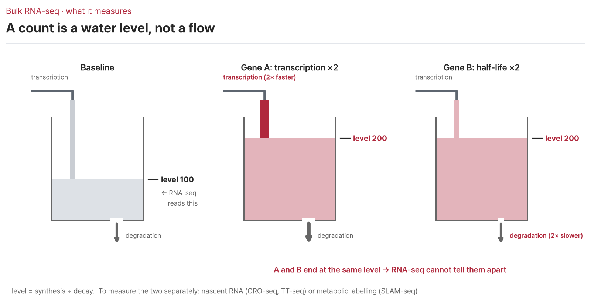{fig-align="center"}

::: {.callout-note collapse="true" icon=false}
## 🔍 Going further — assays that separate synthesis and translation

If the distinction matters to your hypothesis, you need a different assay:

-   **Nascent transcription** — GRO-seq, TT-seq
    -   Label only the RNA made in the last few minutes (BrU, 4sU) → pull out the labelled RNA and sequence it
    -   → measures the **rate of synthesis**, not the accumulated level

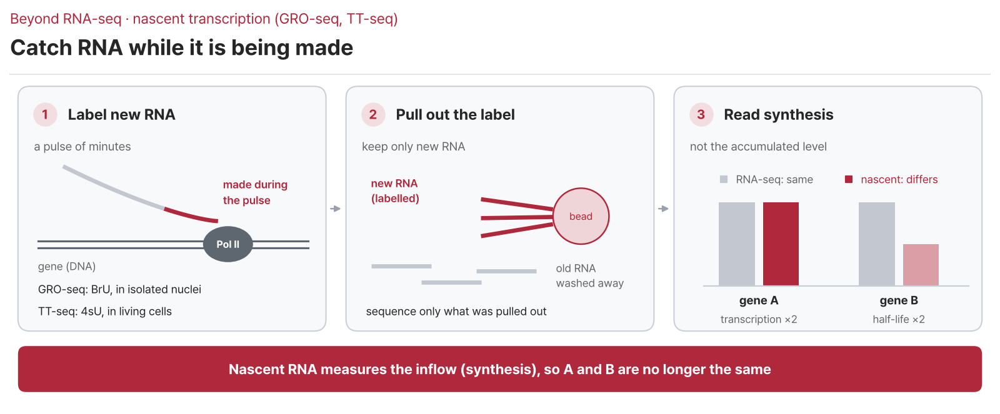{fig-align="center"}

-   **Metabolic labelling** — SLAM-seq
    -   Label new RNA with 4sU → after a chemical treatment, that position reads as C instead of T
    -   → new and old RNA are told apart inside one library, without a pull-down. Measured over time, this estimates **synthesis and decay (half-life)** separately

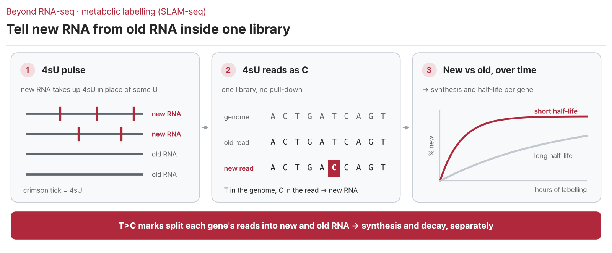{fig-align="center"}

-   **Translation** — ribosome profiling (Ribo-seq)
    -   Stop ribosomes where they sit on the mRNA → digest the RNA no ribosome covers → sequence only the \~30 nt fragments that were covered (footprints)
    -   → how many ribosomes sit on each mRNA = **translation**. Measured alongside RNA-seq, this gives translation efficiency (TE)

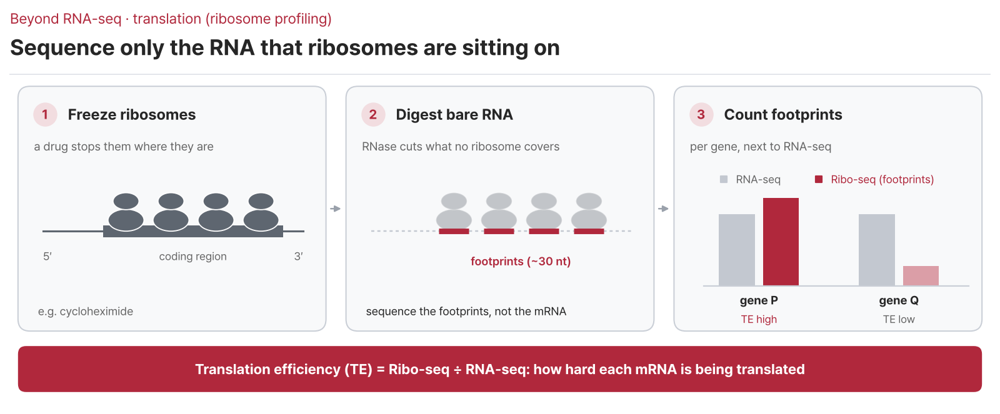{fig-align="center"}
:::

## 3) ⚠️ RNA is not protein {#w4-s1-3}

-   Transcript and protein abundance correlate at **r ≈ 0.4** across genes
-   A real correlation — but nowhere near enough to treat mRNA as a proxy for protein for any individual gene

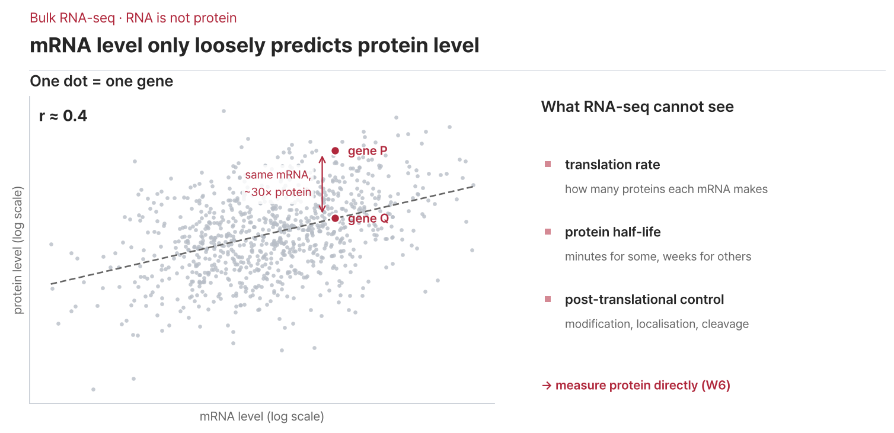{fig-align="center"}

-   Missing from RNA-seq (🔗 W6):
    -   **Translation efficiency** — how many proteins one mRNA makes
    -   **Protein half-life** — some proteins last minutes, others weeks
    -   **Post-translational regulation** — modifications such as phosphorylation, cleavage, location in the cell → the same amount, different activity

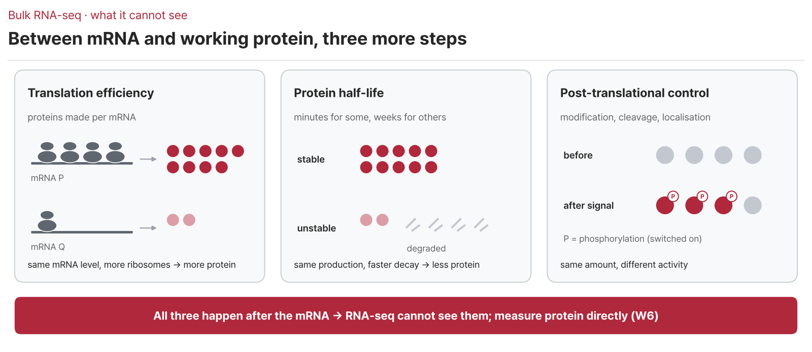{fig-align="center"}

## 4) In short: a snapshot, of a mixture {#w4-s1-4}

-   RNA-seq = a **snapshot** of how much of each RNA was in the tube when you lysed it. Not synthesis rate, not protein, not any single cell
-   ⚠️ **One time point** — responses are dynamic. A single harvest can miss an effect entirely, or catch a transient one and misread it as steady state
-   ⚠️ **A mixture of cells** — bulk RNA-seq averages over every cell in the tube → [§6.2](#w4-s6-2) shows how badly that misleads; 🔗 W5 is the response

------------------------------------------------------------------------

# 2. Before You Sequence ⚙️ {#w4-s2}

> 🔑 **Core idea** — choices made at the bench (library type, replicates, batch layout) set the limits of every later analysis. None can be undone in analysis

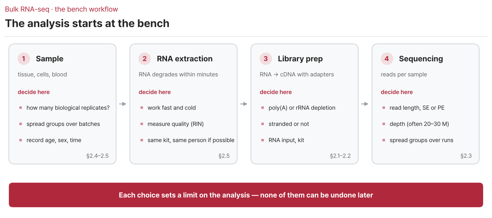{fig-align="center"}

## 1) Poly(A) selection vs. rRNA depletion {#w4-s2-1}

-   There are two ways to remove rRNA (🔗 [§1.1](#w4-s1-1))
-   **Poly(A) selection** — oligo-dT beads capture transcripts with a poly(A) tail. Clean, cheap, the default for DE studies
-   **rRNA depletion** — probes remove rRNA and keep everything else: RNA without a poly(A) tail, newly made (nascent) unspliced RNA, degraded fragments

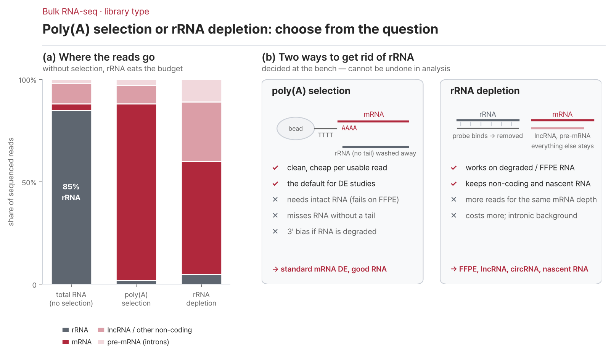{fig-align="center"}

⚠️ Made at the bench → **cannot be undone in analysis**

::: {.callout-tip collapse="true"}
## Which to choose

-   Standard mRNA DE, good-quality RNA → **poly(A)**
-   FFPE or degraded RNA → **rRNA depletion**. Poly(A) selection fails, because degraded transcripts have lost their tails
-   lncRNA, circRNA, histone mRNAs, nascent transcription → **rRNA depletion**
:::

## 2) Stranded vs. unstranded {#w4-s2-2}

-   A stranded library records **which strand** the original transcript came from
-   \~10–20% of the genome has overlapping transcription on both strands → without strand information those reads are assigned ambiguously or wrongly
-   → **Stranded is now standard**; little reason not to use it

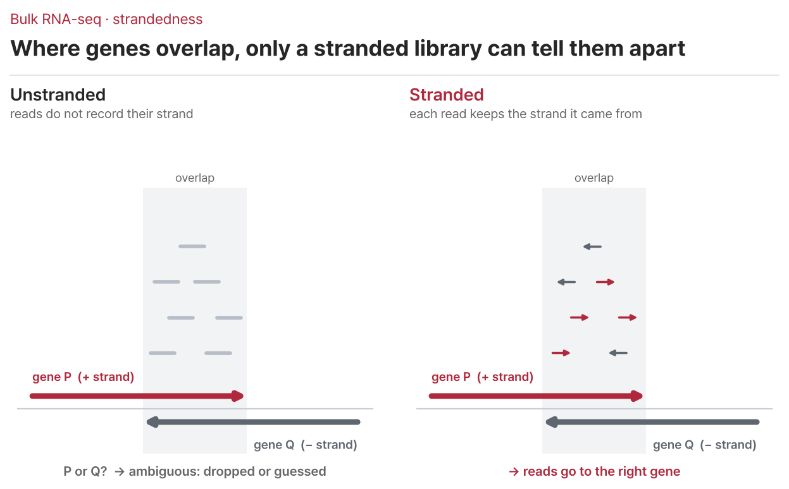{fig-align="center"}

## 3) Read length, depth, and paired-end {#w4-s2-3}

-   **Single-end** = read one end of each fragment; **paired-end** = read both ends (🔗 [W1 §2.1②](w1_intro.qmd#w1-s2-1-2))
-   Plain gene-level DE → single-end is often sufficient; longer reads add little
-   Isoforms, splice junctions, fusions, novel transcripts → longer and paired-end reads
-   💡 **Long reads** (PacBio, Nanopore; 🔗 [W1 §2.1③](w1_intro.qmd#w1-s2-1-3)) → one read covers a whole transcript from end to end → isoforms and fusions are seen directly, not pieced together
-   Depth saturates much earlier than people expect ([§4.3④](#w4-s4-3-4))

{fig-align="center"}

::: {.callout-note collapse="true" icon=false}
## 🔍 Going further — read length, paired-end and depth at a glance

| Choice | When it matters |
|------------------------------------|------------------------------------|
| **Longer reads** (2×150 vs 1×50) | Isoform and splice junction work; less benefit for plain gene-level counting |
| **Paired-end** | Isoforms, fusion detection, novel transcripts. For gene-level DE, single-end is often sufficient |
| **Long reads** (PacBio, Nanopore) | Full-length isoforms, fusions, novel transcripts. Fewer reads at higher cost → gene-level quantification (DE) still relies mostly on short reads |
| **Depth** | See [§4.3④](#w4-s4-3-4) — saturates much earlier than people expect |
:::

## 4) Biological vs. technical replicates {#w4-s2-4}

-   **Technical replicate** — the same RNA sequenced twice
-   **Biological replicate** — a different animal, patient, or independently cultured dish
-   ⚠️ Technical variability in RNA-seq is small; biological variability is not → **n counts biological replicates only**

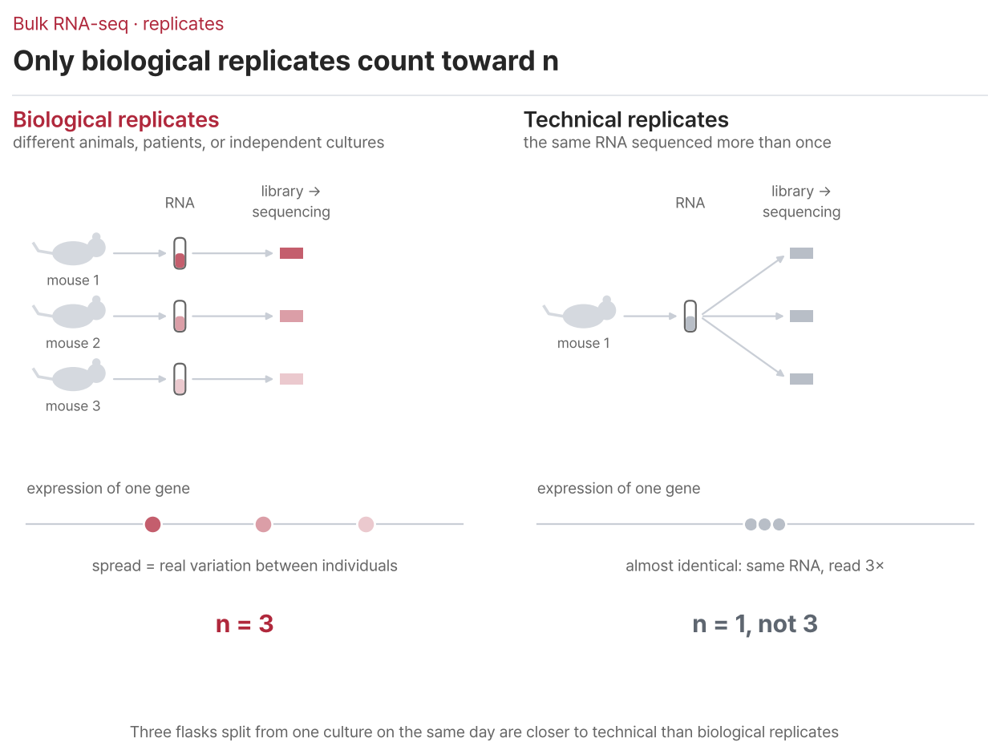{fig-align="center"}

::: {.callout-note collapse="true" icon=false}
## 🔍 Going further — what really counts as a biological replicate

-   Sequencing one sample twice tells you almost nothing new
-   Three flasks from the same passage, split on the same day → closer to technical than biological, whatever the methods section calls them
:::

## 5) What to consider in study design {#w4-s2-5}

Before samples leave the bench (🔗 [W1 §5.3](w1_intro.qmd#w1-s5-3)):

-   **Randomise across batches** — all cases in batch 1 and all controls in batch 2 → unrecoverable. Only when they are mixed can the analysis separate batch out ([§3.4②](#w4-s3-4-2), [§4.4](#w4-s4-4))
-   **Record RIN** (RNA quality) and everything else you might adjust for — age, sex, tissue site, time of collection
-   **Decide n before you start** ([§4.3④](#w4-s4-3-4)), and **keep the design balanced**

::: {.callout-note collapse="true" icon=false}
## 🔍 Going further — each point in detail

-   **Batches** = extraction day, library prep batch, sequencing run
-   **RIN** — RNA quality shifts measurements systematically → treat it as a covariate
-   **Balance** — unbalanced designs are analysable but lose power fast
:::

------------------------------------------------------------------------

# 3. Pre-processing 🔢 {#w4-s3}

> 🔑 **Core idea** — check the samples (QC) → assign reads to genes to build the count matrix → normalise → look at the samples as a whole before testing (EDA)

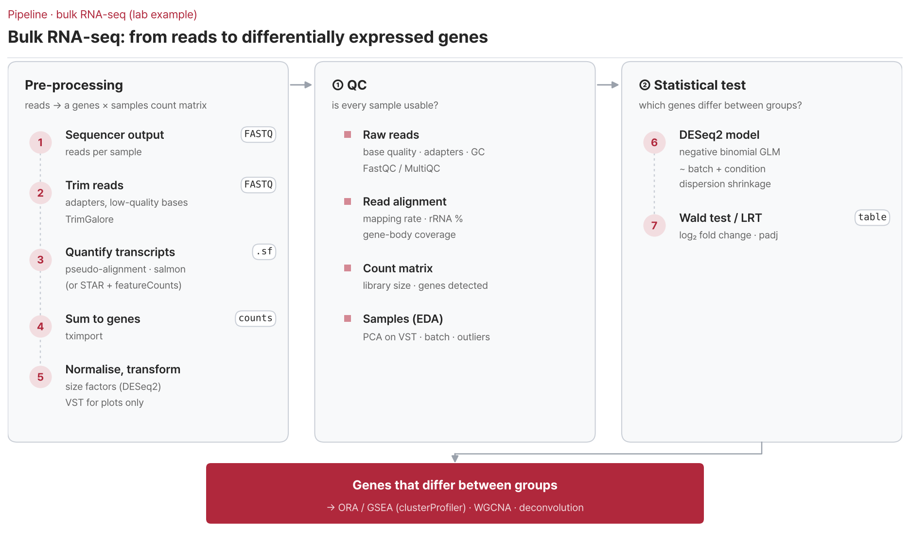{fig-align="center"}

## 1) QC {#w4-s3-1}

-   Check each step separately: raw reads → alignment → count matrix (the shape of the samples as a whole is EDA, [§3.4](#w4-s3-4))
-   💡 **Comparison with the other samples in the same experiment** matters more than any absolute cut-off

### ① Raw sequencing reads {#w4-s3-1-1}

-   **FastQC** — base quality, leftover adapters, GC content, overrepresented sequences → MultiQC collects many samples into one report
-   Adapters and low-quality bases → trimming (TrimGalore, cutadapt)
-   ⚠️ Duplication — naturally high for highly expressed genes in RNA-seq → not a reason to remove reads on its own

### ② Read alignment {#w4-s3-1-2}

-   **Mapping rate** — the share of reads aligned to the genome (or transcriptome)
-   **Where the reads landed** — exon, intron, intergenic, rRNA → be suspicious of one sample that stands out
-   **Gene-body coverage** — reads should cover each transcript evenly from 5′ to 3′. ⚠️ A pile-up toward 3′ = a sign of degraded RNA (low RIN) in a poly(A) library
-   **Strandedness** — whether it matches the lab record

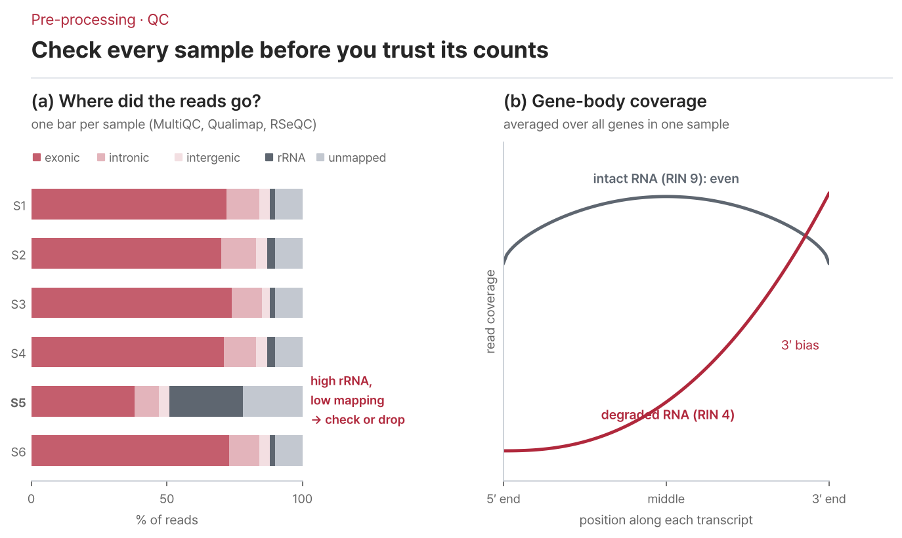{fig-align="center"}

💡 salmon (pseudo-alignment) reports only the mapping rate → check read distribution and gene-body coverage on a genome alignment (e.g. STAR) with RSeQC or Qualimap

### ③ Count matrix {#w4-s3-1-3}

-   **Library size** (a sample's total count) and **genes detected** → be suspicious of a sample with far fewer than the others
-   Check that a handful of genes do not take most of the counts (e.g. haemoglobin genes in whole blood)
-   The shape of the samples as a whole → EDA ([§3.4](#w4-s3-4))

::: {.callout-note collapse="true" icon=false}
## 🔍 Going further — QC metrics by step

| Step | Metric | Warning sign |
|------------------------|------------------------|------------------------|
| **Raw reads** | Base quality | Drops sharply toward the read end → trim |
| **Raw reads** | Adapter content | High → short fragments, trimming needed |
| **Raw reads** | Duplication | Can be high and still normal in RNA-seq |
| **Alignment** | Mapping rate | Clearly lower than other samples → contamination, wrong species, adapters |
| **Alignment** | Exonic / intronic share | High intronic share in a poly(A) library → nuclear RNA or DNA contamination |
| **Alignment** | rRNA share | Higher than other samples → removal failed |
| **Alignment** | Gene-body coverage | 3′ pile-up → degradation |
| **Alignment** | Strandedness | Does not match the record → wrong counting settings |
| **Count matrix** | Library size, genes detected | Far fewer than other samples |

-   Tools: FastQC, MultiQC, RSeQC, Qualimap. Pipelines such as nf-core/rnaseq run them all at once
:::

## 2) Alignment and quantification {#w4-s3-2}

-   Reads are matched to genes and counted → a genes × samples count matrix
-   ⚠️ Every count matrix carries four invisible decisions made along the way (①–④)

### ① Spliced alignment {#w4-s3-2-1}

-   **The problem** — reads come from mature mRNA (introns removed), but you align to the genome → a read crossing an exon–exon junction will not align in one piece
-   **The fix** — spliced aligners (STAR, HISAT2) allow large gaps at annotated or novel junctions
-   Use this route when read **position** matters: novel transcripts, splicing, fusions, allele-specific expression, viewing in a genome browser

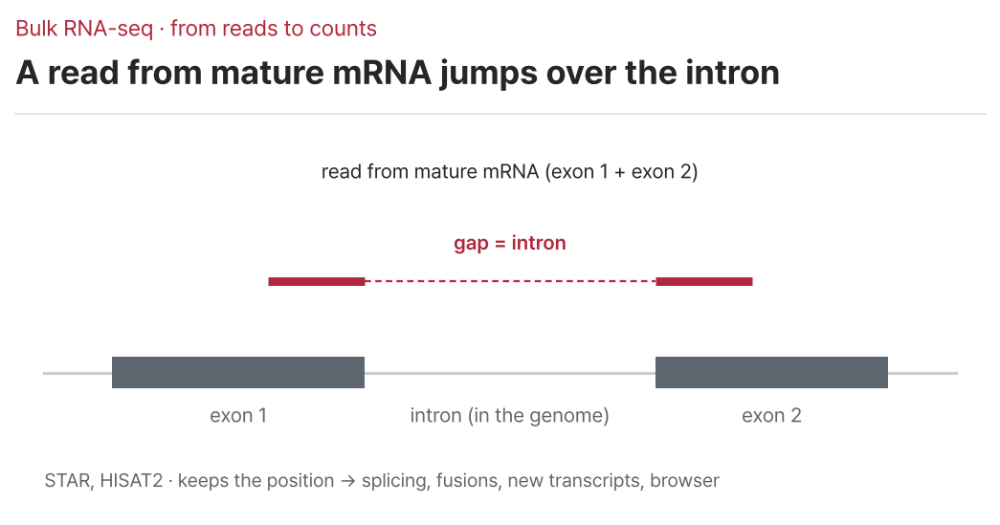{fig-align="center"}

### ② Pseudo-alignment {#w4-s3-2-2}

-   **Salmon** and **kallisto** skip base-level alignment → ask only which transcripts a read is *compatible with*
-   ✅ \~10× faster, far less memory
-   ❌ No BAM file → cannot inspect alignments

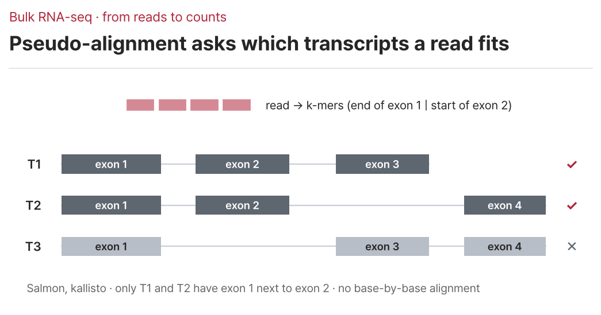{fig-align="center"}

::: {.callout-note collapse="true" icon=false}
## 🔍 Going further — pseudo-alignment in detail

-   Reads compatible with several transcripts → the assignment is resolved **statistically across all reads**
-   ✅ Transcript-level estimates at least as accurate for quantification
-   ❌ Can only quantify transcripts already in the annotation
:::

### ③ Gene level vs. transcript level {#w4-s3-2-3}

-   Most genes produce several isoforms (different transcripts from the same gene)
-   💡 **The pragmatic standard** — quantify at transcript level, then **sum to gene level** (the `tximport` route)

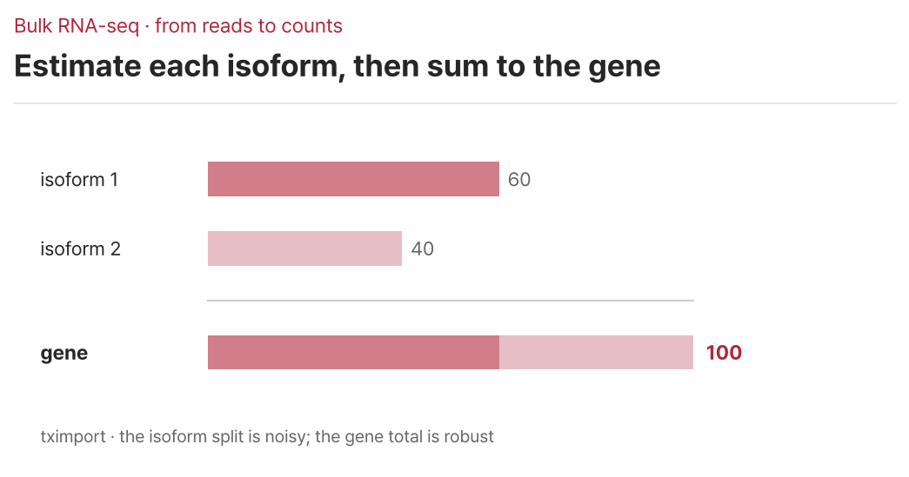{fig-align="center"}

::: {.callout-note collapse="true" icon=false}
## 🔍 Going further — why sum to gene level

-   Transcript-level quantification → more informative, but noisier: reads shared between isoforms must be probabilistically assigned
-   Gene-level results are more robust, and you keep the option of looking at isoforms later
:::

### ④ Multi-mapping reads {#w4-s3-2-4}

-   Some reads map equally well to several places — paralogues, repeats, pseudogenes
-   ⚠️ How they are handled = one of the invisible decisions baked into any count matrix you download from GEO (🔗 [W1 §2.2④](w1_intro.qmd#w1-s2-2-4))

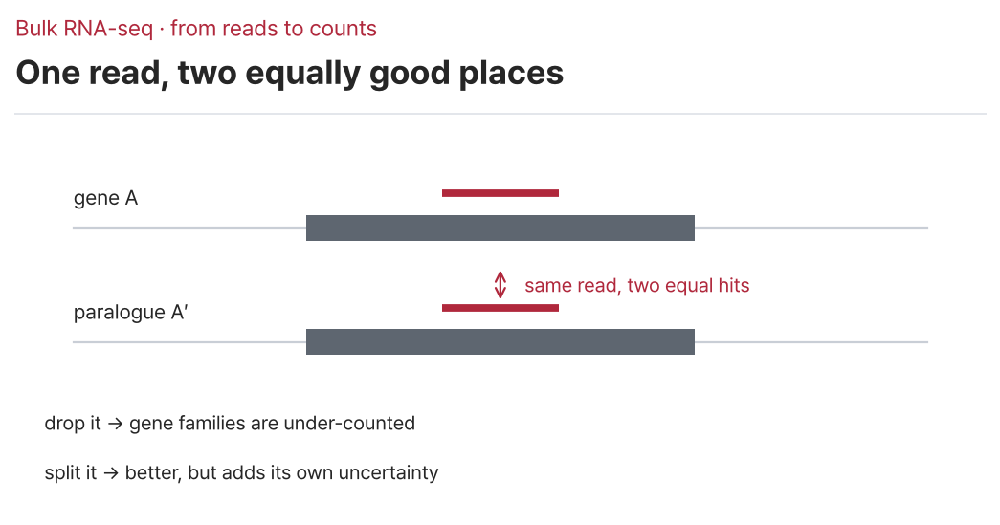{fig-align="center"}

::: {.callout-note collapse="true" icon=false}
## 🔍 Going further — discard or distribute?

-   **Discard** → systematically under-counts gene families
-   **Distribute probabilistically** → better, but introduces its own uncertainty
:::

## 3) Normalization {#w4-s3-3}

-   A raw count reflects sequencing depth, gene length and library composition, not only biology → normalise before comparing samples

### ① Depth, gene length and composition {#w4-s3-3-1}

A count depends on three things that have nothing to do with biology:

1.  **Library size (depth)** — sequence twice as deeply → every gene doubles
2.  **Gene length** — a 10 kb transcript generates more fragments than a 1 kb transcript at the same molar concentration
3.  **Library composition** — the subtle one ([②](#w4-s3-3-2))

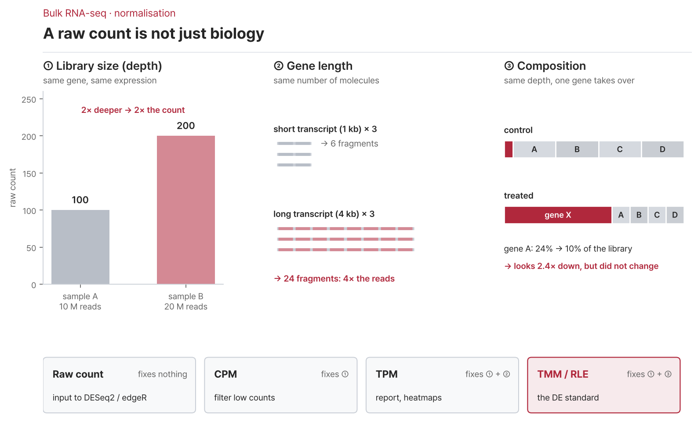{fig-align="center"}

### ② ⚠️ The composition effect {#w4-s3-3-2}

-   **Sequencing measures proportions, not absolute amounts** — the total is fixed by how many reads you bought
-   One gene (or a handful) becomes enormously abundant in one condition → takes a larger share of the library → **every other gene's proportion falls, though nothing happened to it**
-   ⚠️ Simple depth normalisation (CPM) cannot fix this — depth is not what changed
-   ✅ **TMM** (edgeR) and **RLE** (DESeq2) also correct composition → the standard for differential expression

::: {.callout-note collapse="true" icon=false}
## 🔍 Going further — how TMM and RLE work

-   TMM (edgeR) and RLE / median-of-ratios (DESeq2) both assume most genes are *not* differentially expressed
-   → use that majority to estimate a per-sample scaling factor
-   → why they are the standard for differential expression and CPM is not
:::

::: {.callout-warning collapse="true"}
## The assumption behind TMM and RLE

Both assume **the majority of genes do not change**. Usually safe

**Fails when there is a global transcriptional shift:**

-   MYC amplification
-   global transcriptional shutdown
-   some drug treatments
-   comparing very different tissues

→ in those cases you need spike-in controls (ERCC) to anchor the scale
:::

### ③ Expression units {#w4-s3-3-3}

-   **Raw counts** → input to DESeq2 / edgeR — do not pre-normalise
-   **TPM** → reporting expression levels, heatmaps
-   **TMM / RLE** → differential expression — the standard
-   ⚠️ **Never feed normalised values (TPM, CPM) into DESeq2 or edgeR**

::: {.callout-important collapse="true"}
## Never feed normalised values into DESeq2 or edgeR

-   These tools model **raw counts** and estimate their own size factors internally
-   Handing them TPM or CPM breaks the variance model
-   → invalidates the p-values

A common and quiet error
:::

::: {.callout-note collapse="true" icon=false}
## 🔍 Going further — every expression unit compared

| Method | Corrects | Comparable | Use for |
|------------------|------------------|------------------|------------------|
| **Raw counts** | nothing | — | **Input to DESeq2 / edgeR** — do not pre-normalise |
| **CPM** | depth | between samples | Filtering low-expression genes |
| **RPKM / FPKM** | depth + length | within a sample only | Legacy; avoid for comparisons |
| **TPM** | depth + length | within and (loosely) between | Reporting expression levels, heatmaps |
| **TMM / RLE** | depth + **composition** | between samples | **Differential expression — the standard** |
:::

## 4) Exploratory data analysis (EDA) {#w4-s3-4}

-   Before testing genes one by one, look at **the samples as a whole**
-   What to check: are replicates alike? Do the groups separate? Is one sample an outlier? Is there a batch?

### ① Transformation: VST and rlog {#w4-s3-4-1}

-   Put raw counts or log₂(count + 1) straight into PCA → noise from low-count genes dominates the result
-   DESeq2's **VST** (variance stabilizing transformation) and **rlog** (regularized log) → make the spread roughly the same at every expression level
-   ⚠️ **For plots and EDA only**. Differential expression testing still takes raw counts ([§3.3③](#w4-s3-3-3))

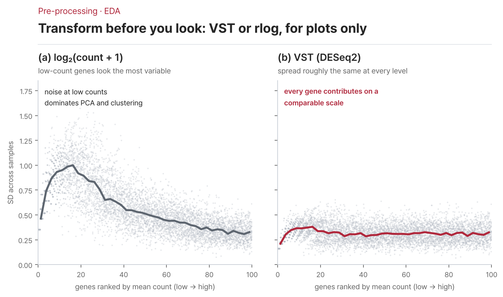{fig-align="center"}

::: {.callout-note collapse="true" icon=false}
## 🔍 Going further — VST vs. rlog, and the code

-   **VST** `vst()` — fast. The default for larger datasets (roughly 30+ samples)
-   **rlog** `rlog()` — a little better with few samples and very different depths between them. Slower
-   Both return values on the log₂ scale → for highly expressed genes, almost the same as log₂ normalised counts
-   `blind = TRUE` (the default) — transforms without knowing the design → suits QC. For experiments with very large group differences, use `blind = FALSE`

``` r
vsd <- vst(dds, blind = TRUE)                        # or rlog(dds)
plotPCA(vsd, intgroup = c("condition", "batch"))     # PCA
dist(t(assay(vsd)))                                  # sample-to-sample distances → heatmap
```
:::

### ② PCA and batch effects {#w4-s3-4-2}

-   **PCA** — summarises the variation of thousands of genes as a few axes that best separate the samples (🔗 [W2 §3.2②](w2_genomics.qmd#w2-s3-2-2))
-   ✅ What you hope to see — the groups separate on PC1, and replicates of a group sit together
-   ⚠️ **Batch effect** — the samples split by processing day, library batch or sequencing run, not by biology (🔗 [§2.5](#w4-s2-5), [W1 §4.3](w1_intro.qmd#w1-s4-3))
-   What to do — do not alter the counts; put batch **in the design formula** → the model takes out batch's share ([§4.2②](#w4-s4-2-2), [§4.4](#w4-s4-4))

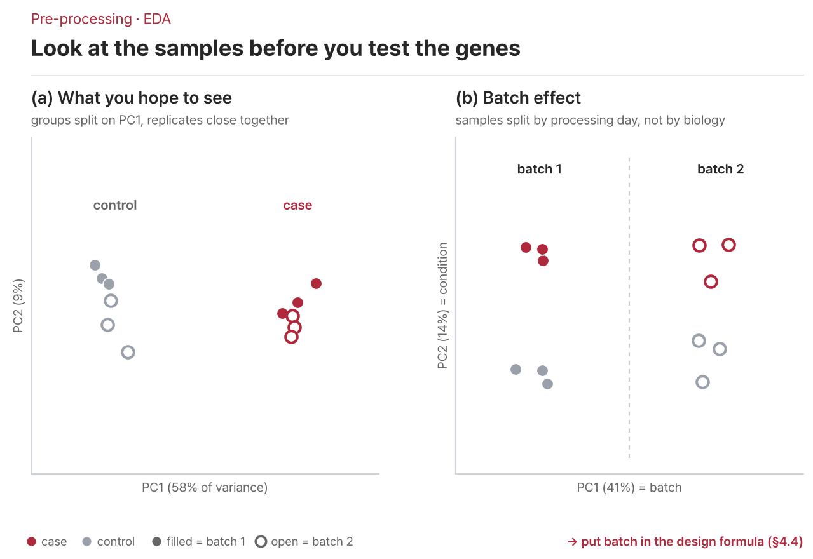{fig-align="center"}

::: {.callout-warning collapse="true"}
## Batch-removed values are for plots only

-   Values with batch removed (e.g. `limma::removeBatchEffect()`) → **for PCA and heatmap figures only**
-   For testing: raw counts + `~ batch + condition`. Testing values that already had batch removed drops the uncertainty of that correction → over-optimistic p-values
-   ⚠️ If batch and condition overlap completely (all cases in batch 1, all controls in batch 2) → no model can separate them ([§2.5](#w4-s2-5))
-   An outlier sample → go back to the QC metrics ([§3.1](#w4-s3-1)) to find the cause. Do not drop it without a reason
:::

------------------------------------------------------------------------

# 4. Analysis: Testing for Differential Expression 📊 {#w4-s4}

> 🔑 **Core idea** — for each gene, test "is the difference between groups larger than the noise?" DESeq2 = a regression model built for counts (negative binomial GLM) + borrowing information across genes. Nothing replaces enough biological replicates

## 1) DEGs {#w4-s4-1}

-   **DEG** (differentially expressed gene) = a gene whose expression differs significantly between conditions (e.g. case vs. control)
-   The difficulty — observed expression mixes biological signal, technical noise and differences between individuals
-   → The goal: pick out **only the biological signal** from the total variation = is the difference between groups large enough compared with the spread within groups?

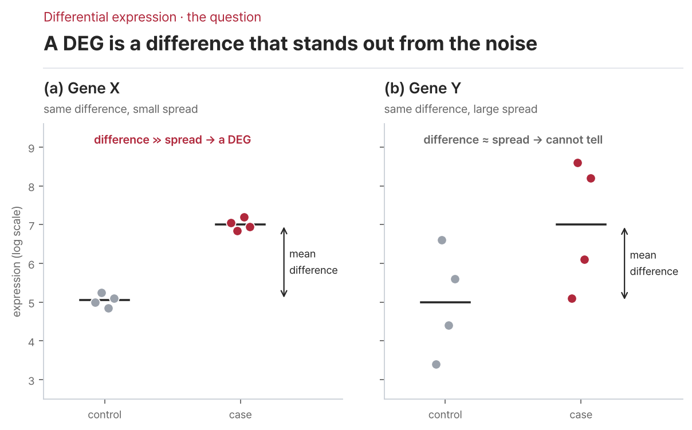{fig-align="center"}

## 2) Regression {#w4-s4-2}

### ① Linear regression {#w4-s4-2-1}

-   Code the condition as a number (control = 0, case = 1) → expression = **a mean part** + **a noise part**

$$
y = \beta_0 + \beta_1 x + \varepsilon, \qquad \varepsilon \sim N(0, \sigma^2)
$$

-   β₀ = the control mean, **β₁ = the condition effect** (what we test), ε = noise
-   ⚠️ Linear regression assumes the variance σ² is the same everywhere → this fails for count data ([§4.3①](#w4-s4-3-1))

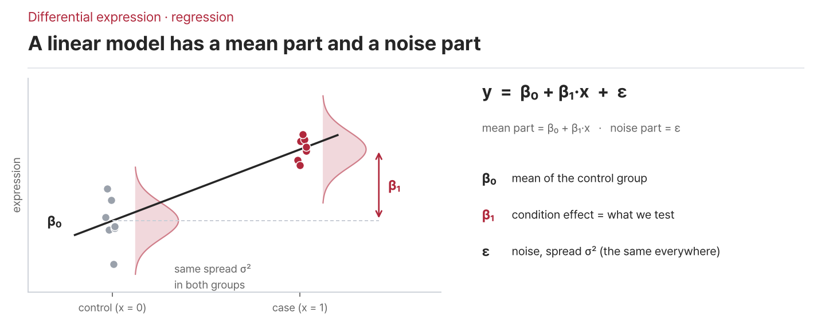{fig-align="center"}

### ② Variance decomposition {#w4-s4-2-2}

-   Statistics = tracing where the variation comes from

$$
\text{Total variation} = \textbf{Condition} + \textbf{Batch} + \text{Residual}
$$

-   **Condition** — the real biological effect
-   **Batch** — systematic noise you can control (day, instrument, operator)
-   **Residual** — random error left unexplained
-   → The strategy: put batch in the model to take it out → the condition signal shows (🔗 [§3.4②](#w4-s3-4-2))

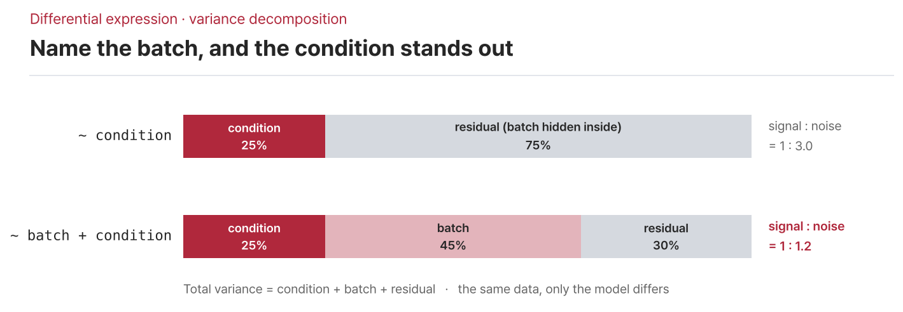{fig-align="center"}

## 3) The statistical model of DESeq2 {#w4-s4-3}

-   Keep the frame of linear regression and change two things for counts: the **distribution** (normal → negative binomial) and the **scale** (log)
-   💡 This chapter follows DESeq2. edgeR and limma-voom are also standard → they agree on large-effect genes and disagree at the margins → **if your conclusion depends on which one you used, you do not have a conclusion**

::: {.callout-note collapse="true" icon=false}
## 🔍 Going further — how the three tools differ

| Tool | Model | Notes |
|------------------------|------------------------|------------------------|
| **DESeq2** | Negative binomial; shrinkage of dispersion *and* log fold change | Conservative; good default; handles small n well |
| **edgeR** | Negative binomial; empirical Bayes dispersion | Very similar in practice; quasi-likelihood mode slightly more conservative |
| **limma-voom** | Transforms counts, models precision weights, then linear models | Fastest at large n; most flexible for complex designs |
:::

### ① What count data looks like {#w4-s4-3-1}

-   **Integers** including 0, never negative
-   **Pure random sampling** → counts would be **Poisson**: variance = mean. Technical replicates roughly behave this way
-   **Biological replicates** → far more variable = **overdispersed**; the excess variance grows with expression level
-   → The constant-variance assumption of linear regression fails. A t-test on counts produces false positives

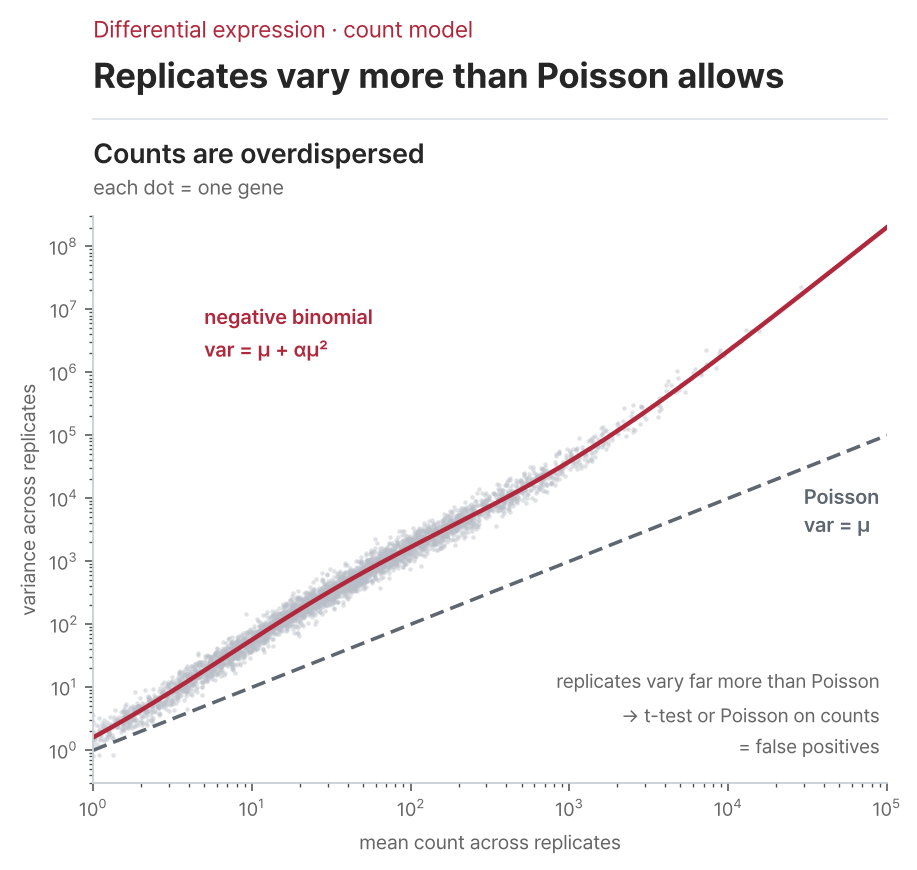{fig-align="center"}

### ② The negative binomial distribution {#w4-s4-3-2}

-   Adds one dispersion parameter α to the Poisson:

$$
\text{Var}(Y) = \mu + \alpha \mu^2
$$

-   μ = sampling noise (the Poisson part), αμ² = the extra variation between biological replicates

::: {.callout-note collapse="true" icon=false}
## 🔍 Going further — reading α

-   α = 0 → recovers Poisson
-   For highly expressed genes, √α ≈ the coefficient of variation (CV) between replicates. E.g. α = 0.04 → about 20% biological variation
-   Estimating α honestly is what separates a valid analysis from an optimistic one
:::

### ③ GLM {#w4-s4-3-3}

-   The mean is linear on the log scale:

$$
\log_2 \mu = \beta_0 + \beta_1 \cdot \text{condition} + \beta_2 \cdot \text{batch} + \cdots
$$

-   = a **generalised linear model (GLM)**: the frame of linear regression + a distribution suited to counts (negative binomial) + a log scale
-   Unlike linear regression, **the variance differs from gene to gene** (each gene has its own α)
-   Each sample's size factor ([§3.3](#w4-s3-3)) enters the model as a depth correction → which is why the input is raw counts

### ④ Dispersion estimation and shrinkage {#w4-s4-3-4}

-   ⚠️ Three numbers give a terrible variance estimate → you cannot estimate a gene's α from n = 3
-   ✅ The solution — **borrow information across genes** (shrinkage):
    1.  Estimate α for each gene (noisy)
    2.  Fit a trend of α against mean expression using all genes
    3.  Pull each gene's estimate toward the trend
-   💡 The single most important methodological idea in bulk RNA-seq → why the standard tools outperform a per-gene t-test so decisively at small n

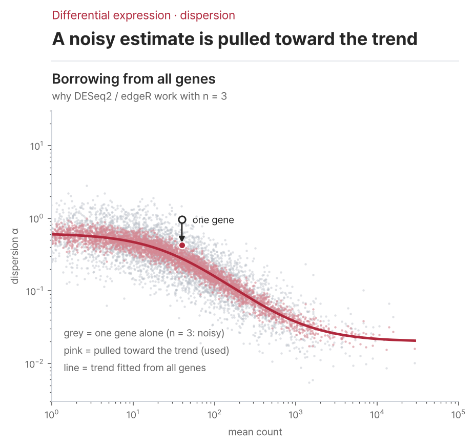{fig-align="center"}

::: {.callout-note collapse="true" icon=false}
## 🔍 Going further — shrinkage in detail

-   How far to pull = how uncertain that gene's estimate is. More replicates → less pulling
-   Genes far above the trend (genuinely variable genes) are left as they are → avoids false positives
-   See it yourself with `plotDispEsts(dds)`
:::

::: {.callout-warning collapse="true"}
## Sample size — n = 3 is a convention

-   Shrinkage makes n = 3 analysable → but it detects only large, consistent changes
-   **Depth saturates, replicates do not** (right-hand panel) → 20–30 M reads per sample is enough for most DE questions
-   → money spent beyond that would buy more power as **additional samples**

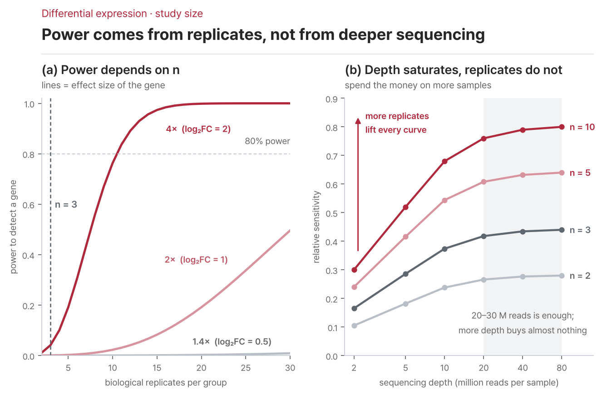{fig-align="center"}

For human tissue with real between-individual variability, three replicates are usually insufficient. Rough orientation:

-   **Cell lines, clean perturbation** — n = 3–4 may be acceptable
-   **Mouse tissue** — n = 5–8
-   **Human tissue / clinical samples** — n = 10–20 minimum, more if the phenotype is heterogeneous
:::

### ⑤ LFC and the statistical test {#w4-s4-3-5}

-   **β₁ = log₂ fold change (LFC)** = log₂(μ~case~ / μ~control~). 1 = a doubling, −1 = a halving
-   **Wald test** — z = β₁ / SE(β₁) → p-value. The default for two groups
-   **LRT** (likelihood ratio test) — compares with a model that leaves the variable out. Three or more groups, time courses
-   One test per gene → multiple-testing correction → **padj** (🔗 [W1 §4.2](w1_intro.qmd#w1-s4-2))

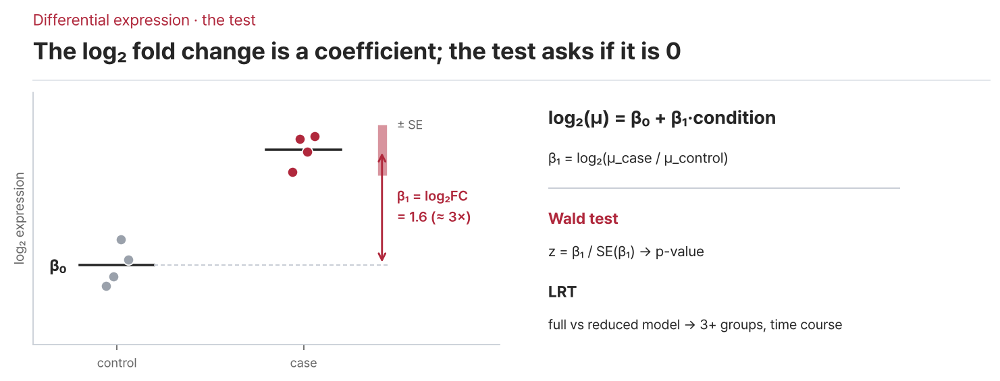{fig-align="center"}

::: {.callout-note collapse="true" icon=false}
## 🔍 Going further — LFC shrinkage

-   Low-count genes → β₁ estimates swing widely → chance large LFCs rise to the top of the ranking
-   `lfcShrink()` (e.g. `type = "apeglm"`) → pulls uncertain LFCs toward 0 → use these for ranking and plots
-   p-values and padj do not change; only the effect-size estimate does
:::

## 4) The design matrix {#w4-s4-4}

-   Sample table → **design formula** → a **design matrix** of 0s and 1s → one coefficient (β) per column
-   Example: `~ batch + condition` → the coefficient of the condition column (case = 1, control = 0), β₁, is the log₂ fold change adjusted for batch
-   **Put the variables to adjust for (batch, confounders) first and the variable of interest (condition) last** → `results()` uses the last variable by default
-   Set the reference group with `relevel()` beforehand, or with `results(contrast = ...)`

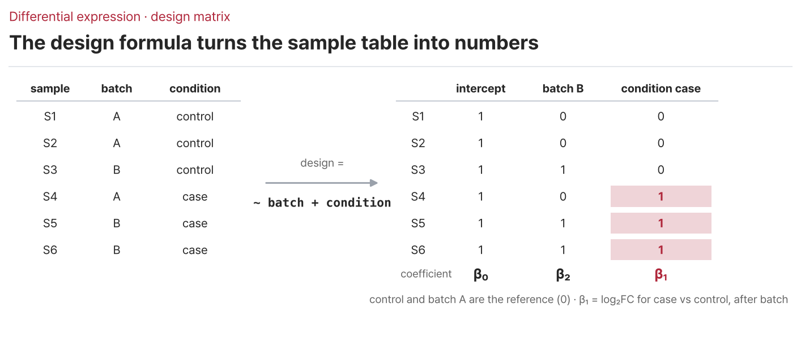{fig-align="center"}

::: {.callout-note collapse="true" icon=false}
## 🔍 Going further — DESeq2 code

``` r
library(DESeq2)
dds <- DESeqDataSetFromMatrix(countData = counts,    # raw counts (not normalised)
                              colData   = coldata,   # sample table
                              design    = ~ batch + condition)
dds$condition <- relevel(dds$condition, ref = "control")
dds <- DESeq(dds)                                    # size factors → dispersion → Wald test
res <- results(dds, contrast = c("condition", "case", "control"))
```
:::

::: {.callout-note collapse="true" icon=false}
## 🔍 Going further — more complex designs

| Situation | Example | Design formula |
|------------------------|------------------------|------------------------|
| **Paired samples** | Tumour vs. normal from the same patient, before vs. after treatment | `~ patient + treatment` |
| **Interaction** | Does drug response differ by disease subtype? | `~ subtype + drug + subtype:drug` |
| **Time course** | Several time points | `~ time`, tested with LRT |
| **Random effects** | Several tissues from one person | Not possible in DESeq2 → limma-voom |
| **Unrecorded batch** | Hidden variation | Estimate surrogate variables with `sva` → `~ SV1 + SV2 + condition` |
:::

::: {.callout-warning collapse="true"}
## Collinearity: variables that cannot go in together

-   In a paired design `~ patient + condition`, do not add age or sex → they do not change within a patient, so patient already explains them
-   Batch and condition overlap completely → two columns of the design matrix are identical → the two cannot be separated (🔗 [§2.5](#w4-s2-5))
:::

## 5) Results table and plots {#w4-s4-5}

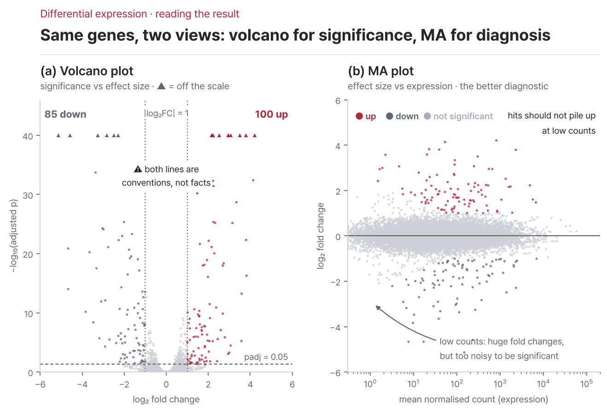{fig-align="center"}

-   **Adjusted p-value (padj)** — "FDR \< 0.05" → \~5% of the genes on this list are expected to be false (🔗 [W1 §4.2](w1_intro.qmd#w1-s4-2))
-   **log₂ fold change** — 1 = a doubling, −1 = a halving
-   **Volcano plot** — significance vs. effect size
-   **MA plot** — effect size vs. expression level → **the better diagnostic**

::: {.callout-note collapse="true" icon=false}
## 🔍 Going further — reading the numbers and plots more carefully

-   The adjusted p-value is almost always Benjamini–Hochberg FDR
-   For small n, report DESeq2's **shrunken** LFC — raw LFCs at low counts are wildly unstable
-   ⚠️ Volcano plot: both threshold lines are conventions
-   Why the MA plot is the better diagnostic: it reveals whether your hits are concentrated at low counts, which is what a poorly controlled analysis looks like
:::

::: {.callout-warning collapse="true"}
## Two habits worth breaking

**① Filtering by fold change alone**

-   log₂FC = 3 with padj = 0.4 is not a finding
-   → fold-change thresholds without significance filtering are how "top 20 gene" lists become unreproducible

**② Treating the threshold as biology**

-   padj = 0.049 and padj = 0.051 are indistinguishable
-   → report the ranked list, not just the cut
:::

------------------------------------------------------------------------

# 5. Downstream Analysis: Making Biological Sense of a Gene List 🧠 {#w4-s5}

> 🔑 **Core idea** — a list of 847 genes is not a result. Enrichment analysis asks **what they have in common** — it describes the list, it does not show a mechanism

## 1) ORA vs. GSEA {#w4-s5-1}

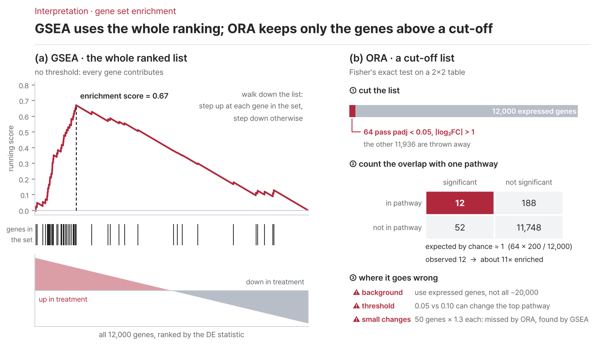{fig-align="center"}

-   **ORA** (over-representation analysis) — take the significant gene list → is a pathway over-represented relative to a background set? (Fisher's exact test)
-   **GSEA** — take *all* genes ranked by some statistic → do a pathway's members cluster toward one end? **No threshold applied**
-   💡 **GSEA's specific advantage** — it detects a pathway where fifty genes each shift by 1.3×. Coordinated, biologically meaningful, and **invisible to any threshold-based method**

## 2) Which databases {#w4-s5-2}

-   Gene sets come from curated databases: **GO**, **KEGG**, **Reactome**, **MSigDB Hallmark**
-   💡 **MSigDB Hallmark** = the best starting point — 50 refined, non-redundant gene sets

::: {.callout-note collapse="true" icon=false}
## 🔍 Going further — what each database contains

| Resource | Content | Caution |
|------------------------|------------------------|------------------------|
| **GO** | Biological process, molecular function, cellular component | Highly redundant; terms nested at wildly different specificity |
| **KEGG** | Curated metabolic and signalling pathways | Manually curated but slow to update |
| **Reactome** | Detailed, hierarchical reaction-level pathways | Deeper than KEGG, more complex to summarise |
| **MSigDB Hallmark** | 50 refined, non-redundant gene sets | 💡 The best starting point — designed to reduce redundancy |
:::

## 3) ⚠️ The three commonest misuses {#w4-s5-3}

-   ① **Wrong background set** — the background = genes expressed in your tissue, not the full annotation
-   ② **Threshold sensitivity** — a different padj cutoff can change the top pathway
-   ③ **Enrichment ≠ mechanism** — it describes your gene list; no driver, no direction, no cause

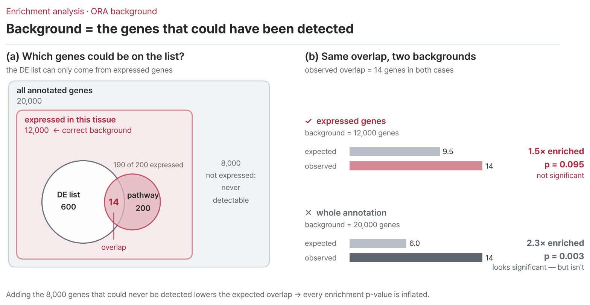{fig-align="center"}

::: {.callout-warning collapse="true"}
## Enrichment analysis is easy to do and easy to do wrong

**① The wrong background set**

-   Only 12,000 of 20,000 genes expressed in your tissue → your background is **12,000**
-   Using the full annotation inflates every p-value in the output
-   → the single most common error in the literature

**② Threshold sensitivity**

-   padj 0.05 → 0.10 can change the top pathway entirely
-   → if your headline result does not survive that, say so

**③ Enrichment is not mechanism**

-   "Enriched for immune response" describes your gene list. It identifies no driver, no direction, no cause
-   ⚠️ Large generic categories (immune, metabolic, cell cycle) are enriched in almost every perturbation, because they contain thousands of genes
:::

------------------------------------------------------------------------

# 6. Beyond Differential Expression 🌐 {#w4-s6}

> 🔑 **Core idea** — the same data can answer other questions: gene modules, cell composition, splicing, genetics. ⚠️ Bulk "differential expression" is frequently a change in cell composition

## 1) Co-expression networks {#w4-s6-1}

-   Instead of comparing conditions → ask which genes vary *together* across samples
-   **WGCNA** clusters genes into modules of correlated expression, then relates module summaries to traits
-   ⚠️ Needs many samples — 20 is a floor, 50+ is better

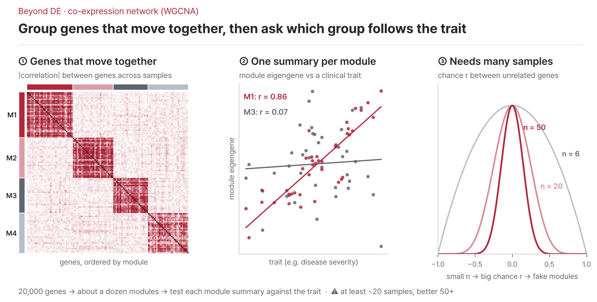{fig-align="center"}

::: {.callout-note collapse="true" icon=false}
## 🔍 Going further — when WGCNA helps

-   ✅ Useful when there is no clean two-group comparison
-   ✅ Reduces 20,000 genes to a dozen interpretable modules
-   ⚠️ Needs many samples because it is estimating a correlation structure
:::

## 2) ⚠️ Deconvolution — the composition problem again {#w4-s6-2}

-   Bulk expression = the **weighted average** of the cell types present
-   Disease changes the mixture (neuron loss, immune infiltration, fibrosis) → coherent, highly significant "differential expression" → **without a single cell changing what it transcribes**
-   ✅ Estimate cell-type proportions computationally (deconvolution) and adjust for them — or measure single cells (🔗 W5)

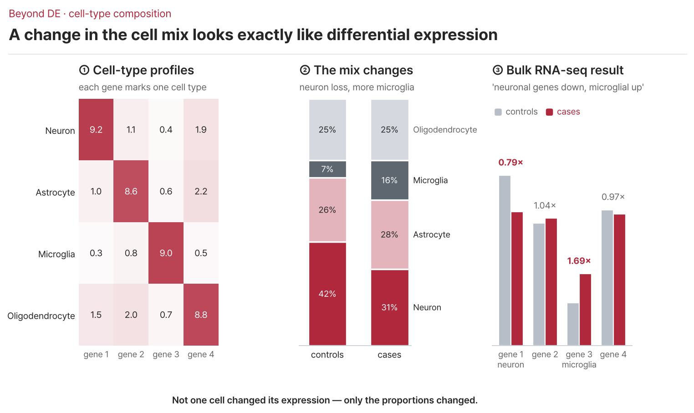{fig-align="center"}

::: {.callout-warning collapse="true"}
## "Neuronal genes down, microglial genes up"

-   🔗 Exactly the confounder from [W3 §5.3](w3_epigenomics.qmd#w3-s5-3), in a different assay
-   → why so many bulk tissue studies report cell-type marker genes as their top hits

**What to do:**

-   ✅ Estimate cell type proportions computationally (CIBERSORTx, MuSiC, BayesPrism — all need a single-cell reference) → include as covariates
-   ✅ Or measure single cells directly (🔗 W5)
:::

## 3) Splicing and isoforms {#w4-s6-3}

-   **Differential expression** — did the gene's total output change?
-   **Differential splicing** — did the *proportions* of its isoforms change?
-   → the second can matter enormously with no change in the first

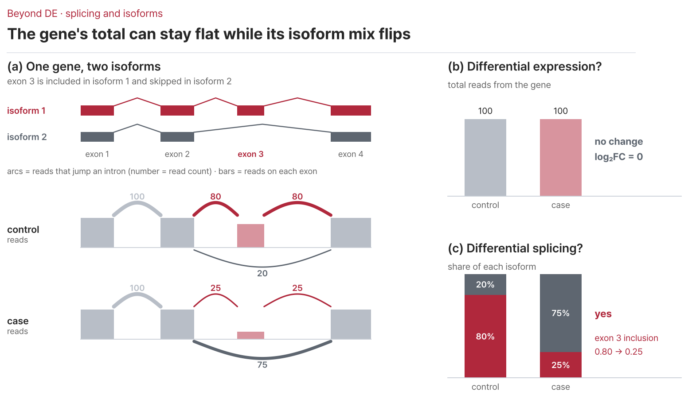{fig-align="center"}

::: {.callout-note collapse="true" icon=false}
## 🔍 Going further — splicing tools and what they need

-   Tools: DEXSeq (exon usage), rMATS and LeafCutter (splicing events)
-   ⚠️ All need more depth and more replicates than gene-level DE. Paired-end reads help substantially
:::

## 4) Expression as a genetic trait {#w4-s6-4}

-   **eQTL** — a genetic variant associated with a gene's expression level
-   **GTEx** — eQTLs across 54 human tissues from hundreds of donors
-   → the main bridge from a non-coding GWAS hit to a candidate gene (🔗 [W2 §4.4](w2_genomics.qmd#w2-s4-4))
-   ⚠️ A caveat that connects all three chapters so far: **eQTLs are tissue- and cell-type-specific** → an eQTL measured in whole blood tells you little about what a variant does in neurons

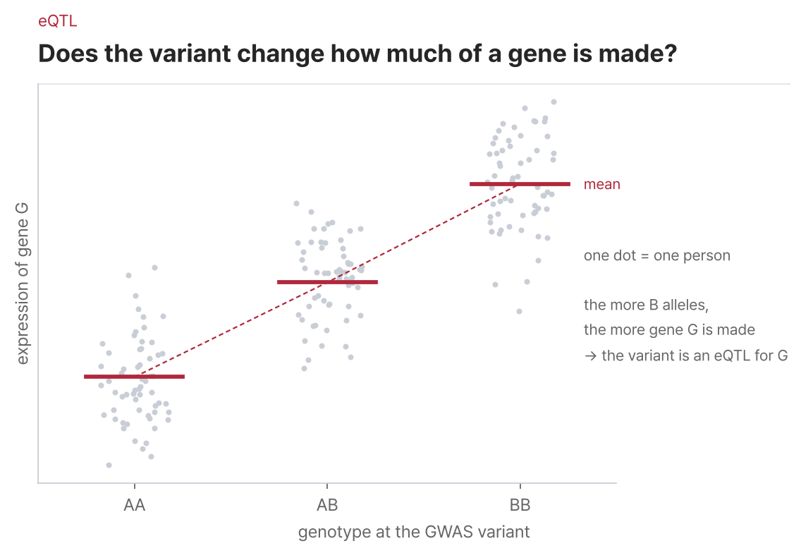{fig-align="center"}

------------------------------------------------------------------------

# 📝 Summary

-   RNA-seq turns RNA into cDNA and counts reads per gene. What it measures = steady-state abundance, in a mixture of cells, at one moment — not synthesis rate, not protein, not any single cell
-   Poly(A) selection = the default; rRNA depletion for FFPE, non-coding RNA and nascent transcription
-   QC step by step: raw reads (FastQC) → alignment (mapping rate, rRNA share, gene-body coverage) → count matrix. Compare with the other samples in the same experiment
-   Pseudo-alignment is fast and accurate for quantification; spliced alignment when read position matters
-   Raw counts are biased by depth, gene length and **composition** → TMM / RLE correct composition = the standard for DE
-   ⚠️ **Never feed normalised values into DESeq2 or edgeR**
-   Before testing, look at the samples with VST or rlog + PCA. Handle a batch effect in the design formula, not by altering the counts
-   DESeq2 = a negative binomial GLM. Counts are overdispersed → a negative binomial model is required. Shrinkage across genes makes small-n analysis possible
-   ⚠️ n = 3 is a convention. Depth saturates around 20–30 M reads; replicates do not
-   The **MA plot** is a better diagnostic than the volcano plot
-   GSEA uses the whole ranked list; ORA throws it away. ⚠️ A wrong background set = the commonest error in enrichment analysis
-   ⚠️ Bulk expression differences are frequently **composition** differences → deconvolve, or go single-cell

------------------------------------------------------------------------

# 🔑 Key terms

| Term | One-line meaning |
|-------------------------|------------------------------------------------|
| Poly(A) selection | Capturing polyadenylated transcripts with oligo-dT |
| rRNA depletion | Removing ribosomal RNA with probes |
| Stranded library | Records which strand a transcript came from |
| Count matrix | Genes × samples table of read counts |
| Gene-body coverage | How reads spread along transcripts from 5′ to 3′; a 3′ pile-up = degraded RNA |
| Library size | Total reads for a sample |
| Composition effect | One gene's rise lowering every other proportion |
| CPM / TPM / FPKM | Depth- and length-normalised expression units |
| TMM / RLE | Composition-aware size factors (edgeR / DESeq2) |
| VST / rlog | DESeq2 transformations that even out the spread across expression levels; for plots and EDA only |
| Batch effect | A systematic difference from processing day or batch, not biology |
| DEG | A gene whose expression differs significantly between conditions |
| Design formula | The variables put into the model (e.g. `~ batch + condition`) |
| log₂ fold change | Effect size on a log scale |
| Volcano / MA plot | Significance vs. effect / effect vs. expression |
| ORA | Fisher test on a thresholded gene list |
| GSEA | Enrichment across a full ranked list |
| Deconvolution | Estimating cell type proportions from bulk data |
| eQTL | Variant associated with a gene's expression |

::: {.callout-note collapse="true" icon=false}
## 🔍 Going further — advanced terms

| Term | One-line meaning |
|-------------------------|------------------------------------------------|
| Spliced alignment | Alignment allowing exon–exon junction gaps |
| Pseudo-alignment | Transcript compatibility without base-level alignment |
| Overdispersion | Variance exceeding the Poisson expectation |
| Dispersion (α) | The extra-Poisson variance parameter |
| GLM | Linear regression's frame plus a count distribution and a log scale |
| Design matrix | The design formula written as 0s and 1s; one coefficient per column |
| Wald test | Tests whether a coefficient is 0 by dividing it by its standard error |
| Shrinkage | Pulling noisy per-gene estimates toward a global trend |
| WGCNA | Clustering genes into co-expression modules |
:::

------------------------------------------------------------------------

# ➕ References

### Best practice and pipelines

Conesa A, et al. [*A survey of best practices for RNA-seq data analysis.*](https://doi.org/10.1186/s13059-016-0881-8) Genome Biol. 2016.\
Stark R, Grzelak M, Hadfield J. [*RNA sequencing: the teenage years.*](https://doi.org/10.1038/s41576-019-0150-2) Nat Rev Genet. 2019.\
Soneson C, Love MI, Robinson MD. [*Differential analyses for RNA-seq: transcript-level estimates improve gene-level inferences.*](https://doi.org/10.12688/f1000research.7563.2) F1000Res. 2015. (tximport)

### Assays beyond RNA-seq

Core LJ, Waterfall JJ, Lis JT. [*Nascent RNA sequencing reveals widespread pausing and divergent initiation at human promoters.*](https://doi.org/10.1126/science.1162228) Science. 2008. (GRO-seq)\
Schwalb B, et al. [*TT-seq maps the human transient transcriptome.*](https://pubmed.ncbi.nlm.nih.gov/27257258/) Science. 2016.\
Herzog VA, et al. [*Thiol-linked alkylation of RNA to assess expression dynamics.*](https://doi.org/10.1038/nmeth.4435) Nat Methods. 2017. (SLAM-seq)\
Ingolia NT, et al. [*Genome-wide analysis in vivo of translation with nucleotide resolution using ribosome profiling.*](https://doi.org/10.1126/science.1168978) Science. 2009.

### QC and quantification

Ewels P, et al. [*MultiQC: summarize analysis results for multiple tools and samples in a single report.*](https://doi.org/10.1093/bioinformatics/btw354) Bioinformatics. 2016.\
Wang L, Wang S, Li W. [*RSeQC: quality control of RNA-seq experiments.*](https://pubmed.ncbi.nlm.nih.gov/22743226/) Bioinformatics. 2012.\
Dobin A, et al. [*STAR: ultrafast universal RNA-seq aligner.*](https://doi.org/10.1093/bioinformatics/bts635) Bioinformatics. 2013.\
Patro R, et al. [*Salmon provides fast and bias-aware quantification of transcript expression.*](https://doi.org/10.1038/nmeth.4197) Nat Methods. 2017.\
Bray NL, et al. [*Near-optimal probabilistic RNA-seq quantification.*](https://doi.org/10.1038/nbt.3519) Nat Biotechnol. 2016. (kallisto)

### Normalization and differential expression

Robinson MD, Oshlack A. [*A scaling normalization method for differential expression analysis of RNA-seq data.*](https://doi.org/10.1186/gb-2010-11-3-r25) Genome Biol. 2010. (TMM)\
Love MI, Huber W, Anders S. [*Moderated estimation of fold change and dispersion for RNA-seq data with DESeq2.*](https://doi.org/10.1186/s13059-014-0550-8) Genome Biol. 2014.\
Love MI, Anders S, Kim V, Huber W. [*RNA-Seq workflow: gene-level exploratory analysis and differential expression.*](https://doi.org/10.12688/f1000research.7035.1) F1000Res. 2015. (VST, PCA, design)\
Robinson MD, McCarthy DJ, Smyth GK. [*edgeR: a Bioconductor package for differential expression analysis of digital gene expression data.*](https://doi.org/10.1093/bioinformatics/btp616) Bioinformatics. 2010.\
Law CW, et al. [*voom: precision weights unlock linear model analysis tools for RNA-seq read counts.*](https://doi.org/10.1186/gb-2014-15-2-r29) Genome Biol. 2014.

### Interpretation

Subramanian A, et al. [*Gene set enrichment analysis.*](https://doi.org/10.1073/pnas.0506580102) PNAS. 2005.\
Liberzon A, et al. [*The Molecular Signatures Database hallmark gene set collection.*](https://pubmed.ncbi.nlm.nih.gov/?term=The+Molecular+Signatures+Database+hallmark+gene+set+collection) Cell Syst. 2015.\
Timmons JA, Szkop KJ, Gallagher IJ. [*Multiple sources of bias confound functional enrichment analysis of global -omics data.*](https://pubmed.ncbi.nlm.nih.gov/?term=Multiple+sources+of+bias+confound+functional+enrichment+analysis+of+global+-omics+data) Genome Biol. 2015.\
Langfelder P, Horvath S. [*WGCNA: an R package for weighted correlation network analysis.*](https://doi.org/10.1186/1471-2105-9-559) BMC Bioinformatics. 2008.

### Deconvolution and eQTL

Newman AM, et al. [*Determining cell type abundance and expression from bulk tissues with digital cytometry.*](https://doi.org/10.1038/s41587-019-0114-2) Nat Biotechnol. 2019. (CIBERSORTx)\
[GTEx Portal](https://gtexportal.org/) · GTEx Consortium. *The GTEx Consortium atlas of genetic regulatory effects across human tissues.* Science. 2020.
