::: {.callout-note collapse="true"}
## 🎯 Learning objectives

By the end of this chapter you should be able to:

-   Tell which questions bulk can answer and which need single cell
-   Name the decisions made at sample preparation (cells vs. nuclei, number of donors)
-   Describe how the count matrix is made and what QC removes
-   Say what clustering and UMAP show — and what they do not
-   ⚠️ Explain why n = the number of donors when comparing conditions (pseudobulk)
-   Read trajectories and cell–cell communication as hypotheses
-   Say what spatial transcriptomics, snATAC-seq and multiome add to scRNA-seq
:::

> 🤔 **Motivating question**\
> Your bulk RNA-seq shows a clean two-fold increase, *p* = 0.001\
> → Is that every cell changing a little, 5% of cells changing a lot, or no cell changing at all?

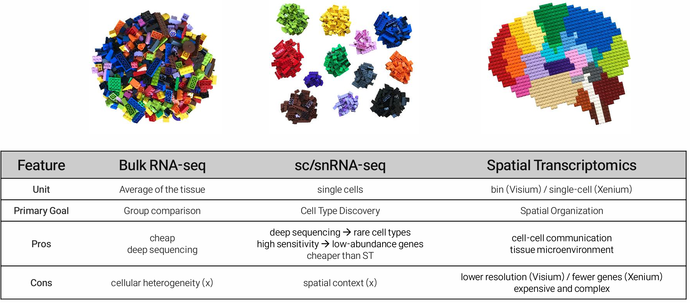{fig-align="center"}

💡 The main text of each section = the basics you need. **🔍 Going further** boxes = deeper material to open when you are curious

------------------------------------------------------------------------

# 1. Why Single Cell 🔬 {#w5-s1}

> 🔑 **Core idea** — bulk = an average. Very different biology can hide behind the same average

## 1) What averaging destroys {#w5-s1-1}

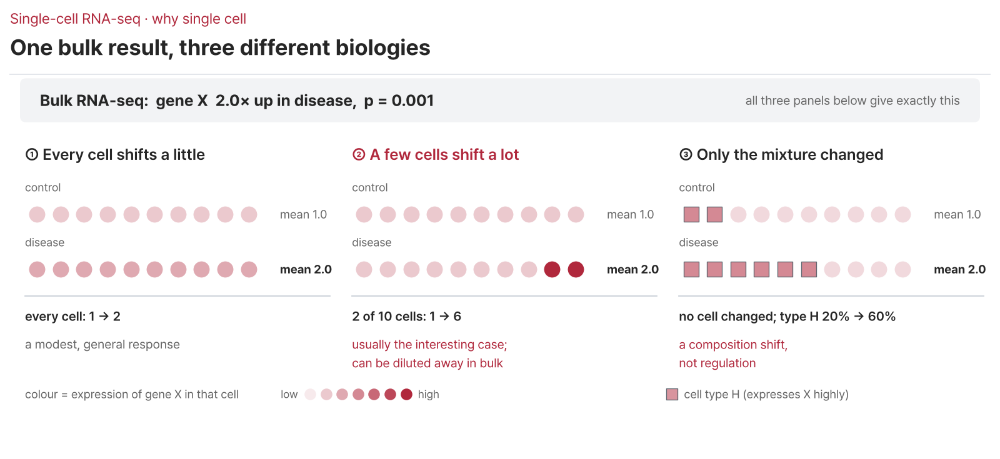{fig-align="center"}

-   **① Every cell changes a little** — the case everyone implicitly assumes
-   **② A few cells change a lot** — usually the interesting case. In bulk it can be diluted to nothing
-   **③ Only the cell mix changes** — no cell changed. There is simply more of a high-expressing cell type

→ Bulk cannot tell these apart; single cell can

::: {.callout-note collapse="true" icon=false}
## 🔍 Going further — ③ composition shifts are more common than you think

-   ⚠️ Common in inflamed, fibrotic or infiltrated tissue — exactly the tissue clinicians study — and routinely written up as if it were ①
-   The same problem in other guises: bulk tissue deconvolution (🔗 [W4 §6.2](w4_transcriptomics.qmd#w4-s6-2)), epigenomics (🔗 [W3 §5.3](w3_epigenomics.qmd#w3-s5-3))
:::

## 2) When to use single cell {#w5-s1-2}

| ✅ Single cell is right for | ✅ Bulk is right for |
|------------------------------------|------------------------------------|
| Finding new or rare cell populations | Comparing homogeneous samples (cell lines, sorted cells) |
| Changes in cell-type proportions | Deep work — isoforms, low-expression genes |
| Responses that differ by cell type | Cohorts with many patients (cost) |

💡 Single cell is expensive → if bulk answers the question, use bulk

::: {.callout-note collapse="true" icon=false}
## 🔍 Going further — continuous states, and sorting before bulk

-   **Continuous states** (differentiation, activation, exhaustion), where discrete categories fail, are another single-cell strength
-   **Cell-type-specific effects** — a gene up in one cell type and down in another → cancels out, invisible in bulk
-   Already know which cell type you care about? → FACS-sort it and run deep bulk RNA-seq. Often **cheaper, deeper, and statistically cleaner**, and you can afford far more patients — which is where your power actually comes from (§5.2)
-   💡 "We did single cell" is not by itself a stronger design. Sometimes it is a more expensive way to be underpowered
:::

------------------------------------------------------------------------

# 2. Before You Sequence 🧫 {#w5-s2}

> 🔑 **Core idea** — every decision the analysis cannot undo is made at sample collection and experimental design

## 1) ⚠️ Cells vs. nuclei {#w5-s2-1}

⚠️ **Decided at collection**, not at analysis

-   **scRNA-seq** — needs **fresh** tissue broken into intact cells with enzymes (dissociation)
-   **snRNA-seq** — reads **nuclei** instead of cells. Works on frozen tissue, and on cells that are hard to dissociate (neurons, adipocytes, cardiomyocytes)

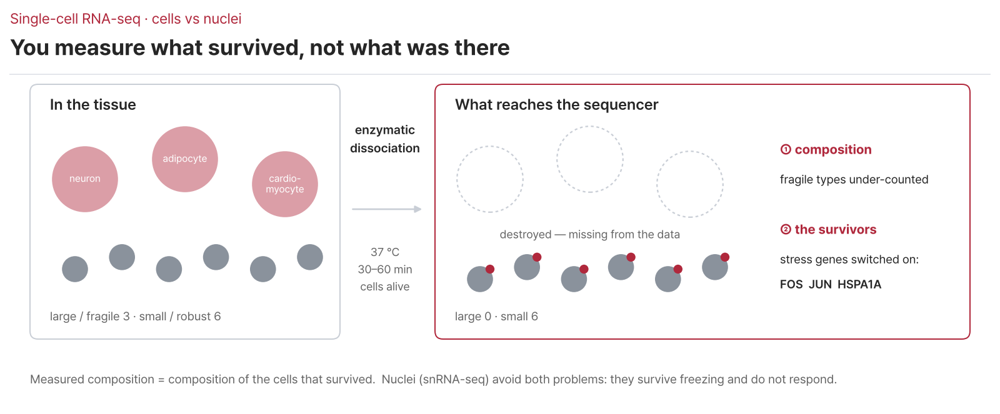{fig-align="center"}

⚠️ Dissociation itself changes the result: stress genes are induced and fragile cells are lost → the composition you measure = **the composition that survived**

::: {.callout-warning collapse="true"}
## Dissociation is an experiment you did not intend to run

**What happens:**

-   Enzymatic dissociation at 37 °C for 30–60 minutes. Cells are alive and responding the whole time → stress-response genes induced
-   ⚠️ Worse — **dissociation is not uniform**. Large or fragile cells such as neurons and adipocytes are destroyed preferentially

**Two consequences worth carrying into a design meeting:**

-   ⚠️ **Immediate-early genes are the classic false positive.** A cluster defined by *FOS*, *JUN* and *EGR1* is very often a dissociation artifact, not an "activated" state. If one condition sat on the bench longer, it will look more activated
-   ⚠️ **Depletion claims need scrutiny.** "Cell type X is depleted in disease" and "cell type X is harder to release from diseased tissue" produce identical data

✅ Mitigations: dissociate at low temperature with a cold-active protease, keep the protocol identical across conditions, and use nuclei when the tissue allows it
:::

::: {.callout-note collapse="true" icon=false}
## 🔍 Going further — scRNA-seq vs. snRNA-seq

|   | scRNA-seq | snRNA-seq |
|------------------------|:----------------------:|:----------------------:|
| Frozen / archived tissue | ❌ needs fresh | ✅ |
| Large or fragile cells (neurons, adipocytes, myofibres, cardiomyocytes) | ❌ lost during dissociation | ✅ |
| Dissociation stress response | ⚠️ yes — *FOS*, *JUN*, heat-shock genes induced by the protocol itself | ✅ minimal |
| Cytoplasmic transcripts | ✅ captured | ❌ missed |
| Fraction of intronic reads | low | high — nuclei are enriched for unspliced pre-mRNA |
:::

## 2) Unit of replication: the donor (biological replicate) {#w5-s2-2}

-   ⚠️ In the statistics, n = **the number of donors (patients) = biological replicates**, not cells (§5)
-   💡 With a fixed budget → **more donors** beats more cells per donor
-   ⚠️ Patients processed one day, controls another → cannot be rescued by analysis (§4.3)

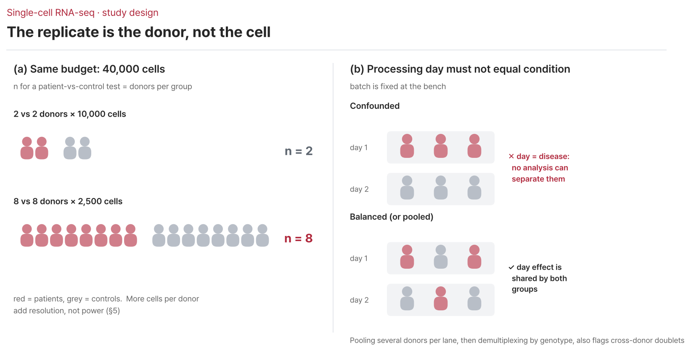{fig-align="center"}

::: {.callout-note collapse="true" icon=false}
## 🔍 Going further — running several samples at once (sample multiplexing)

-   Load several samples mixed in one lane → after sequencing, split them again by sample (demultiplexing)
    -   **By genotype** — each donor's own SNPs: `demuxlet`, `souporcell`, `vireo`. Works only when the samples come from different people
    -   **By hashtag (cell hashing)** — label each sample's cells with an antibody carrying its own oligo, then mix. Also works for several conditions from one person, or inbred animals
-   ✅ What it buys
    -   lane-to-lane batch effects are no longer tied to one condition
    -   doublets made of cells from two samples are identified directly (§4.1⑤) → you can load more cells
-   💡 **Pooling** mixes tissue or RNA from several individuals and reads it **as one sample** → individual information is lost and n = 1. **Multiplexing** mixes them for the run but **splits them again** by barcode or genotype → each individual still counts towards n
:::

------------------------------------------------------------------------

# 3. Sequencing Technology 🧪 {#w5-s3}

> 🔑 **Core idea** — trap one cell in one droplet (or microwell) and tag all of its RNA with the same barcode → every read tells you which cell and which molecule it came from. The price: only part of each cell's RNA is captured

## 1) Platforms {#w5-s3-1}

-   The current default = **droplet-based (10x Genomics)**: each cell is sealed in an oil droplet with one barcoded bead
-   Another option = **microwell-based (BD Rhapsody)**: cells settle by gravity into hundreds of thousands of tiny wells, and each well gets one barcoded bead. No microfluidics, so cells are handled gently
-   Thousands to tens of thousands of cells per run — but only part of each cell's genes is detected
-   Every platform trades **number of cells vs. depth per cell**

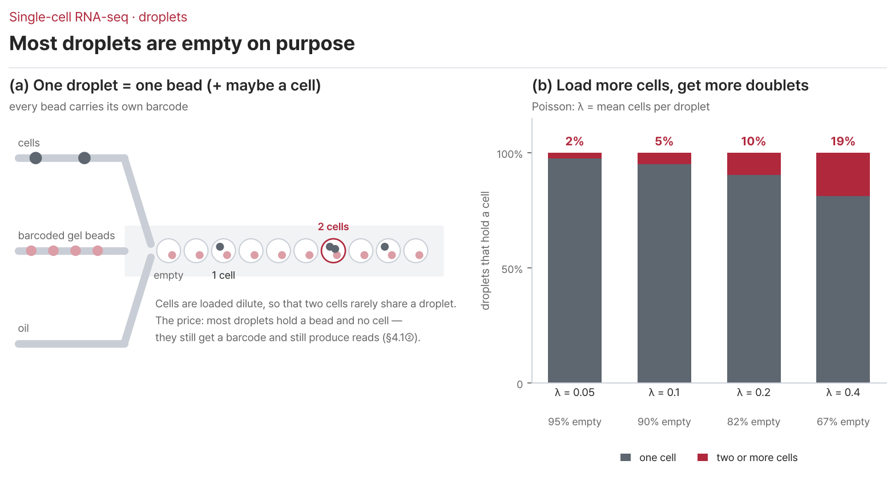{fig-align="center"}

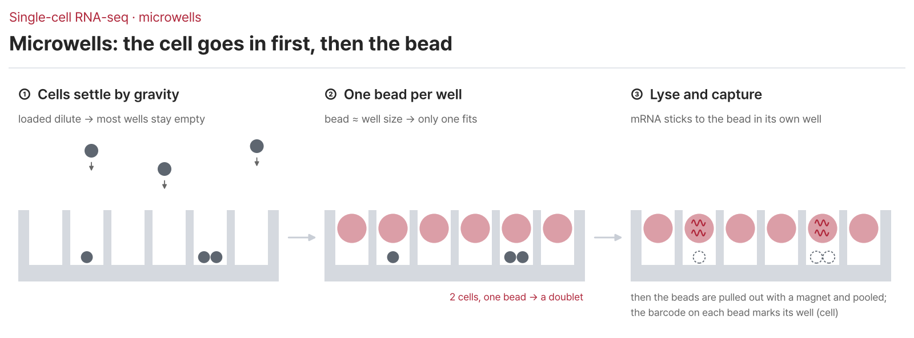{fig-align="center"}

::: {.callout-note collapse="true" icon=false}
## 🔍 Going further — comparing platforms

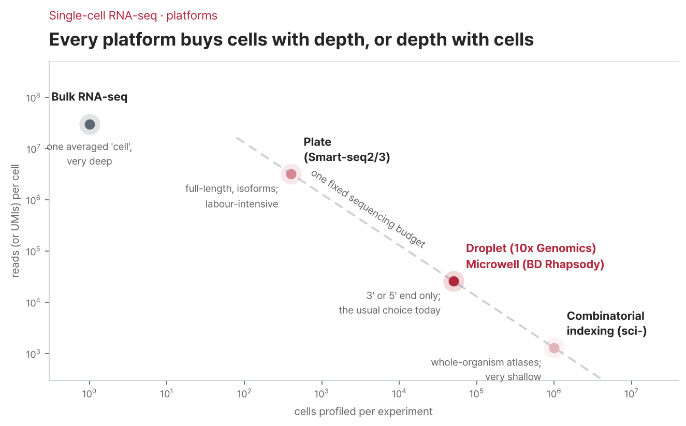{fig-align="center"}

| Platform | How it works | Cells | Depth | When |
|-------------------|-------------------|-----------|-------------------|-------------------|
| **Droplet (10x Genomics)** | one cell + one barcoded bead in an oil droplet | 10³–10⁵ | a few thousand genes/cell, 3′ or 5′ end only | the current default |
| **Microwell (BD Rhapsody)** | cells settle by gravity into hundreds of thousands of microwells; one barcoded bead per well | 10³–10⁵ | a few thousand genes/cell, 3′ end (whole transcriptome) or a targeted panel (hundreds of genes, deeper) | gentle handling without microfluidics; when a targeted panel is enough |
| **Plate (Smart-seq2/3)** | one cell per well | 10² | full-length, deep | isoforms, very sensitive detection |
| **Combinatorial indexing (sci-, SPLiT-seq)** | no physical isolation; barcode combinations built by rounds of split-pool | 10⁶ | very shallow | whole-organism atlases |
:::

## 2) Barcodes and UMIs {#w5-s3-2}

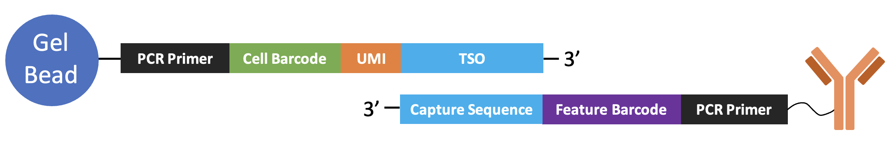{fig-align="center"}

Every read carries two tags:

-   **Cell barcode** — which cell it came from
-   **UMI** — which original mRNA molecule it came from → reads multiplied by PCR are counted as one molecule

→ Count matrix = number of **molecules** per cell × gene

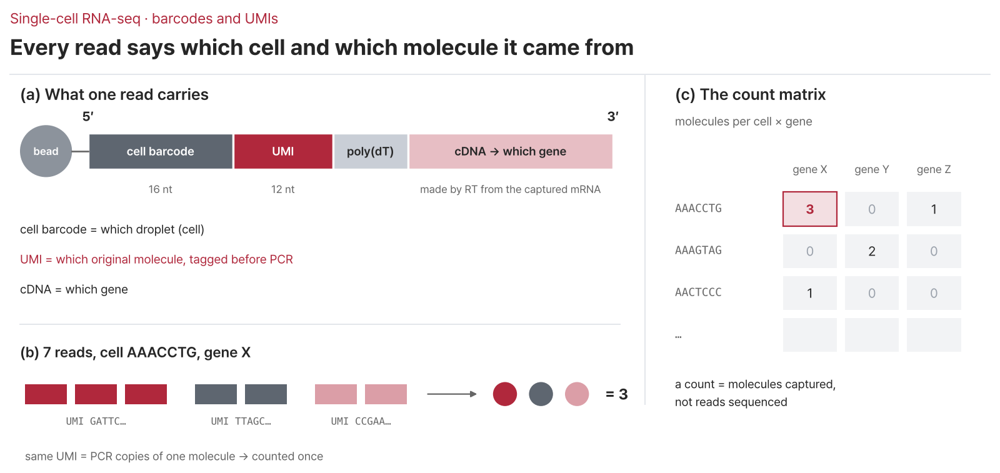{fig-align="center"}

::: {.callout-note collapse="true" icon=false}
## 🔍 Going further — the TSO, and what UMIs cannot fix

-   **TSO (template switching oligo)** — when reverse transcriptase (RT) reaches the 5′ end of the mRNA, it adds a few extra Cs to the cDNA → a TSO ending in GGG pairs with them, and RT switches to the TSO as a new template and keeps copying (template switching) → the cDNA now carries a known sequence at both ends → PCR can amplify the whole cDNA
-   **3′ kits** — barcode and UMI sit next to poly(dT) (panel a above). The TSO is a separate reagent → the 3′ end of the transcript is read
-   **5′ kits** — barcode and UMI sit **on the TSO** on the bead (the bead diagram above) → the barcode joins the 5′ end of the transcript → the 5′ end is read. TCR/BCR variable regions lie near the 5′ end, hence 5′ kits for them (§3.3)
-   ⚠️ What UMIs cannot fix: a molecule that was never captured gets no UMI at all → hence the zeros below
:::

## 3) 3′ vs. 5′ {#w5-s3-3}

-   Droplet kits read only the **3′ or 5′ end region** of each transcript, not the full length → enough to count genes
-   ⚠️ This is not single-end sequencing — the run itself is **paired-end**: Read 1 = cell barcode + UMI, Read 2 = cDNA. The cDNA is read by Read 2 alone, and Read 2 comes from near one end of the transcript (🔗 [W1 §2.1②](w1_intro.qmd#w1-s2-1-2))
-   Most data is **3′**. Need T/B cell receptor (TCR/BCR) sequences? → **5′**

::: {.callout-note collapse="true" icon=false}
## 🔍 Going further — why only one end of the transcript is read

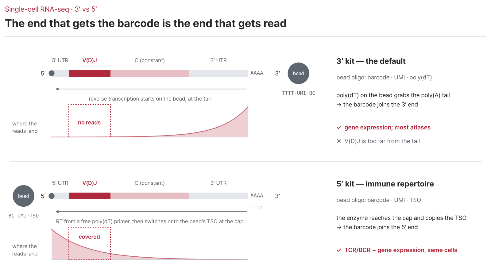{fig-align="center"}

-   The end that carries the barcode = the end that gets read
-   ✅ **3′** — most public atlases. ✅ **5′** — when you need clonotypes: tumour immunology, autoimmunity, vaccine responses
-   ⚠️ For gene counting the two are broadly similar, but **not interchangeable within one comparison** — 3′ and 5′ samples mixed in one study are a batch effect by design
-   💡 Fixed or FFPE samples: probe-based kits (10x Flex), which hybridise probes instead of capturing the poly(A) tail
:::

## 4) Sparsity and dropout {#w5-s3-4}

-   Each cell shows only 1,000–5,000 of \~20,000 genes
-   A zero means either **not expressed**, or **there but not captured (dropout)** — droplet capture efficiency is \~10–30%
-   ⚠️ **A single zero in one cell does not mean the gene is off**

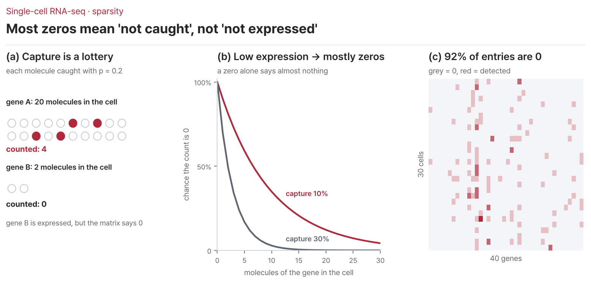{fig-align="center"}

::: {.callout-note collapse="true" icon=false}
## 🔍 Going further — how zeros are modelled, and "zero inflation"

-   UMI counts are usually modelled with a **negative binomial (NB)** (🔗 [W4 §4.3③](w4_transcriptomics.qmd#w4-s4-3-3)). For cell *c* and gene *g*, the mean μ = (how much of the cell was captured, *s~c~*) × (the gene's share of expression, *q~g~*)
-   The chance of a zero under each model:

$$
\begin{aligned}
\text{Poisson:}\quad & P(Y=0) = e^{-\mu} \\
\text{NB (variance } \mu + \alpha\mu^2\text{):}\quad & P(Y=0) = \left(\frac{1}{1+\alpha\mu}\right)^{1/\alpha} \\
\text{ZINB:}\quad & P(Y=0) = \pi + (1-\pi)\left(\frac{1}{1+\alpha\mu}\right)^{1/\alpha}
\end{aligned}
$$

-   A feel for it (Poisson): μ = 0.1 → a 90% chance of zero, μ = 1 → 37%, μ = 5 → 0.7% → a lowly expressed gene is zero in most cells **with no extra cause**
-   **ZINB** assumes "more zeros than the NB predicts" and adds a separate zero-making process (probability π) = **zero inflation**
-   💡 For UMI data the NB alone largely explains the zeros → π ≈ 0 (Svensson 2020), so the field has largely moved on from calling this "zero inflation". Read-based data without UMIs (Smart-seq2 etc.) can behave differently
:::

------------------------------------------------------------------------

# 4. Pre-processing 🧮 {#w5-s4}

> 🔑 **Core idea** — the count matrix (a cells × genes table) is not a raw measurement. It is the **result of decisions** that filter out empty droplets, floating RNA, two-cell droplets and dying cells

💡 This course focuses on **what each step decides**, not on how to run the tools. Hands-on analysis comes in next semester's practical course

{fig-align="center"}

## 1) Quality control {#w5-s4-1}

-   Check each step separately, in pipeline order: reads and alignment → empty droplets → ambient RNA → individual cells → doublets

Four things QC removes:

| Problem | What it is |
|------------------------|------------------------------------------------|
| **Empty droplets** | droplets with a bead but no cell — most droplets |
| **Ambient RNA** | RNA from burst cells ("soup") that gets into every droplet |
| **Doublets** | two cells in one droplet → look like one cell |
| **Dying cells** | broken membrane → high fraction of mitochondrial reads (mito %) |

### ① Sequencing reads and alignment {#w5-s4-1-1}

-   Cell Ranger (or STARsolo; for BD Rhapsody data, the BD Rhapsody Sequence Analysis Pipeline) aligns reads to the transcriptome and counts them by barcode and UMI → start with its summary report (web summary)
-   **Valid barcodes**, **reads mapped to the transcriptome**, **fraction of reads in cells**, **sequencing saturation** (how often the same molecule has already been read), **median genes per cell**
-   ⚠️ One sample lower than the rest → suspect that sample's dissociation or loading first

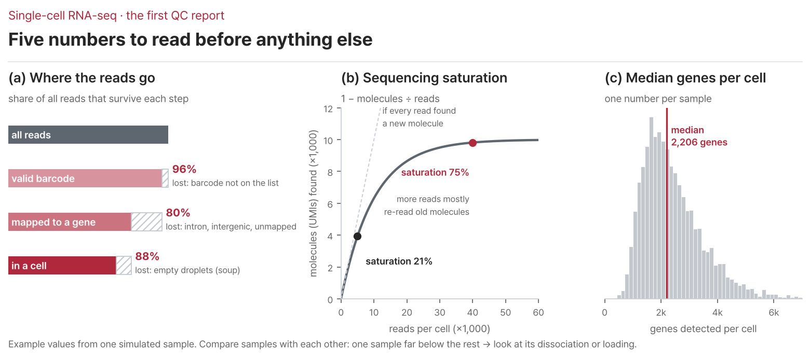{fig-align="center"}

### ② Empty droplets {#w5-s4-1-2}

-   Cells are loaded dilute on purpose → most droplets get a bead and no cell (and still get a barcode) → keep only the barcodes that hold a real cell (**cell calling**)
-   **Knee plot (barcode rank plot)** — rank every barcode by total UMI count and plot on log–log axes
    -   high, flat **plateau** = real cells / steep drop (**the knee**) = the transition / long low **tail** = empty droplets
-   **Setting the cut (Cell Ranger)**
    -   ① at or above a big cell's UMI count (the 99th percentile of the top N, N = expected cells) divided by 10 → a cell, no test needed
    -   ② each barcode below that is tested with **EmptyDrops** — not "is the total high?" but "is this barcode's **profile** different from an empty droplet's (the soup)?" → a small cell with a distinct profile is kept
-   ⚠️ A hard cut at the knee deletes real cells that simply have little RNA (small or quiescent cells, neutrophils)

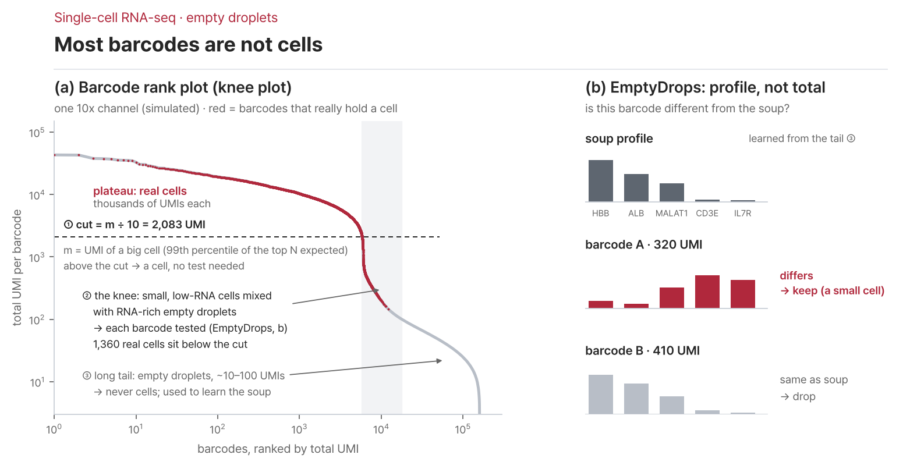{fig-align="center"}

💡 **Keep the raw matrix**, empty droplets included — ambient RNA correction needs them

::: {.callout-note collapse="true" icon=false}
## 🔍 Going further — CellBender, and cell calling in BD Rhapsody

**CellBender** (`remove-background`)

-   A deep generative model that treats each droplet's counts as the cell's own RNA + ambient RNA (soup) + technical noise, and estimates all three at once
-   Two outputs: for each barcode, the **probability that it is a cell** (cell calling) + a **corrected count matrix** with the soup removed (ambient RNA, §4.1③)
-   Input = the raw matrix, empty droplets included. You give the expected number of cells and how many droplets to include. A GPU is recommended
-   ⚠️ Check rather than trust: did the soup markers (e.g. haemoglobin) drop, and did the real markers stay?

**BD Rhapsody** (BD Rhapsody Sequence Analysis Pipeline) — microwells are also mostly empty, so cell calling is needed too, but it works differently

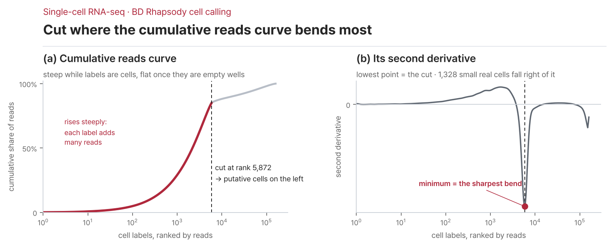{fig-align="center"}

-   Rank cell labels (barcodes) by reads and draw the **cumulative reads curve** → it rises steeply while the labels are cells and flattens once they are empty wells
-   The point where the curve bends most = **where its second derivative is lowest** → labels to the left = cells (the basic algorithm)
-   If there are several bends, the one nearest the **expected cell count** is chosen → giving this value is recommended
-   Optional: the refined algorithm repeats the analysis on highly variable genes, removing false cells and recovering cells with few molecules
-   ⚠️ In the end it finds the knee → like a hard cut on a knee plot, it can miss small cells
:::

### ③ Ambient RNA {#w5-s4-1-3}

-   RNA leaking from burst cells ("soup") gets into every droplet in small amounts
-   The sign: one cell type's markers detected at low levels in **every** cluster → remove with CellBender or SoupX

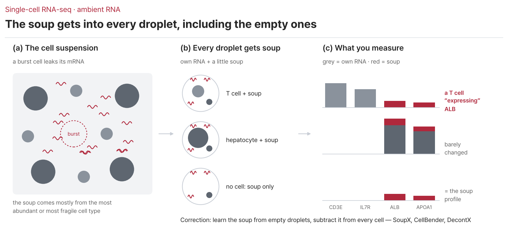{fig-align="center"}

::: {.callout-note collapse="true" icon=false}
## 🔍 Going further — ambient RNA in detail

Cells that burst during dissociation and loading release their mRNA into the suspension. This **"soup"** gets into every droplet → every cell's profile = its own RNA + a little soup

-   **What it looks like** — markers of the most abundant or most fragile cell type at low level in **every** cluster. E.g. haemoglobin genes in every cell of a bloody sample, *ALB* in the immune cells of a liver
-   **Why it matters** — false co-expression, blurred cluster boundaries, and ⚠️ false DE when one condition releases more soup (diseased, necrotic tissue usually does)
-   **Correction** — estimate the soup profile from empty droplets and subtract it from each cell: `SoupX`, `CellBender`, `DecontX`
-   ⚠️ **Worst in snRNA-seq** (isolating nuclei lyses every cell). Well-based platforms (BD Rhapsody, Smart-seq) capture far less, but not zero
:::

### ④ Dying cells {#w5-s4-1-4}

-   Three numbers per cell: **total UMIs**, **genes detected**, **mitochondrial fraction (mito %)**
-   A cell with a broken membrane → few genes and a high mito %

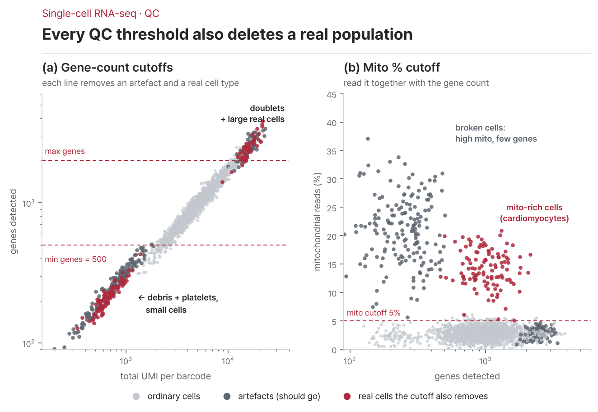{fig-align="center"}

⚠️ **Every QC threshold also removes a real cell population** → set thresholds per tissue, and report them

::: {.callout-important collapse="true"}
## Examples: what each threshold also deletes

-   A mito cutoff of 5% is conventional — and **wrong for cardiomyocytes**, which are genuinely mitochondria-rich → set it per tissue and cell type
-   A minimum of 500 genes removes debris — **and also** small, low-RNA cells such as platelets and some granulocytes
-   An upper gene-count cutoff removes doublets — **and also** genuinely large, transcriptionally active cells

→ QC cannot be automated. Plot the distribution, look at what sits outside your proposed cut, then decide
:::

::: {.callout-note collapse="true" icon=false}
## 🔍 Going further — reading the three numbers

| Metric | Too low → | Too high → |
|------------------|------------------------|------------------------------|
| Total UMIs | empty droplet, debris, broken cell | doublet — or a large, transcriptionally active cell |
| Genes detected | as above | as above |
| Mitochondrial % (mito %) | — | dying cell — or a genuinely mitochondria-rich one |

**Why does a high mito % mean a dying cell?** When the membrane breaks, cytoplasmic mRNA leaks out, but transcripts inside mitochondria are protected by the mitochondrial membrane and stay → the **fraction** rises (the cell did not make more)

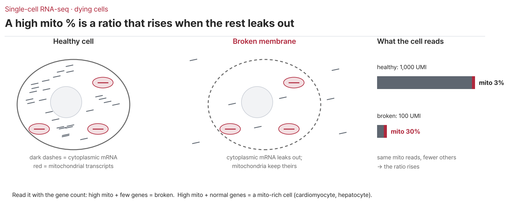{fig-align="center"}

-   ⚠️ **Read them together.** High mito **and** few genes = broken cell. With a normal gene count it may be a genuinely mitochondria-rich cell (cardiomyocyte, hepatocyte, renal tubule)
-   ⚠️ **snRNA-seq**: nuclei contain no mitochondria → mito reads near zero is normal
-   ✅ **Data-driven cutoffs, per sample, rather than a fixed number** — there are several ways to flag cells that sit outside the distribution
    -   median ± *n* × MAD (median absolute deviation, often *n* = 3–5) — less swayed by extreme values
    -   mean ± *n* × SD, or upper and lower percentiles
    -   splitting cells into two groups — k-means (*k* = 2), mixture models (`miQC`: models mito % and genes detected together)
    -   ⚠️ Whatever the method, plot the distribution and check where the cut lands
:::

### ⑤ Doublets {#w5-s4-1-5}

-   Two cells in one droplet → markers of two cell types together → looks like an "in-between" cell type that does not exist
-   **The core idea** — we never see which barcodes are doublets → instead we **make** fake doublets, then ask which real cells look like them (scDblFinder, DoubletFinder)

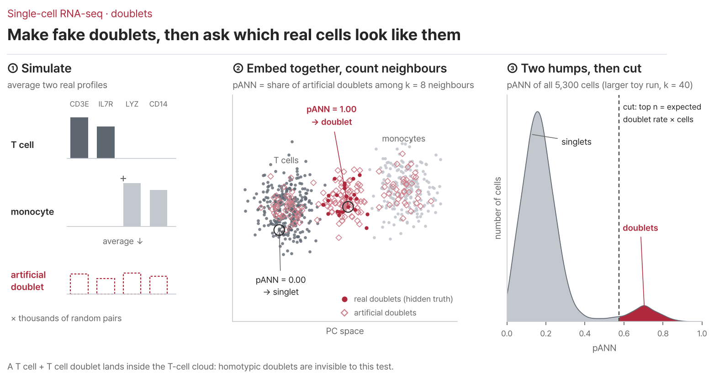{fig-align="center"}

1.  **Simulate** — mix the profiles of random pairs of real cells into thousands of artificial doublets
2.  **Embed together** — real + artificial cells in the same space
3.  **Count neighbours** — a real cell whose neighbours are mostly artificial doublets (high pANN) → probably a doublet. The pANN distribution has two humps → cut from the top at the expected number of doublets

::: {.callout-note collapse="true" icon=false}
## 🔍 Going further — how doublets are found

-   The rate rises with loading: \~0.8% per 1,000 cells recovered on standard 10x → **10,000 cells → \~8% doublets**

|   | **Heterotypic** | **Homotypic** |
|--------------|--------------------------------|--------------------------|
| Made of | two different cell types (T cell + monocyte) | two cells of the same type |
| Looks like | markers of both types; a fake "intermediate" cluster | one cell with \~2× the counts |
| Detectable from expression | ✅ yes | ❌ almost never |
| Damage | ⚠️ invents cell types and transitions | mild |

-   Tools: `scDblFinder` (a common default now), `DoubletFinder`. Run per sample (capture)
-   ⚠️ Homotypic doublets survive every expression-based method
-   ⚠️ A doublet cluster sits between its two parents and is easily named a transitional state
-   💡 **Design beats algorithms** — with sample multiplexing + demultiplexing (§2.2), every between-sample doublet is identified directly
:::

## 2) Normalisation and dimensionality reduction {#w5-s4-2}

-   Each cell yields a different total amount of RNA → **normalisation** evens this out
-   Keep \~2,000 highly variable genes → **PCA** summarises them into a few dozen axes
-   Each PC = a group of genes that move together (a program) → every later step runs on these summaries

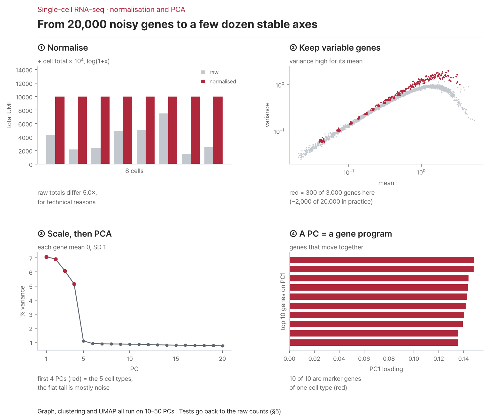{fig-align="center"}

::: {.callout-note collapse="true" icon=false}
## 🔍 Going further — what each step does

| Step | What it does | Why |
|------------|--------------------------|----------------------------------|
| **Normalise** | divide by the cell's total UMIs, × 10,000, then log(1 + x) | capture efficiency differs several-fold between cells for technical reasons; the log tames a few huge values |
| **Select HVGs** | keep \~2,000 genes whose variance exceeds what their mean predicts | most genes are flat or noise; HVGs carry the cell-type signal |
| **Scale** | per gene: subtract the mean, divide by the SD | so a highly expressed gene does not dominate PCA simply by being large |
| **PCA** | 2,000 HVGs → 10–50 principal components | below |

-   **Denoising** — single genes are noisy; correlated programs are stable. Top PCs carry biology, later ones mostly noise
-   ✅ **Check what drives the top PCs.** If PC1 tracks total UMIs or mito %, your main axis of variation is technical → back to QC
-   ⚠️ Several versions of the same matrix now exist: raw counts, log-normalised, scaled (+ batch-corrected later) → tests use raw counts (§5)
:::

**Try it** — [PCA and SVD: low-rank approximation ↗](https://kkonoo.github.io/edu_sims/sims/pca-svd/?lang=en){target="_blank"}

::: {.column-page}
```{=html}
<iframe src="https://kkonoo.github.io/edu_sims/sims/pca-svd/?embed=1&lang=en" title="PCA and SVD: low-rank approximation" loading="lazy"
        style="width: 100%; height: 1300px; border: 0;"></iframe>
```
:::

## 3) Batch effects and integration {#w5-s4-3}

-   Combine samples from several patients and cells often group **by patient (batch)** before cell type
-   **Integration** (Harmony, scVI, …) = aligning samples so the same cell type from different patients sits together
-   ⚠️ Align too hard and you **erase real differences (disease-specific cells)** → always colour by batch **and** by cell type to check
-   💡 Integration assumes "all differences between batches are technical" → that assumption breaks exactly when the biology gets interesting

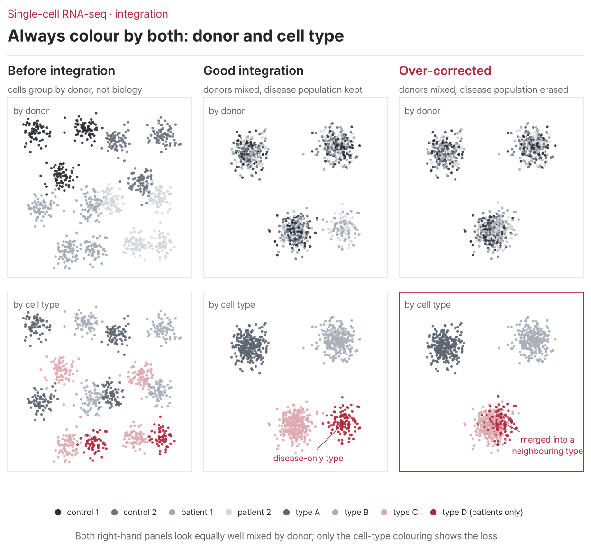{fig-align="center"}

⚠️ Patients processed one day, controls another → **no integration method can separate them** (🔗 [W1 §4.3](w1_intro.qmd#w1-s4-3))

::: {.callout-warning collapse="true"}
## Over-correction

⚠️ Integration's assumption fails exactly when the biology is interesting:

-   a disease-specific cell state
-   a population present only in one condition
-   a treatment-induced program

→ Aggressive integration merges it away, and the resulting UMAP looks **beautifully mixed**

**Diagnostics:**

-   ✅ Colour by batch **and** by cell type — and put both in the paper
-   ✅ Check that known markers still separate after integration
-   ✅ Check whether a population unique to one condition **survived**

⚠️ Most papers show only the batch colouring — the figure that shows the method worked, and the one that can never show it failed
:::

::: {.callout-note collapse="true" icon=false}
## 🔍 Going further — how integration works

-   Correction works on the **embedding** (PCs etc.), not on the counts → used for the neighbour graph, clustering and UMAP
-   ✅ **Check first whether you need it** — colour the uncorrected UMAP by sample. If cell types already mix across samples, skip it
-   ⚠️ **Corrected values are for grouping cells, not for testing genes.** DE goes back to raw counts (§5.2)
-   ✅ Benchmarks such as **scIB** score the batch-removal vs. biology-preservation trade-off
-   💡 "Patients and controls perfectly mixed on the UMAP" and "a disease-specific cell state" in the same paper → the two claims are in tension. Check the cell-type colouring
:::

**Try it** — [Confounding and batch effects ↗](https://kkonoo.github.io/edu_sims/sims/confounding/?lang=en){target="_blank"}

::: {.column-page}
```{=html}
<iframe src="https://kkonoo.github.io/edu_sims/sims/confounding/?embed=1&lang=en" title="Confounding and batch effects" loading="lazy"
        style="width: 100%; height: 1300px; border: 0;"></iframe>
```
:::

## 4) Clustering and annotation {#w5-s4-4}

-   Group cells with similar expression (clustering), show them as a 2D picture (UMAP), and name them (annotation). All three are products of choices

**Link neighbours → group (clustering) → picture (UMAP) → name (annotation)**

⚠️ UMAP is only a picture for display. Clustering is done on the data from the earlier step, not on the UMAP

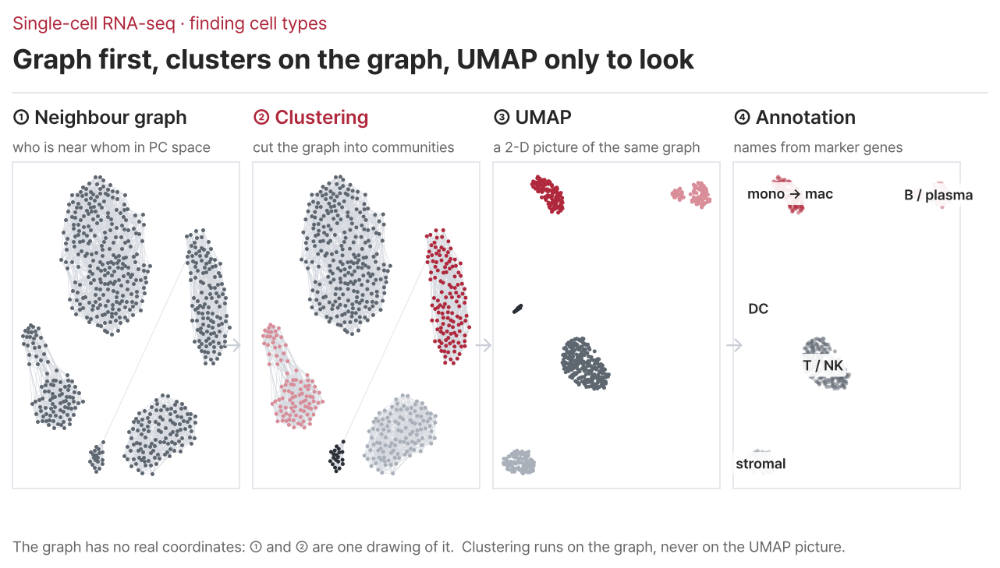{fig-align="center"}

### ① The neighbour graph {#w5-s4-4-1}

-   For each cell, find the few (*k*) cells with the most similar expression and draw a line to each → a network (graph) where cells are points and similarity is a line
-   💡 Clustering and UMAP both start from this graph — neither looks at genes directly

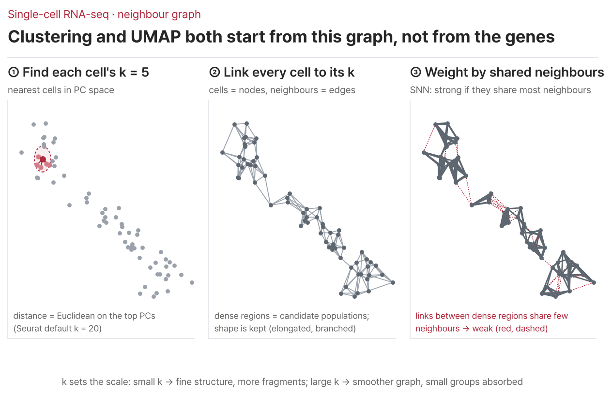{fig-align="center"}

::: {.callout-note collapse="true" icon=false}
## 🔍 Going further — the neighbour graph in detail

-   **kNN graph** — cells are nodes; each cell is linked to its *k* nearest neighbours in PC space. Seurat reweights each link by how many neighbours the two cells **share** (SNN graph) → damps outliers
-   **Why a graph?** — cell populations are rarely round blobs. A graph follows the shape of the data, including elongated, branching and continuous populations
-   ⚠️ *k* sets the scale. Small *k* → fine structure, more fragments. Large *k* → a smoother graph, and a population smaller than *k* gets absorbed
:::

### ② Clustering and resolution {#w5-s4-4-2}

-   Clustering = finding groups of cells densely linked in the neighbour graph
-   The **resolution** value changes how many clusters you get

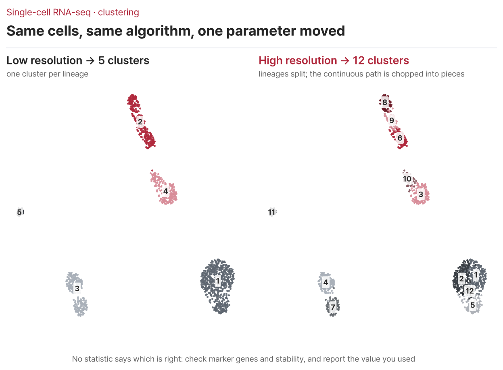{fig-align="center"}

⚠️ **There is no correct resolution** → check against marker genes and known biology, and report the value you used

::: {.callout-warning collapse="true"}
## A cluster is not a cell type

Clusters can equally reflect:

-   cell **state** (activated vs. resting)
-   cell cycle phase
-   stress response (dissociation, §2.1)
-   ambient contamination, doublets (§4.1)
-   **donor identity** (differences between individuals)

→ Naming a cluster after its top marker and treating it as a cell type is how the literature accumulates **cell types that do not exist**. Be especially careful with "novel cell type" claims
:::

::: {.callout-note collapse="true" icon=false}
## 🔍 Going further — clustering algorithms and choosing a resolution

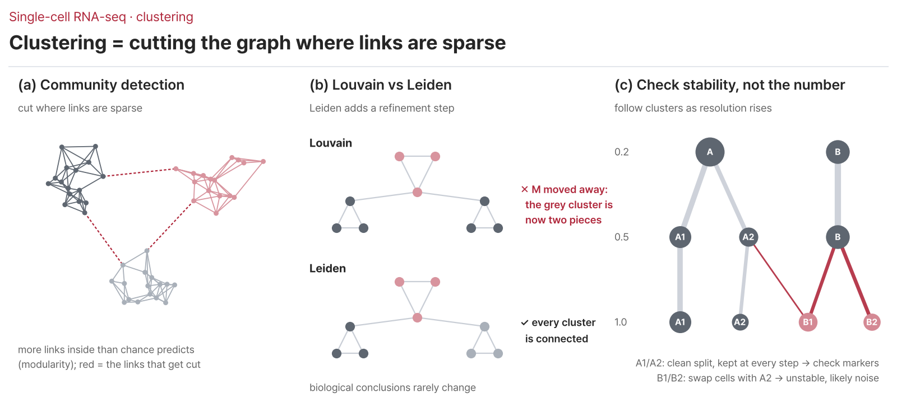{fig-align="center"}

-   **Community detection** — cut the graph into groups more densely linked to each other than chance predicts
-   **Louvain vs. Leiden** — Leiden fixes Louvain's flaw (internally disconnected clusters). The biological conclusion rarely changes

💡 Instead of agonising over the value, check:

-   **Stability** — does the cluster survive a different resolution, a different seed, a subsampled dataset?
-   Does a "new" cluster at higher resolution have genuinely distinct markers, or just gradations of the same ones?
:::

### ③ ⚠️ UMAP {#w5-s4-4-3}

-   UMAP = a **picture** that flattens high-dimensional data into 2D
-   ✅ Cells sitting close together being similar — fairly trustworthy
-   ❌ **Distances** between clusters, cluster **sizes**, and thin **bridges** between them — not interpretable
-   → A claim that matters needs a number, not a UMAP

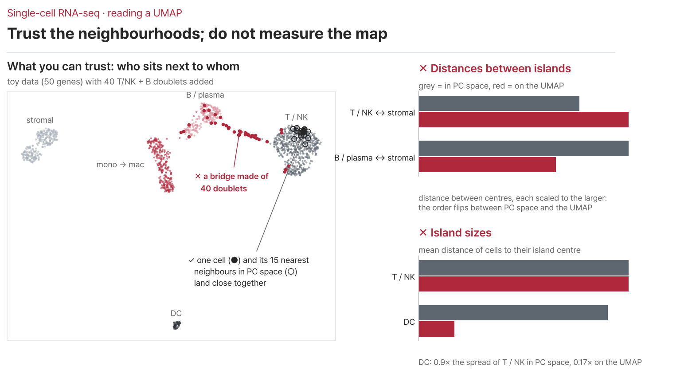{fig-align="center"}

::: {.callout-note collapse="true" icon=false}
## 🔍 Going further — why UMAP became the default, and PCA / t-SNE

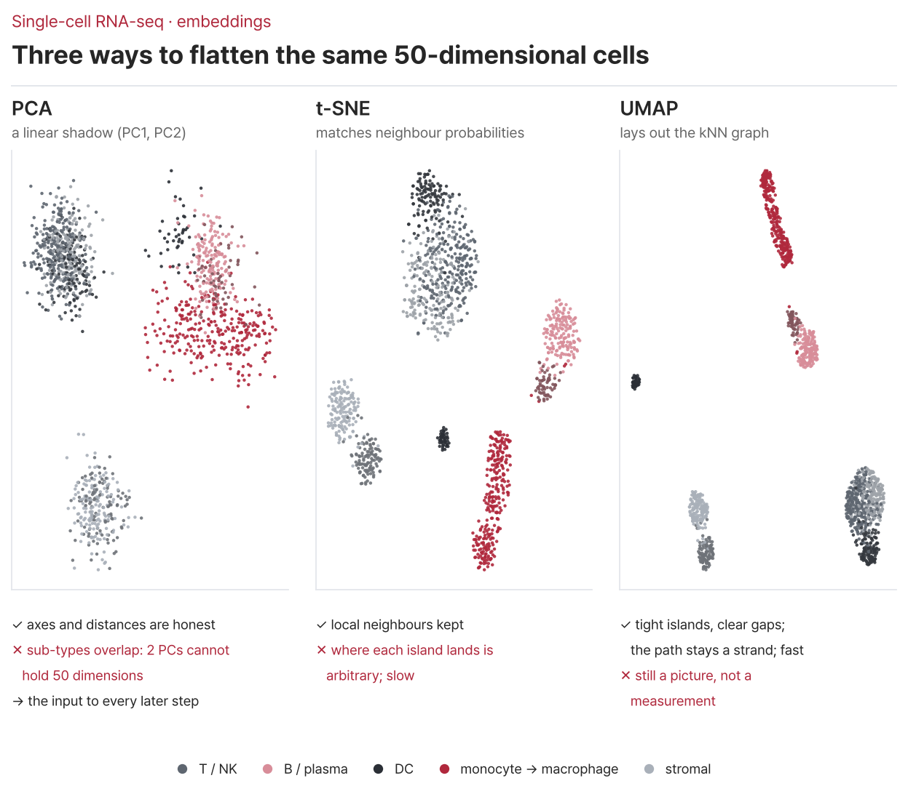{fig-align="center"}

-   **PCA** — linear, distances are meaningful. The input to everything downstream, but too coarse to *see* clusters
-   **t-SNE** (the standard before UMAP)
    1.  In high dimensions, compute for every pair of cells a "probability of being neighbours" (Gaussian → high only for close neighbours)
    2.  Scatter the points at random in 2D (current tools often start from the PCA layout instead)
    3.  Move the points step by step until the 2D neighbour probabilities (a heavy-tailed *t*-distribution) match the high-dimensional ones
    -   The heavy tail pushes non-neighbours far apart → clusters separate. Local neighbourhoods are kept well; where clusters land and how far apart they are is arbitrary
    -   Tendency: clusters of similar size that fill the space evenly, roughly a round cloud overall
-   **UMAP** — lays out **the same kNN graph** used for clustering → islands usually match clusters. Fast
    -   Attraction is relatively stronger than in t-SNE → tighter clumps with wider empty gaps between islands
    -   Its default start is not random but a layout computed from the graph (spectral) → large-scale structure tends to survive a little better
-   💡 Most of the difference is **settings** (the starting layout, how strongly points attract), not the algorithm — t-SNE started from PCA with stronger attraction looks like UMAP
-   ⚠️ Bridges are often doublets, ambient RNA or parameter artifacts. The layout changes with parameters and random seed (`n_neighbors`, `min_dist`). No method turns a 2D distance into a measurement
:::

### ④ Annotation {#w5-s4-4-4}

-   **Marker-based** — name clusters by known marker genes
-   **Reference-based** — map onto an atlas that is already labelled (Azimuth, SingleR)
-   💡 Use both. Where they disagree → a new population, or an artifact

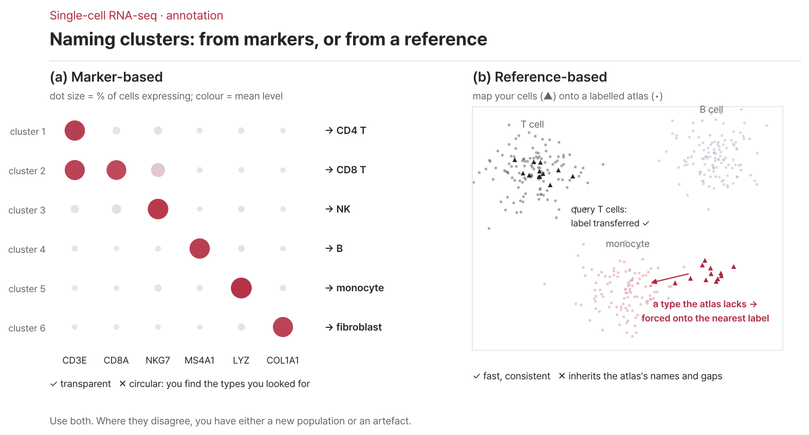{fig-align="center"}

::: {.callout-note collapse="true" icon=false}
## 🔍 Going further — strengths and weaknesses

-   **Marker-based** — ✅ transparent. ⚠️ circular — you find the cell types you looked for
-   **Reference-based** (Azimuth, SingleR, scANVI) — ✅ fast and consistent. ⚠️ inherits the reference's vocabulary; cannot name anything the reference lacks
-   🗺️ Reference-based annotation is the single-cell form of **reference bias** (🔗 [W1 §2.3③](w1_intro.qmd#w1-s2-3-3)) — a cell type absent from the atlas becomes invisible, or is mislabelled as its nearest neighbour
:::

------------------------------------------------------------------------

# 5. Statistical Testing 📊 {#w5-s5}

> 🔑 **Core idea** — n = the number of **donors**, not cells. Sequencing more cells buys resolution, never power

## 1) ⚠️ Pseudoreplication {#w5-s5-1}

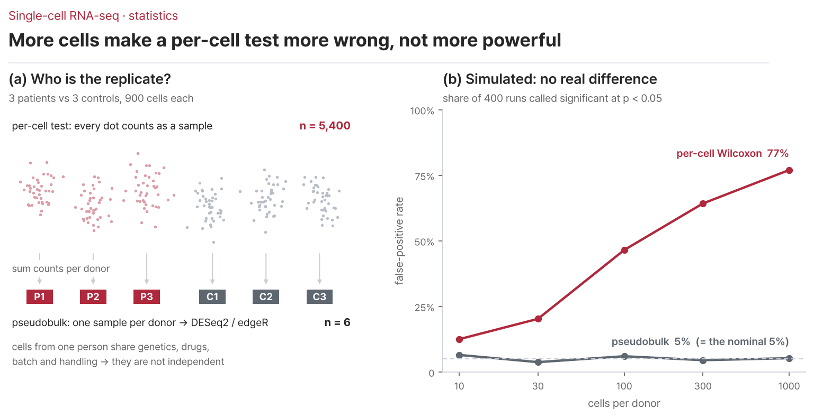{fig-align="center"}

-   Testing thousands of cells as independent samples → cells from one person are not independent → p-values become unrealistically small = **pseudoreplication**
-   Add more cells and the p-value keeps shrinking → you are measuring **how many cells you loaded**, not how many people you studied

::: {.callout-important collapse="true"}
## Cells from one donor are not independent samples

-   A Wilcoxon or t-test across 5,400 cells from 6 donors → treats those cells as 5,400 independent observations
-   **They are not independent** — cells from the same person share that person's genetics, environment, medication, batch, and processing
-   → p-values inflated by many orders of magnitude

⚠️ Seurat's default `FindMarkers` behaves this way

-   ✅ Fine for *identifying cluster markers within one dataset* — a descriptive task
-   ❌ **Comparing conditions** — invalid
:::

## 2) Pseudobulk {#w5-s5-2}

-   Sum the counts for each **sample (donor) × cell type** → analyse with DESeq2 or edgeR like bulk RNA-seq (🔗 [W4 §4](w4_transcriptomics.qmd#w4-s4))
-   Three patients vs. three controls = **n = 3**, whether you sequenced 3,000 cells or 300,000

::: {.callout-tip collapse="true"}
## The design consequence

Unit of replication = the donor → **the number of donors is your n** (§2.2)

→ This changes what a single-cell experiment should cost. Many published studies profile enormous numbers of cells from two or three individuals:

-   ✅ excellent for **describing** what cell types exist
-   ❌ uninformative for **claiming a difference** between conditions
:::

::: {.callout-note collapse="true" icon=false}
## 🔍 Going further — evidence and alternatives

-   Benchmarks consistently find pseudobulk controls false positives far better than per-cell tests
-   **Mixed models** with a donor random effect are a reasonable alternative — more power retained, more computation
-   Pseudobulk starts from raw counts → never feed it normalised or batch-corrected values
:::

## 3) Differential abundance {#w5-s5-3}

-   The question: did the **proportion** of a cell type go up or down?
-   ⚠️ Proportions are linked — one goes up, the others go down automatically → needs dedicated methods (not a χ² test on cell counts)
-   ⚠️ It may be a difference in dissociation efficiency, not a real change (§2.1)

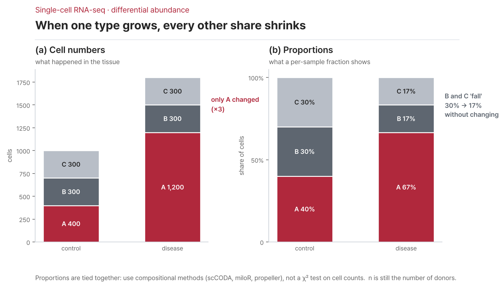{fig-align="center"}

::: {.callout-note collapse="true" icon=false}
## 🔍 Going further — compositional data

-   Proportions are **compositional data** — one cell type expands → all others' proportions fall by arithmetic, with no biological change
-   The same problem: 🔗 [W4 §3.3②](w4_transcriptomics.qmd#w4-s3-3-2), and in a different guise 🔗 [W7 §4.3](w7_metagenomics.qmd#w7-s4-3)
-   ✅ Methods that handle it: `scCODA`, `miloR`, `propeller`, Dirichlet-multinomial models
-   n is the number of donors here too
:::

------------------------------------------------------------------------

# 6. Downstream Analysis: Dynamics, Mechanism, and Atlases 🌈 {#w5-s6}

> 🔑 **Core idea** — methods that infer time, regulation and interaction from **one snapshot** of dissociated cells. The outputs look convincing, but every one is a **hypothesis**. Reference atlases = where you compare your results, and check whether the answer already exists before generating data

## 1) Trajectories and pseudotime {#w5-s6-1}

-   If differentiating cells were caught at different stages → line them up by similarity = **pseudotime**
-   ⚠️ **Pseudotime ≠ real time**
-   ⚠️ The algorithm draws a trajectory even when there is no underlying process

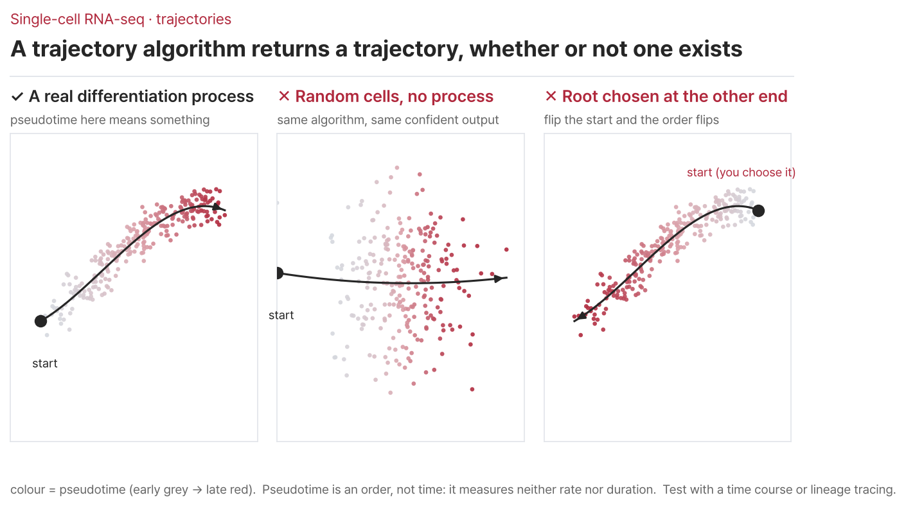{fig-align="center"}

::: {.callout-warning collapse="true"}
## Three caveats worth stating plainly

-   ⚠️ **A trajectory algorithm always returns a trajectory** — there is no "no trajectory found" output
-   ⚠️ **Pseudotime is not time.** It measures neither rate nor duration. Two cells far apart in pseudotime may be minutes or months apart in reality
-   ⚠️ **You choose the starting point (root).** Reverse the root and the ordering reverses → prior knowledge entering as if it were a result

✅ What tests it: a **time course** or **lineage tracing**
:::

::: {.callout-note collapse="true" icon=false}
## 🔍 Going further — tools and RNA velocity

-   E.g. stem cell → progenitor → differentiated / naive T → activated → effector → exhausted
-   Tools: Monocle3, Slingshot, PAGA
-   **RNA velocity** (scVelo) — adds **direction** by comparing unspliced (new) to spliced (mature) reads per gene

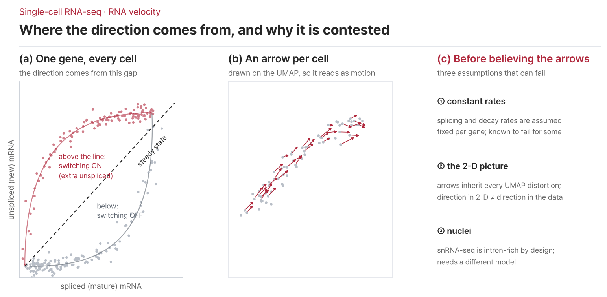{fig-align="center"}

-   ⚠️ Its assumptions about splicing and degradation rates are **contested**, and known to fail for some genes and systems
-   ⚠️ The arrows are drawn on a UMAP → they inherit every distortion from §4.4③
:::

## 2) Regulons and cell–cell communication {#w5-s6-2}

-   "Which TF switches this state on?" (regulons), "which cell signals to which?" (cell–cell communication) → all inferred only from **whether genes are expressed together (co-expression)**
-   ⚠️ Co-expression ≠ regulation, co-expression ≠ interaction → use as **hypotheses**, and test them experimentally

::: {.callout-note collapse="true" icon=false}
## 🔍 Going further — within a cell: regulons and gene programs

|   | Within a cell | Between cells |
|----------|--------------------------------------|------------------------|
| Pair | gene ↔ gene | ligand ↔ receptor |
| Result | **Regulon** (TF-centred) / **gene program** (genes that move together) | **Cell–cell communication** |
| Typical tools | SCENIC, decoupleR / cNMF | CellPhoneDB, CellChat, NicheNet |
| Limit | co-expression ≠ regulation | co-expression ≠ interaction |

-   **Regulon** — genes co-expressed with a TF, kept only if that TF's motif sits near their promoter (SCENIC)
-   **Gene program** — without a TF list, groups of genes that move together, found from the data (the NMF family). Each cell = a mixture of programs (cell-type identity + cell cycle, IFN response, hypoxia…)

⚠️ Reading them:

-   **TF mRNA ≠ TF activity** — post-translational control such as phosphorylation, nuclear translocation and ligand binding is invisible in RNA (🔗 W6)
-   **A motif ≠ binding** — closed chromatin blocks it (🔗 [W3](w3_epigenomics.qmd))
-   **A pathway name on a program is an interpretation.** Compare conditions per donor (§5)

✅ Validation: binding by ChIP-seq / CUT&RUN; function by TF knockout / CRISPR / Perturb-seq
:::

::: {.callout-note collapse="true" icon=false}
## 🔍 Going further — between cells: cell–cell communication

CellPhoneDB, CellChat, NicheNet score ligand–receptor pairs co-expressed between cluster pairs. Is the ligand's mRNA high in cluster A and the receptor's mRNA high in cluster B? → that is all

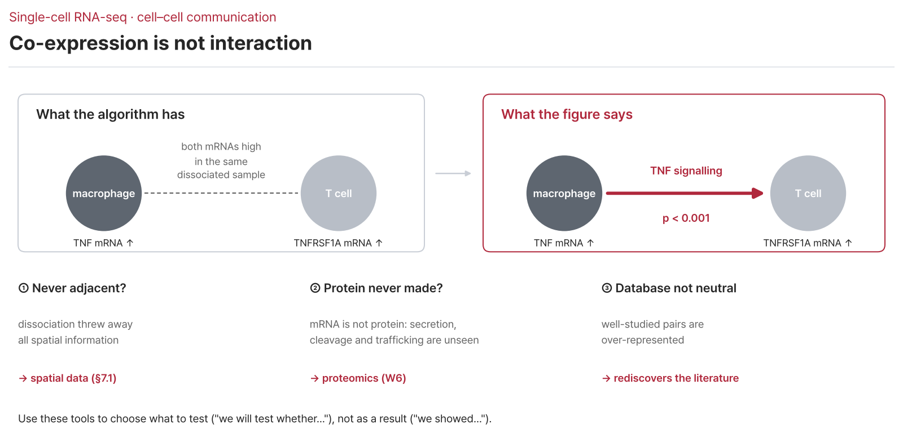{fig-align="center"}

⚠️ Co-expression of a ligand and a receptor ≠ **evidence that the cells interact**

-   the cells may never have been adjacent (dissociation discards space, §7.1)
-   the protein may not be made at all (🔗 W6)
-   the database is biased towards well-studied pairs → results rediscover the literature you already had

**Using them honestly:**

-   ✅ **As hypothesis generators** — "which TF / program / signalling axis is worth testing?"
-   ✅ **Spatial validation** (§7.1), **functional validation** (blocking antibody, receptor knockout, ligand stimulation)
-   ❌ **Not as standalone results** — "macrophages signal to T cells via TNF" is not shown by co-expression
:::

## 3) Reference atlases {#w5-s6-3}

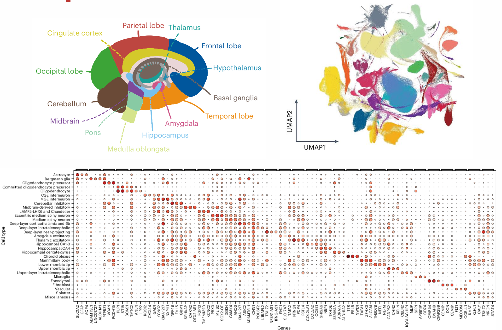{fig-align="center"}

| Resource | What it gives you |
|------------------------------------|------------------------------------|
| [**Human Cell Atlas**](https://www.humancellatlas.org/) | Coordinated single-cell reference across human tissues |
| [**CELLxGENE**](https://cellxgene.cziscience.com/) | Browse, subset, and download hundreds of published datasets interactively |
| [**Tabula Sapiens**](https://tabula-sapiens.sf.czbiohub.org/) | Multi-organ atlas from the same donors |
| [**Azimuth**](https://azimuth.hubmapconsortium.org/) | Reference-based annotation, in the browser |

💡 **Before generating data, check whether an atlas already answers your question.** For "which cell types express my gene?", it usually does

::: {.callout-tip collapse="true"}
## ✅ Try it: find your gene in CELLxGENE, no code

[**CELLxGENE**](https://cellxgene.cziscience.com) → search a gene you care about

-   ① Which cell types, in which tissues, express it?
-   ② Is expression broad, or confined to one population?
-   ③ Find a dataset for your disease of interest → check **how many donors**, not how many cells
-   ④ 💡 If the atlas already answers the question → you just saved a grant's worth of money
:::

## 4) How far each result can be claimed {#w5-s6-4}

-   ✅ **Solid results** — clusters confirmed by markers, pseudobulk DE across donors
-   ⚠️ **Hypotheses** — pseudotime, RNA velocity, regulons, cell–cell communication → write "consistent with", and pair them with a validation experiment

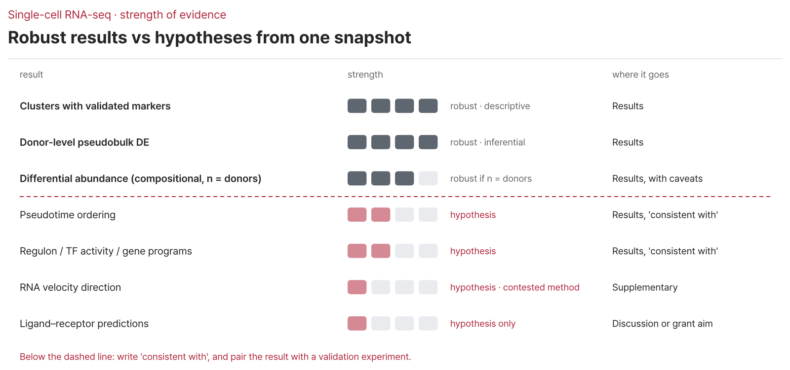{fig-align="center"}

::: {.callout-note collapse="true" icon=false}
## 🔍 Going further — where each result belongs

| Result | What it is | Where it belongs |
|------------------------------------|------------------------|------------------------|
| Cluster + validated markers | ✅ Descriptive, solid | Results |
| Pseudobulk DE across donors | ✅ Inferential, solid | Results |
| Differential abundance with a compositional method | ⚠️ Solid if n is donors | Results, with caveats |
| Pseudotime ordering | ⚠️ Hypothesis | Results, phrased as "consistent with" |
| RNA velocity direction | ⚠️ Hypothesis, contested method | Supplementary, or a hypothesis |
| Regulon / TF activity / gene program | ⚠️ Hypothesis | Results, phrased as "consistent with" |
| Ligand–receptor prediction | ❌ Hypothesis only | Discussion, or a grant aim |
:::

::: {.callout-tip collapse="true"}
## Phrasing results appropriately

*"Trajectory analysis revealed that fibroblasts differentiate into myofibroblasts, and cell–cell communication analysis showed that macrophage-derived TGF-β drives this transition."*

→ Nothing here was revealed or shown. Two algorithms produced two orderings from one snapshot of dissociated cells

✅ A version that matches the evidence: *"Pseudotime ordering is consistent with a fibroblast-to-myofibroblast transition, and ligand–receptor analysis nominates macrophage TGF-β as a candidate driver. We are testing this by \[spatial validation / receptor blockade\]."*

→ The second version also reads like a fundable next step
:::

------------------------------------------------------------------------

# 7. Other Methods: Spatial Transcriptomics and Single-cell Multi-omics 🧩 {#w5-s7}

> 🔑 **Core idea** — recover the location that dissociation discards (spatial transcriptomics), or read a layer other than RNA from the same cell (snATAC-seq, multiome)

## 1) Spatial transcriptomics {#w5-s7-1}

-   Dissociation discards *where* each cell was → spatial transcriptomics keeps the location
-   **Spot-based (Visium)** — whole transcriptome, but several cells per spot
-   **Imaging-based (MERFISH, Xenium, CosMx)** — subcellular resolution, but only a fixed gene panel

→ The same trade-off as everything else in this chapter: **resolution vs. breadth**

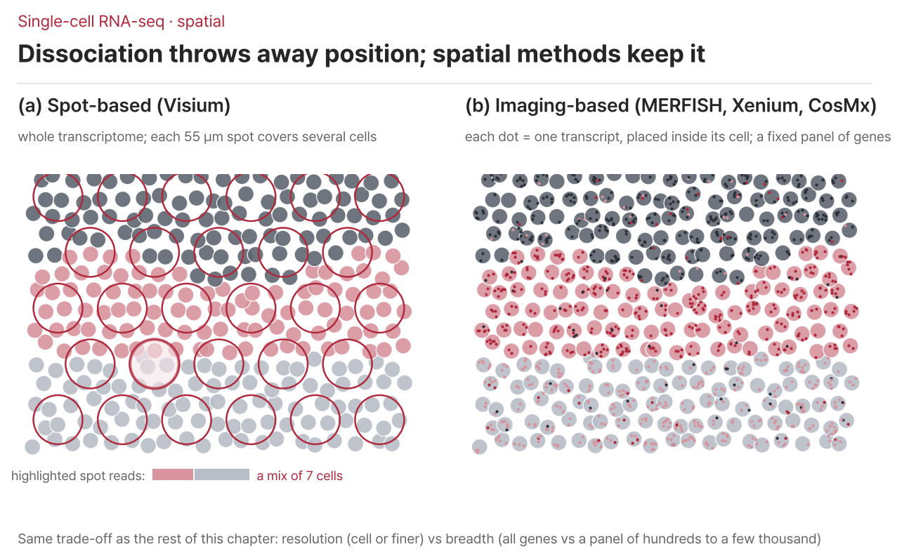{fig-align="center"}

::: {.callout-note collapse="true" icon=false}
## 🔍 Going further — niches: comparing surroundings instead of positions

-   Spatial data = coordinates on a slide image → each slide differs in tissue shape, orientation and where it was cut → **the coordinates themselves cannot be merged across samples**
-   **Niche (cellular neighbourhood)** = each cell re-described as "which cell types surround it, and in what proportions"
    1.  For each cell, count the cell types within radius *r* (or among its *k* nearest cells) → a composition vector (e.g. tumour 60%, T cell 30%, fibroblast 10%)
    2.  Cluster the composition vectors of all slides together → niches that recur across slides (e.g. the tumour–immune border, tertiary lymphoid structures)
-   Unlike coordinates, a composition vector **means the same thing on every slide** → slides and patients can be compared and integrated on one scale. Comparing conditions = the niche proportions per donor (n is still the number of donors, §5)
-   Tools: e.g. Squidpy, CellCharter. A classic study: cellular neighbourhoods at the invasive front of colorectal cancer (Schürch 2020)
-   ⚠️ Spot-based data (Visium) has several cells per spot → first estimate each spot's cell mix by deconvolution, then do the same
:::

## 2) snATAC-seq {#w5-s7-2}

-   ATAC-seq (🔗 [W3 §3](w3_epigenomics.qmd#w3-s3)) one nucleus at a time → a map of open chromatin for each cell
-   Each cell type opens different enhancers and TF motifs → clues to which TFs define that cell type
-   ⚠️ Far sparser than RNA: each locus has only two copies per cell → essentially open-or-closed data → each step uses different methods from scRNA-seq
-   💡 Without RNA, naming cell types is harder → use gene activity scores built from accessibility around each gene, or map to an scRNA-seq reference

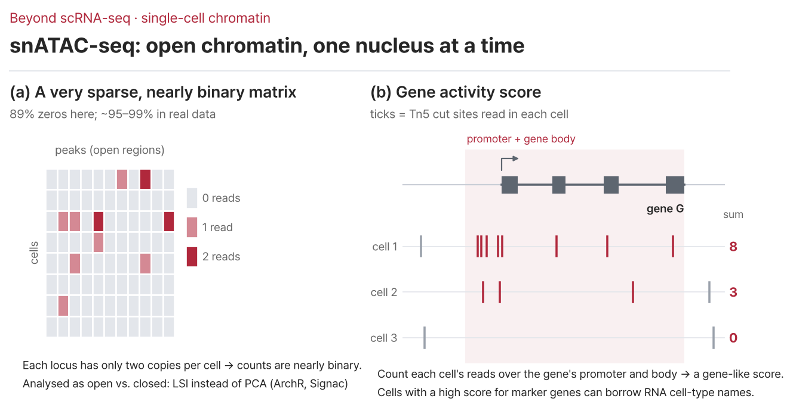{fig-align="center"}

|   | scRNA-seq | snATAC-seq |
|------------|--------------------------|----------------------------------|
| Columns (features) | genes | peaks (or fixed-width tiles across the genome) |
| Values | UMI counts (0, 1, 2, … hundreds) | almost all 0/1 → often binarised |
| Share of zeros | over 90% | 95–99% |
| Cell QC | total UMIs, genes detected, mito % | fragments, TSS enrichment, fraction of reads in peaks (FRiP), nucleosome signal |
| Doublets | scDblFinder, DoubletFinder | counting loci covered by 3+ reads (AMULET), scDblFinder |
| Normalisation + reduction | log-normalisation → PCA | TF-IDF → SVD (= **LSI**) |
| Naming cell types | marker gene expression | **gene activity scores**, mapping to an scRNA-seq reference, TF motifs |
| Tools | Seurat, Scanpy | Signac, ArchR, SnapATAC2 |

::: {.callout-note collapse="true" icon=false}
## 🔍 Going further — LSI and gene activity scores

**LSI (latent semantic indexing)** — borrowed from document search. Cells = documents, peaks = words

1.  **TF (term frequency)** — each cell's peak counts ÷ that cell's total → evens out sequencing depth
2.  **IDF (inverse document frequency)** — down-weights peaks open in many cells and up-weights rarely open ones → highlights the peaks that separate cell types (a promoter open in every cell says little)
3.  **SVD** — summarises the TF-IDF matrix into a few dozen components (much the same job as PCA)

-   ⚠️ The first component often tracks each cell's total reads (depth) → usually dropped, starting from the second. After that, the neighbour graph, clustering and UMAP work as in scRNA-seq

**Gene activity score** — an approximation that turns peak data into "gene-like" values (panel b above)

-   For each gene, add up each cell's fragments over the promoter and gene body (Signac default: gene body + 2 kb upstream). ArchR uses a model that weights nearby peaks by distance
-   Uses: naming clusters by known marker genes, and matching to an scRNA-seq reference (label transfer)
-   ⚠️ Open chromatin ≠ expression. Many genes are open but not transcribed → the correlation with real RNA is only moderate. If you need RNA from the same cell → multiome (§7.3)
:::

## 3) Multiome {#w5-s7-3}

-   **Multiome** (10x Multiome) — reads RNA and ATAC from the same nucleus → barcodes from the same bead pair the two readouts again → expression and open chromatin are seen together in each cell
-   ✅ What it allows: defining cell types from both layers together (WNN, MultiVI), and finding peaks whose openness moves with a gene's expression → candidate enhancer–gene links
-   ⚠️ Moving together ≠ regulation (the same limit as §6.2) → treat links as candidates and test them, e.g. with CRISPR
-   💡 Other pairings: CITE-seq (RNA + surface protein, §3.2), Perturb-seq (CRISPR perturbation + RNA)

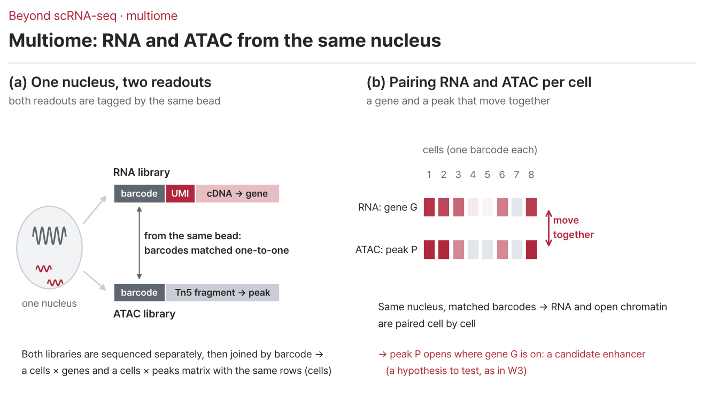{fig-align="center"}

------------------------------------------------------------------------

# 📝 Summary

-   One bulk result = every cell changing a little, a few cells changing a lot, or **a change in the cell mix** → single cell tells them apart
-   ⚠️ **Fresh vs. frozen is decided at collection** → so is scRNA-seq vs. snRNA-seq. Dissociation itself changes the result
-   ⚠️ The unit of replication = the **donor (biological replicate)** → spend the budget on donors rather than cells
-   UMIs count molecules, not reads. The matrix is \>90% zeros, and a single zero means little
-   QC removes empty droplets, ambient RNA, doublets and dying cells. ⚠️ **Every threshold also removes a real population**
-   Resolution sets the number of clusters, and there is no right answer → check with markers. ⚠️ UMAP distances, sizes and bridges are **not interpretable**
-   ⚠️ Integration can erase real differences → colour by batch **and** cell type
-   ⚠️ **Per-cell tests across conditions are invalid.** Use pseudobulk; n = **the number of donors**
-   Trajectories and cell–cell communication are **hypotheses**, not results
-   Spatial transcriptomics adds location; snATAC-seq and multiome add chromatin from the same cells
-   Check the atlases before generating data

------------------------------------------------------------------------

# 🔑 Key terms

| Term | One-line meaning |
|-------------------------|------------------------------------------------|
| scRNA-seq / snRNA-seq | Reading RNA per cell / per nucleus |
| Droplet | Oil droplet that seals one cell with one barcoded bead |
| Microwell | Tiny well that a cell settles into by gravity, with one barcoded bead per well (BD Rhapsody) |
| Cell barcode | Sequence identifying which cell a read came from |
| UMI | Tag marking one original mRNA molecule |
| Count matrix | Table of molecule counts per cell × gene |
| Dropout | Expressed transcript not captured — a technical zero |
| Ambient RNA | Free-floating RNA ("soup") contaminating every droplet |
| Doublet | Two cells captured in one droplet |
| Clustering | Grouping cells with similar expression |
| Resolution | Parameter controlling how many clusters you get |
| UMAP | A 2D picture, for visualisation only |
| Annotation | Naming clusters as cell types |
| Integration | Aligning samples so the same cell types sit together |
| Pseudobulk | Summing counts per sample (donor) × cell type before testing |
| Pseudotime | Ordering of cells along an inferred process — not time |

::: {.callout-note collapse="true" icon=false}
## 🔍 Going further — advanced terms

| Term | One-line meaning |
|-------------------------|------------------------------------------------|
| 3′ / 5′ kit | Which end of the transcript is read; 5′ also reaches TCR/BCR sequences |
| TSO (template switching oligo) | Oligo that joins the cDNA end during reverse transcription so the whole cDNA can be amplified; carries the barcode in 5′ kits |
| Sample multiplexing (multiplexing) | Running several samples mixed in one lane, then splitting them again by genotype or hashtag |
| Dissociation artifact | Gene expression induced by tissue dissociation, not by biology |
| Knee plot | Ranked UMI counts, used to separate cells from empty droplets |
| Cell calling | Deciding which barcodes are cells (e.g. EmptyDrops) |
| Homotypic / heterotypic doublet | Same type (almost undetectable) / different types (hybrid profile) |
| MAD | Median absolute deviation — the basis for per-sample, data-driven QC cutoffs |
| HVG | Highly variable genes selected before PCA |
| PCA | Linear reduction into groups of genes that move together (programs) |
| kNN / SNN graph | Graph linking each cell to its nearest (or neighbour-sharing) cells in PC space |
| Leiden / Louvain | Community detection on the kNN graph; Leiden guarantees connected clusters |
| Over-correction | Integration that removes real biological differences |
| Differential abundance | Testing whether cell-type proportions changed |
| Compositional data | Proportions that sum to 1, so none can change independently |
| Root cell | The starting cell for pseudotime, chosen by the user |
| Pseudoreplication | Counting non-independent observations (cells from one donor) as independent samples |
| snATAC-seq | Chromatin accessibility read one nucleus at a time |
| LSI | TF-IDF + SVD — the reduction used for snATAC-seq instead of PCA |
| Gene activity score | Accessibility summed around a gene — an approximation of its expression |
| Niche (cellular neighbourhood) | A cell's surroundings, defined by the cell types around it — comparable across slides |
| Multiome | Reading RNA and ATAC from the same nucleus |
| RNA velocity | Direction of change inferred from unspliced vs. spliced reads |
| Regulon | A TF plus the target genes backed by its motif |
| Gene program | A group of genes that move together — used to different degrees by each cell |
| Ligand–receptor analysis | Inferring cell–cell communication from ligand and receptor co-expression |
:::

------------------------------------------------------------------------

# ➕ References

### Overviews and best practice

Heumos L, et al. [*Best practices for single-cell analysis across modalities.*](https://doi.org/10.1038/s41576-023-00586-w) Nat Rev Genet. 2023.\
[Single-cell best practices (online book)](https://www.sc-best-practices.org/) — free, and kept up to date\
Luecken MD, Theis FJ. [*Current best practices in single-cell RNA-seq analysis: a tutorial.*](https://doi.org/10.15252/msb.20188746) Mol Syst Biol. 2019.

### Technology, QC, artifacts

Svensson V, Vento-Tormo R, Teichmann SA. [*Exponential scaling of single-cell RNA-seq in the past decade.*](https://pubmed.ncbi.nlm.nih.gov/?term=Exponential+scaling+of+single-cell+RNA-seq+in+the+past+decade) Nat Protoc. 2018.\
Fan HC, Fu GK, Fodor SPA. [*Combinatorial labeling of single cells for gene expression cytometry.*](https://doi.org/10.1126/science.1258367) Science. 2015. **← the microwell method behind BD Rhapsody**\
van den Brink SC, et al. [*Single-cell sequencing reveals dissociation-induced gene expression in tissue subpopulations.*](https://doi.org/10.1038/nmeth.4437) Nat Methods. 2017. **← read before designing a dissociation protocol**\
Denisenko E, et al. [*Systematic assessment of tissue dissociation and storage biases in single-cell and single-nucleus RNA-seq workflows.*](https://doi.org/10.1186/s13059-020-02048-6) Genome Biol. 2020.\
Stoeckius M, et al. [*Cell Hashing with barcoded antibodies enables multiplexing and doublet detection for single cell genomics.*](https://doi.org/10.1186/s13059-018-1603-1) Genome Biol. 2018.\
Kang HM, et al. [*Multiplexed droplet single-cell RNA-sequencing using natural genetic variation.*](https://doi.org/10.1038/nbt.4042) Nat Biotechnol. 2018. (demuxlet)\
Svensson V. [*Droplet scRNA-seq is not zero-inflated.*](https://doi.org/10.1038/s41587-019-0379-5) Nat Biotechnol. 2020.\
Lun ATL, et al. [*EmptyDrops: distinguishing cells from empty droplets in droplet-based single-cell RNA sequencing data.*](https://doi.org/10.1186/s13059-019-1662-y) Genome Biol. 2019.\
Young MD, Behjati S. [*SoupX removes ambient RNA contamination.*](https://doi.org/10.1093/gigascience/giaa151) GigaScience. 2020.\
Fleming SJ, et al. [*Unsupervised removal of systematic background noise from droplet-based single-cell experiments using CellBender.*](https://doi.org/10.1038/s41592-023-01943-7) Nat Methods. 2023.\
McGinnis CS, Murrow LM, Gartner ZJ. [*DoubletFinder: doublet detection in single-cell RNA sequencing data using artificial nearest neighbors.*](https://doi.org/10.1016/j.cels.2019.03.003) Cell Syst. 2019.\
Germain PL, et al. [*Doublet identification in single-cell sequencing data using scDblFinder.*](https://doi.org/10.12688/f1000research.73600.2) F1000Research. 2021.\
Hippen AA, et al. [*miQC: An adaptive probabilistic framework for quality control of single-cell RNA-sequencing data.*](https://doi.org/10.1371/journal.pcbi.1009290) PLoS Comput Biol. 2021.

### Embedding, clustering, integration

Becht E, et al. [*Dimensionality reduction for visualizing single-cell data using UMAP.*](https://doi.org/10.1038/nbt.4314) Nat Biotechnol. 2019.\
Chari T, Pachter L. [*The specious art of single-cell genomics.*](https://doi.org/10.1371/journal.pcbi.1011288) PLoS Comput Biol. 2023. **← a sharp critique of 2D embeddings**\
Kobak D, Berens P. [*The art of using t-SNE for single-cell transcriptomics.*](https://doi.org/10.1038/s41467-019-13056-x) Nat Commun. 2019.\
Böhm JN, Berens P, Kobak D. [*Attraction-repulsion spectrum in neighbor embeddings.*](https://jmlr.org/papers/v23/21-0055.html) J Mach Learn Res. 2022. **← UMAP ≈ t-SNE with stronger attraction**\
Kobak D, Linderman GC. [*Initialization is critical for preserving global data structure in both t-SNE and UMAP.*](https://doi.org/10.1038/s41587-020-00809-z) Nat Biotechnol. 2021.\
Traag VA, Waltman L, van Eck NJ. [*From Louvain to Leiden: guaranteeing well-connected communities.*](https://doi.org/10.1038/s41598-019-41695-z) Sci Rep. 2019.\
Korsunsky I, et al. [*Fast, sensitive and accurate integration of single-cell data with Harmony.*](https://doi.org/10.1038/s41592-019-0619-0) Nat Methods. 2019.\
Luecken MD, et al. [*Benchmarking atlas-level data integration in single-cell genomics.*](https://doi.org/10.1038/s41592-021-01336-8) Nat Methods. 2022. (scIB)

### Statistics

Squair JW, et al. [*Confronting false discoveries in single-cell differential expression.*](https://doi.org/10.1038/s41467-021-25960-2) Nat Commun. 2021.\
Zimmerman KD, Espeland MA, Langefeld CD. [*A practical solution to pseudoreplication bias in single-cell studies.*](https://doi.org/10.1038/s41467-021-21038-1) Nat Commun. 2021.\
Murphy AE, Skene NG. [*A balanced measure shows superior performance of pseudobulk methods.*](https://doi.org/10.1038/s41467-022-35519-4) Nat Commun. 2022.\
Büttner M, et al. [*scCODA is a Bayesian model for compositional single-cell data analysis.*](https://doi.org/10.1038/s41467-021-27150-6) Nat Commun. 2021.

### Trajectories, regulation, cell–cell communication

Saelens W, et al. [*A comparison of single-cell trajectory inference methods.*](https://doi.org/10.1038/s41587-019-0071-9) Nat Biotechnol. 2019.\
Bergen V, Soldatov RA, Kharchenko PV, Theis FJ. [*RNA velocity — current challenges and future perspectives.*](https://doi.org/10.15252/msb.202110282) Mol Syst Biol. 2021. **← read before putting velocity in a figure**\
Aibar S, et al. [*SCENIC: single-cell regulatory network inference and clustering.*](https://doi.org/10.1038/nmeth.4463) Nat Methods. 2017.\
Kotliar D, et al. [*Identifying gene expression programs of cell-type identity and cellular activity with single-cell RNA-Seq.*](https://doi.org/10.7554/eLife.43803) eLife. 2019. (cNMF)\
Dimitrov D, et al. [*Comparison of methods and resources for cell-cell communication inference from single-cell RNA-Seq data.*](https://doi.org/10.1038/s41467-022-30755-0) Nat Commun. 2022. **← how much the answer depends on the tool and database**

### Single-cell chromatin and multi-omics

Buenrostro JD, et al. [*Single-cell chromatin accessibility reveals principles of regulatory variation.*](https://doi.org/10.1038/nature14590) Nature. 2015.\
Cusanovich DA, et al. [*Multiplex single cell profiling of chromatin accessibility by combinatorial cellular indexing.*](https://doi.org/10.1126/science.aab1601) Science. 2015. (the first use of LSI)\
Thibodeau A, et al. [*AMULET: a novel read count-based method for effective multiplet detection from single nucleus ATAC-seq data.*](https://doi.org/10.1186/s13059-021-02469-x) Genome Biol. 2021.\
Granja JM, et al. [*ArchR is a scalable software package for integrative single-cell chromatin accessibility analysis.*](https://doi.org/10.1038/s41588-021-00790-6) Nat Genet. 2021.\
Stuart T, et al. [*Single-cell chromatin state analysis with Signac.*](https://doi.org/10.1038/s41592-021-01282-5) Nat Methods. 2021.\
Hao Y, et al. [*Integrated analysis of multimodal single-cell data.*](https://doi.org/10.1016/j.cell.2021.04.048) Cell. 2021. (WNN)

### Atlases and spatial

[Human Cell Atlas](https://www.humancellatlas.org/) · [CELLxGENE](https://cellxgene.cziscience.com/) · [Azimuth](https://azimuth.hubmapconsortium.org/) · [Tabula Sapiens](https://tabula-sapiens.sf.czbiohub.org/)\
Schürch CM, et al. [*Coordinated cellular neighborhoods orchestrate antitumoral immunity at the colorectal cancer invasive front.*](https://doi.org/10.1016/j.cell.2020.07.005) Cell. 2020. **← the classic example of niche (cellular neighbourhood) analysis**\
Moses L, Pachter L. [*Museum of spatial transcriptomics.*](https://pubmed.ncbi.nlm.nih.gov/?term=Museum+of+spatial+transcriptomics) Nat Methods. 2022.
