::: {.callout-note collapse="true"}
## 🎯 Learning objectives

By the end of this chapter you should be able to:

-   Explain why mRNA is not a proxy for protein
-   Describe the bottom-up MS workflow — measure peptides, infer proteins
-   Tell DDA, DIA and targeted acquisition apart, and LFQ, TMT and SILAC
-   Say when to use mass spectrometry and when to use an affinity platform
-   Follow the pipeline from spectra to a protein matrix, and spot a problem run from its QC metrics
-   ⚠️ Explain the protein inference problem and what a "protein group" means
-   ⚠️ Explain why proteomics data has missing values, and why naive imputation is dangerous
-   Explain how differential abundance is tested (`limma`, MSstats), and why enrichment needs the detected proteome as its background
:::

> 🤔 **Motivating question**\
> Transcript and protein levels correlate at roughly r ≈ 0.4\
> → So what, exactly, did your RNA-seq tell you?

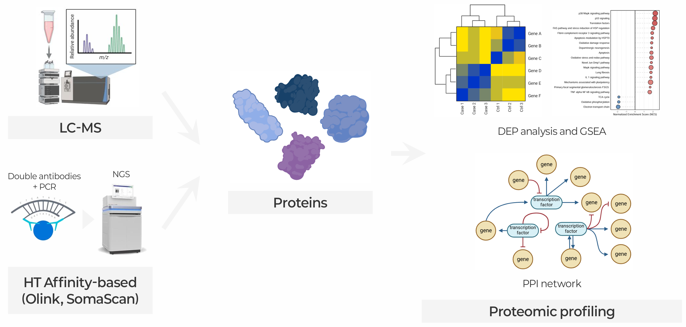

💡 The main text of each section = the basics you need. **🔍 Going further** boxes = deeper material to open when you are curious

------------------------------------------------------------------------

# 1. Why Measure Proteins 💪 {#w6-s1}

> 🔑 **Core idea** — proteins do the work, but RNA-seq does not measure them. mRNA predicts protein only loosely → a claim about protein needs a protein measurement

## 1) The correlation problem {#w6-s1-1}

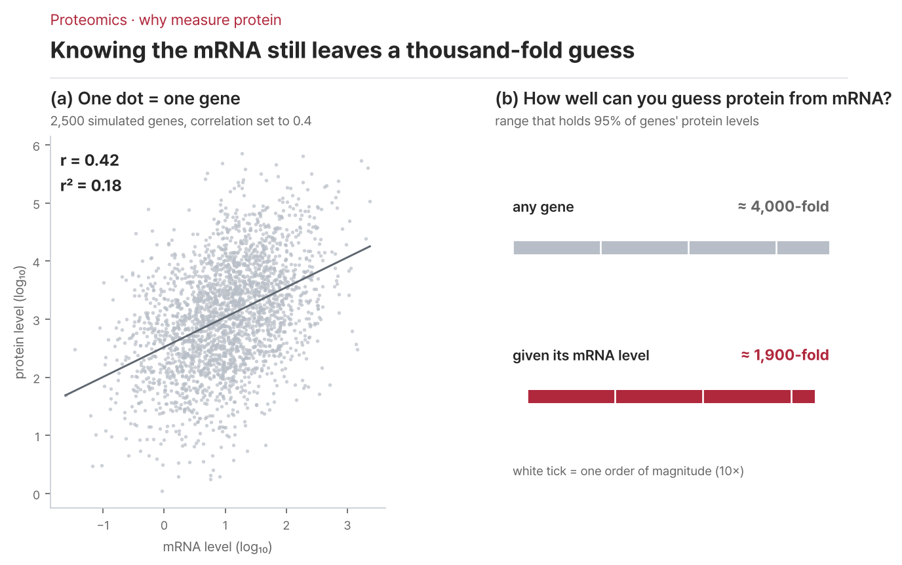{fig-align="center"}

-   **Proteins do the work** — drug targets, biomarkers, enzymes
-   RNA-seq measures **none of them directly**
-   mRNA vs. protein: r ≈ 0.4 → mRNA explains only about **a fifth** of the variation in protein abundance across genes
-   ⚠️ "Gene X's transcript went up — did the protein?" → the honest answer from RNA-seq alone is *probably, maybe*

::: {.callout-note collapse="true" icon=false}
## 🔍 Going further — reading r ≈ 0.4 carefully

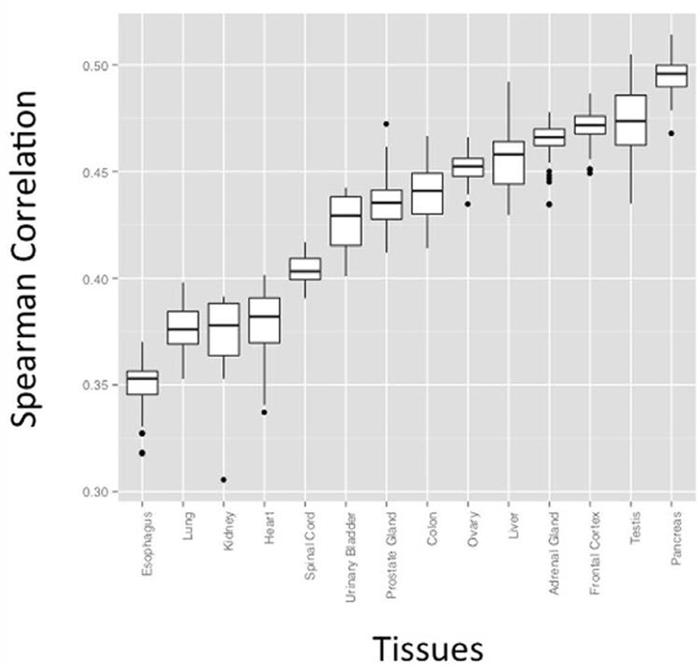{fig-align="center"}

-   An **across-genes** correlation: gene A's mRNA vs. gene A's protein, over thousands of genes
-   Within one gene, across conditions → often better
:::

## 2) Where the other 80% goes {#w6-s1-2}

Steps between mRNA and protein that change the amount — or the activity:

-   **Translation efficiency** — varies more than a hundred-fold between transcripts
-   **Protein half-life** — minutes to days → a stable protein accumulates from a modest transcript
-   **Post-translational modification** — changes activity with no change in abundance at all

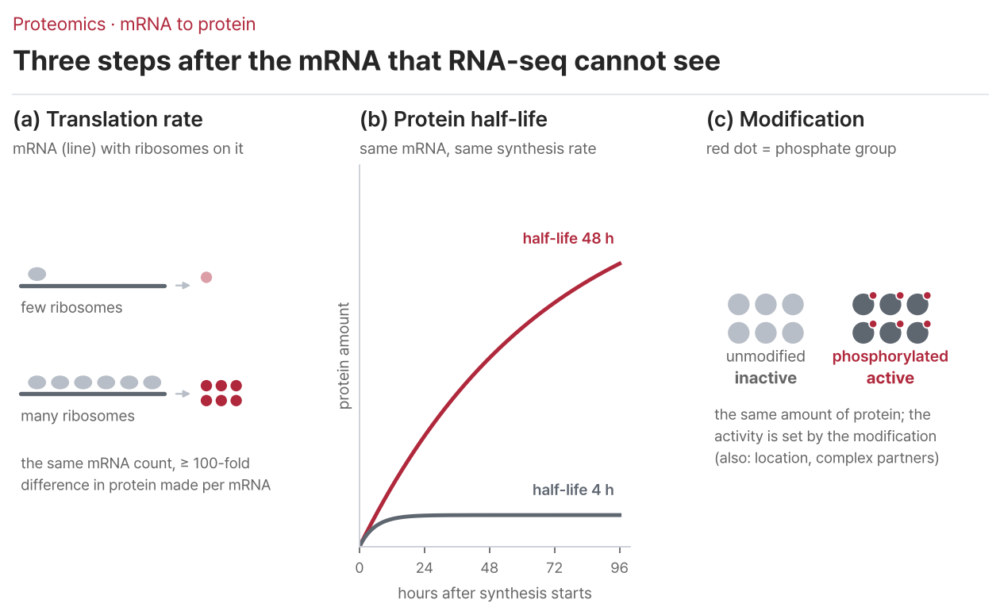{fig-align="center"}

::: {.callout-note collapse="true" icon=false}
## 🔍 Going further — localisation and complex stoichiometry

-   **Localisation** — the same quantity of protein in the nucleus vs. cytoplasm is different biology
-   **Complex stoichiometry** — unassembled subunits are degraded → abundance set by the limiting partner
:::

::: {.callout-important collapse="true"}
## The practical rule

Whenever a conclusion is *about protein* — a drug target, a biomarker, a signalling event —

→ **mRNA evidence is a hypothesis, not a result**
:::

------------------------------------------------------------------------

# 2. Techniques: Mass Spectrometry and Affinity Assays ⚗️ {#w6-s2}

> 🔑 **Core idea** — MS does not measure whole proteins. It cuts them into peptides, weighs the peptides and their fragments, and **infers** the proteins. Affinity assays instead count **binding** to a reagent. Each choice decides what you can see — and which artifact you inherit

-   **Mass spectrometry** — how it works (①–②), which peptides it picks (③), how samples are compared (④)
-   **Affinity assays** — when the sample is plasma and the cohort is a biobank (⑤)
-   **Sample handling** — what goes wrong before any instrument runs (⑥)

## 1) Bottom-up mass spectrometry {#w6-s2-1}

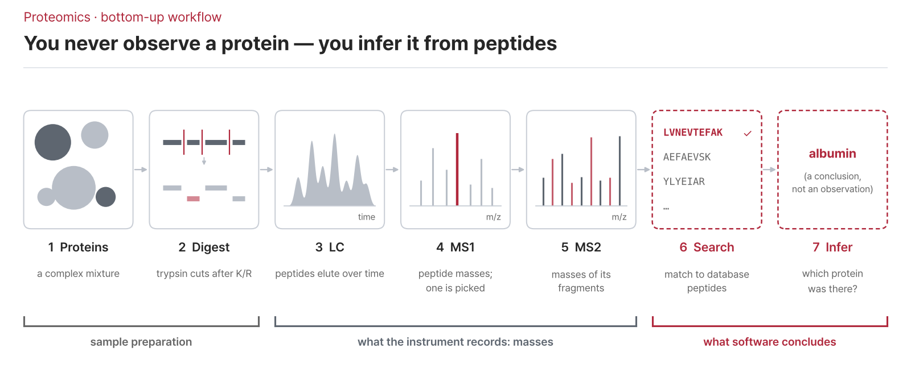{fig-align="center"}

-   Intact proteins are too large and heterogeneous to measure well → cut them into **peptides** with trypsin (cuts after lysine and arginine) = **bottom-up** proteomics
-   Peptides separated by liquid chromatography → weighed (**MS1**) → broken into fragments and weighed again (**MS2**)
-   Fragment pattern matched to a peptide sequence in a database → proteins **inferred** from the peptides

::: {.callout-note collapse="true" icon=false}
## 🔍 Going further — the seven steps

1.  **Digest** the protein mixture into peptides (almost always with trypsin)
2.  **Separate** by liquid chromatography over 30–120 minutes
3.  **MS1 survey scan** — measure the m/z of everything eluting at this moment
4.  **Fragment** selected peptides by collision (HCD/CID)
5.  **MS2 spectrum** — measure the fragment masses
6.  **Database search** — match the spectrum to a peptide sequence
7.  **Infer** which proteins those peptides came from
:::

::: {.callout-warning collapse="true"}
## You never observe a protein

Every step from ④ onwards is **inference**

-   You observe peptide fragment masses
-   The protein identity is a **conclusion drawn from them**
-   → [§3.3](#w6-s3-3) explains why that conclusion is sometimes ambiguous
:::

## 2) The MS2 spectrum {#w6-s2-2}

-   Fragmentation breaks the peptide backbone at different positions → a **ladder** of fragments
-   **Mass difference between neighbouring rungs = one amino acid** → this is how the sequence is read

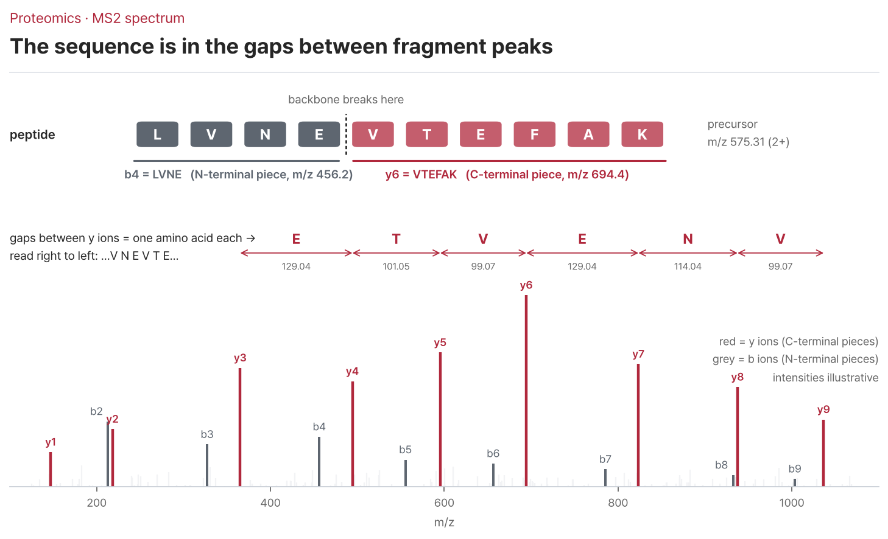{fig-align="center"}

::: {.callout-note collapse="true" icon=false}
## 🔍 Going further — b and y ions, and how search engines read spectra

-   **b ions** — retain the N-terminus
-   **y ions** — retain the C-terminus
-   The ladder is read from consecutive ions **within one series**
-   💡 In practice a search engine does not read sequences *de novo* → it generates theoretical spectra for every peptide in a database and scores the match
:::

## 3) Acquisition: DDA, DIA and targeted {#w6-s2-3}

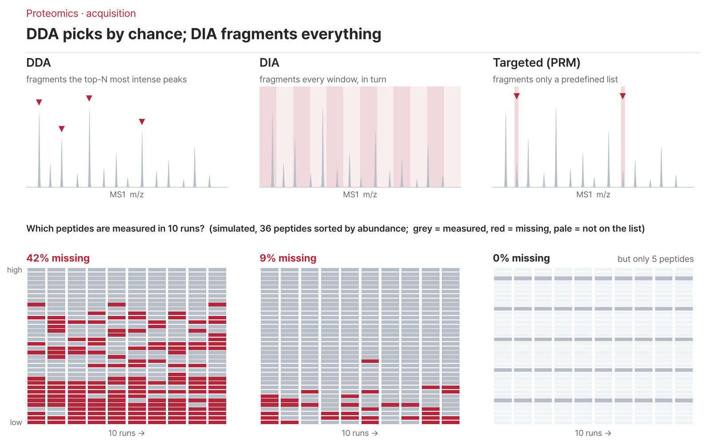{fig-align="center"}

Three rules for **which peptides to fragment**:

-   **DDA** — only the most intense at each moment → the picks differ run to run → many missing values ([§3.6](#w6-s3-6))
-   **DIA** — everything, window by window → far fewer missing values. Now the default for large cohorts
-   **Targeted (PRM/MRM)** — a predefined list only → for validating a specific panel

::: {.callout-note collapse="true" icon=false}
## 🔍 Going further — the three strategies compared

|   | **DDA** | **DIA** | **Targeted (PRM/MRM)** |
|------------------|------------------|------------------|------------------|
| What is fragmented | Top-N most intense precursors | Everything, in fixed m/z windows | A predefined list only |
| Proteins per run | Thousands | Thousands, more consistently | Tens |
| Missing values across runs | ⚠️ High | Low | Very low |
| Spectra | Clean, one peptide each | Complex, must be deconvoluted | Clean |
| Quantitative precision | Moderate | Good | Excellent |
| Best for | Discovery, established workflows | Large cohorts, biomarker studies | Validating a specific panel |
:::

::: {.callout-note collapse="true" icon=false}
## 🔍 Going further — why DDA leaves holes, and what made DIA practical

**DDA's weakness — the selection is stochastic:**

-   A low-abundance peptide picked in run 1 may be skipped in run 2, simply because something else was momentarily more intense
-   → across 100 clinical samples, a matrix full of holes ([§3.6](#w6-s3-6))

**DIA's fix** — fragment everything. Cost: far more complex spectra

-   DIA-NN and Spectronaut — increasingly using machine-learning-predicted spectral libraries rather than experimental ones
-   → what made DIA practical, and now the default for large cohort studies
:::

## 4) Quantification: LFQ, TMT and SILAC {#w6-s2-4}

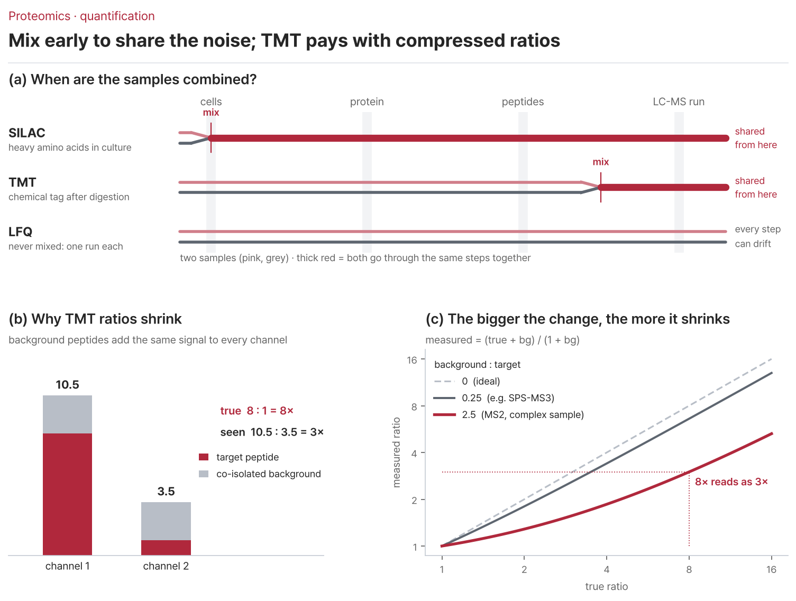{fig-align="center"}

Three ways to compare protein amounts between samples — they differ in **when samples are combined**:

-   **LFQ** (label-free) — separate runs, intensities compared → applicable to anything, including tissue and plasma
-   **TMT** — isobaric chemical tags → up to 18 samples in one run. ⚠️ Ratios pulled toward 1, and batches must be randomised ([§4.3](#w6-s4-3))
-   **SILAC** — heavy amino acids fed to cells → cultured cells only

::: {.callout-note collapse="true" icon=false}
## 🔍 Going further — LFQ vs. TMT vs. SILAC

|   | **LFQ** | **TMT / iTRAQ** | **SILAC** |
|------------------|------------------|------------------|------------------|
| How | Separate runs, compare intensities | Isobaric chemical tags, one run | Heavy amino acids fed to cells |
| Samples per run | 1 | Up to 18 | 2–3 |
| Samples combined at | Never | After digestion | In culture |
| Applicable to | Anything, including tissue and plasma | Anything | Cultured cells only |
| Main weakness | Run-to-run drift, more missing values | ⚠️ Ratio compression, batch structure | Not usable in humans |
:::

::: {.callout-note collapse="true" icon=false}
## 🔍 Going further — TMT ratio compression

⚠️ **The mechanism:**

-   In TMT, all samples are measured in one MS2 spectrum via reporter ions
-   The instrument's isolation window is not perfectly selective
-   → **co-eluting background peptides get co-isolated** and contribute their own reporter ions
-   → the background is roughly equal across channels → it pulls every ratio toward 1

**The magnitude** — a genuine 8-fold change can be reported as 3-fold

**The fix** — SPS-MS3 acquisition largely corrects it, at the cost of speed and sensitivity
:::

## 5) Affinity assays: Olink and SomaScan {#w6-s2-5}

### ① The dynamic range problem {#w6-s2-5-1}

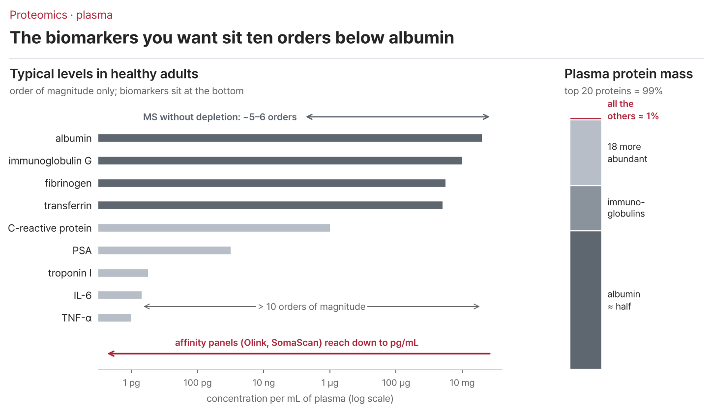{fig-align="center"}

-   Plasma — the most clinically desirable sample, and the hardest to analyse
-   The top 20 proteins ≈ **99%** of the protein mass (albumin alone ≈ half)
-   The biomarkers you want (cytokines, tissue leakage proteins, tumour-derived proteins) sit **ten orders of magnitude below**
-   → Unfractionated MS covers perhaps five to six orders → hence depletion of abundant proteins, fractionation or enrichment — all of which add variability and cost

### ② Affinity platforms {#w6-s2-5-2}

Two technologies dominate large-cohort plasma proteomics — **neither uses mass spectrometry**:

-   **Olink (PEA)** — a pair of antibodies; signal only when **both** bind → high specificity
-   **SomaScan** — modified DNA aptamers (SOMAmers) bind the targets
-   ✅ Thousands of proteins (up to \~11,000), down to pg/mL, from a few µL, at biobank scale. ❌ Predefined panel only
-   ⚠️ What is measured = **binding** to a reagent, not the peptide sequence

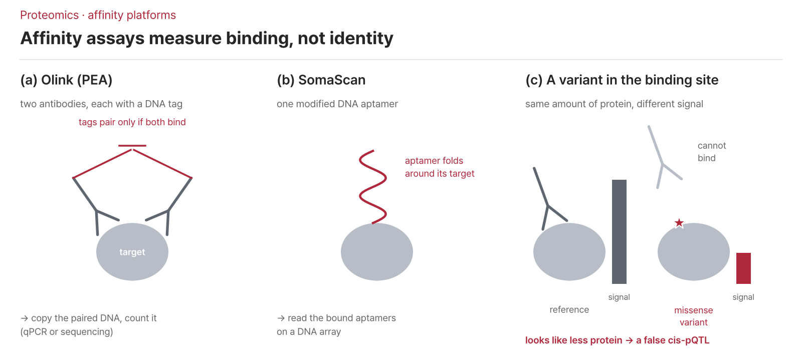{fig-align="center"}

::: {.callout-warning collapse="true"}
## Affinity assays measure binding, not identity

An Olink or SomaScan readout is a **binding signal** → binding can be affected by things other than concentration:

-   **Cross-reactivity** — the reagent binds something else
-   **Epitope-altering variants** — a missense variant in the epitope reduces binding → appears as reduced protein level
    -   ⚠️ In pQTL studies this produces spurious *cis*-signals. A known confounder requiring explicit checking ([§5.3](#w6-s5-3))
-   **Platform disagreement** — Olink and SomaScan measurements of the same protein correlate only moderately for many targets. Which one is "right" is often unresolved
:::

::: {.callout-note collapse="true" icon=false}
## 🔍 Going further — how Olink and SomaScan read out

-   **Olink (PEA)** — a pair of antibodies binds the target; when both bind, attached DNA oligos hybridise, are amplified, and read out by sequencing or qPCR. Requiring **two** binding events gives high specificity
-   **SomaScan** — modified DNA aptamers (SOMAmers) bind targets; abundance read from aptamer quantity on an array
:::

::: {.callout-note collapse="true" icon=false}
## 🔍 Going further — mass spectrometry vs. affinity

|   | Mass spectrometry | Affinity (Olink / SomaScan) |
|------------------------|------------------------|------------------------|
| Targets | Unbiased — whatever is there | Predefined panel only |
| Proteins measured | \~3,000 (plasma, with effort) | Thousands, up to \~11,000 |
| Sensitivity | Limited by dynamic range | Reaches pg/mL |
| Sample volume | µL–mL | A few µL |
| Throughput | Moderate | Very high — biobank scale |
| What is measured | Peptide sequence | **Binding** to a reagent |
| Isoforms and PTMs | Detectable | Generally not distinguished |
:::

## 6) ⚠️ Sample handling {#w6-s2-6}

Many proteomics errors start at the bench, not in the software:

-   **Keratin contamination** — skin and hair keratins are the classic proteomics contaminant. Keratins in your top hits → the problem is at the bench (QC: [§3.1](#w6-s3-1))
-   **Dynamic range** — failing to deplete or fractionate plasma means **you measured albumin** ([①](#w6-s2-5-1))
-   **Storage and freeze–thaw** — plasma proteomes are sensitive to pre-analytical handling: collection tube, time to freezing, freeze–thaw cycles. ⚠️ In biobank studies, collection protocols that differed between groups → a **systematic confounder**
-   **Digestion** — incomplete tryptic digestion varies between samples → a real source of quantitative noise (QC: missed cleavages, [§3.1](#w6-s3-1))

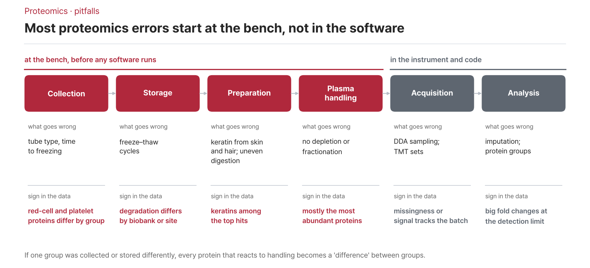{fig-align="center"}

------------------------------------------------------------------------

# 3. Pre-processing: From Spectra to a Protein Matrix 🔢 {#w6-s3}

> 🔑 **Core idea** — match spectra to peptides with a known error rate → group peptides into proteins → one value per protein per sample → a normalised matrix. Check QC at every step, and decide what to do with the gaps

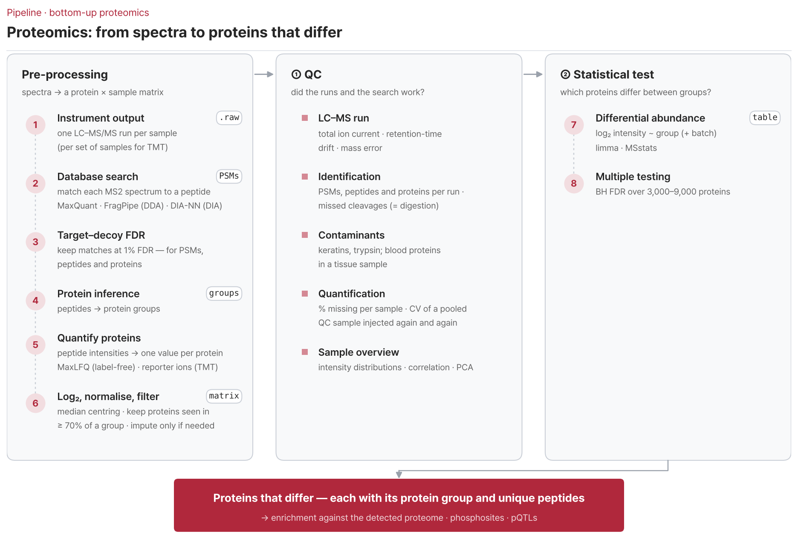{fig-align="center"}

-   The search software (MaxQuant, FragPipe, DIA-NN, Spectronaut) runs steps 2–5 in one go → its output is a **protein × sample intensity matrix**
-   ⚠️ Every matrix carries the decisions made along the way: the FDR threshold ([②](#w6-s3-2)), how shared peptides were assigned ([③](#w6-s3-3)), how peptides were summarised ([④](#w6-s3-4)), how samples were normalised ([⑤](#w6-s3-5)) and how gaps were handled ([⑥](#w6-s3-6))

## 1) QC {#w6-s3-1}

Check each step with its own metrics:

-   **LC–MS run** — total ion current (TIC) and retention time: did the chromatography and the instrument behave the same in every run? Mass error: is the instrument still calibrated?
-   **Identification** — PSMs (peptide–spectrum matches), peptides and proteins per run → a run far below the rest is a problem run. **Missed cleavages** — the share of peptides where trypsin skipped a K/R → digestion efficiency
-   **Contaminants** — keratins, trypsin itself; blood proteins in a tissue sample. High in one sample → a handling problem, not biology
-   **Quantification** — % missing per sample; the CV of a **pooled QC sample** (a mix of all samples, injected again and again through the batch) → technical noise must sit well below the biological spread
-   **Sample overview** — intensity distributions, sample correlation, PCA (🔗 [W4 §3.4](w4_transcriptomics.qmd#w4-s3-4)) → outliers, batches, run-order drift

{fig-align="center"}

::: {.callout-note collapse="true" icon=false}
## 🔍 Going further — the QC metrics in detail

| Step | Metric | What it shows | Warning sign |
|------------------|------------------|------------------|------------------|
| **LC–MS run** | TIC, retention time | Whether chromatography was stable | One run's trace shifted or much lower |
| **LC–MS run** | Mass error (ppm) | Instrument calibration | Drifts away from 0 over the batch |
| **Identification** | PSMs / peptides / proteins per run | Whether the run and search worked | Clearly fewer than other runs |
| **Identification** | Missed cleavages | Whether digestion was complete | Higher than other samples |
| **Contaminants** | Keratin, trypsin share | Sample handling | High in one sample |
| **Quantification** | % missing per sample | Depth of detection | Much higher than the others |
| **Quantification** | CV of a pooled QC sample | Technical reproducibility | Close to the CV between replicates |
| **Sample overview** | Correlation, PCA | Outliers, batch effects | Samples cluster by run date or TMT set |

-   **Comparison with the other runs in the same experiment** matters more than any absolute cut-off
-   Tools: the search software's own report (MaxQuant, DIA-NN), PTXQC for MaxQuant output
:::

## 2) Target–decoy FDR {#w6-s3-2}

-   **The question** — how do you know a peptide–spectrum match is real?
-   **The trick** — also search the spectra against a **decoy** database of reversed or shuffled sequences → any decoy match is false by definition → the decoy hit rate estimates the false discovery rate (FDR)
-   Convention: **1% FDR**
-   ⚠️ 1% FDR at the *peptide* level ≠ 1% FDR at the *protein* level

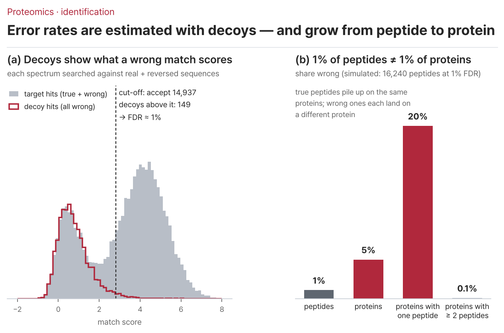{fig-align="center"}

::: {.callout-note collapse="true" icon=false}
## 🔍 Going further — why protein-level error is larger

-   The FDR among target hits is estimated from the rate of decoy hits **above a score threshold**
-   Protein-level error **accumulates**
-   ⚠️ Single-peptide identifications are the least reliable
:::

## 3) ⚠️ Protein inference {#w6-s3-3}

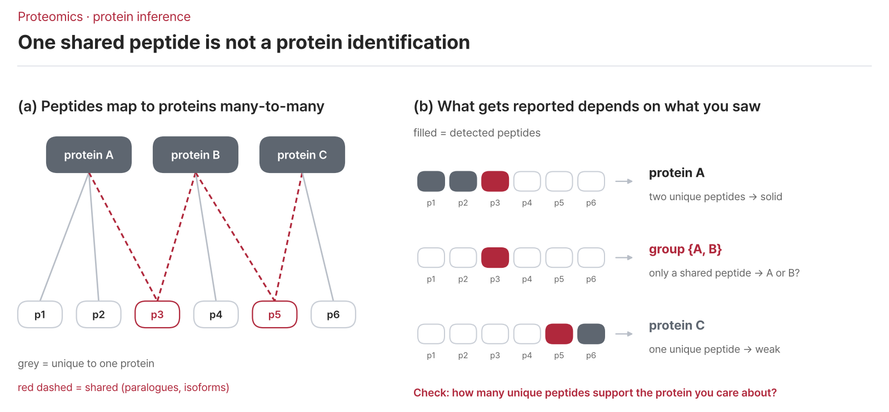{fig-align="center"}

-   Many peptides are **shared** between related proteins — paralogues, isoforms, family members
-   Detect only a shared peptide → several proteins are equally consistent with the data
-   Software reports a **protein group** — a set of indistinguishable proteins under one representative name
-   ✅ For any protein you care about → check how many **unique** (protein-specific) peptides support it

::: {.callout-warning collapse="true"}
## Shared peptides and protein groups

⚠️ The group's representative accession is often the only name that reaches your results table, your figure, and your abstract

**What to check on any protein of interest:**

-   How many **unique** peptides support it? One is weak; two is a common minimum
-   Is it reported as part of a group? If so, which members?
-   Would the biological story change if a different group member were the real one?
:::

## 4) Protein quantification {#w6-s3-4}

-   One protein is seen through several peptides → their intensities must be summarised into **one value per sample**
-   Peptides ionise very differently → within one protein, raw heights can differ a hundred-fold → summarise the **pattern across samples**, not the raw sum
-   Common methods — **MaxLFQ** (label-free; built from peptide ratios between samples), **Tukey median polish** (MSstats). TMT: reporter-ion intensities per peptide, summed per protein
-   ✅ Use peptides unique to the protein group — shared ones mix the signal of several proteins ([③](#w6-s3-3))

{fig-align="center"}

## 5) Normalization {#w6-s3-5}

-   Raw intensities are extremely skewed → **log₂-transform**: the distribution becomes roughly symmetric, and a doubling is +1 anywhere on the scale
-   Samples differ in how much material was loaded → every protein in a sample shifts together → **median centring** of log intensities lines the samples up (quantile normalisation is the stronger alternative)
-   Intensities are **continuous, not counts** → the negative binomial machinery of RNA-seq (🔗 [W4 §4.3](w4_transcriptomics.qmd#w4-s4-3)) does not apply
-   ⚠️ The same assumption as TMM and RLE — **most proteins do not change**. One dominant protein, or very different sample types, distorts everything (🔗 [W4 §3.3②](w4_transcriptomics.qmd#w4-s3-3-2))
-   TMT — normalise within each set, then align sets through a common reference channel ([§4.3](#w6-s4-3))

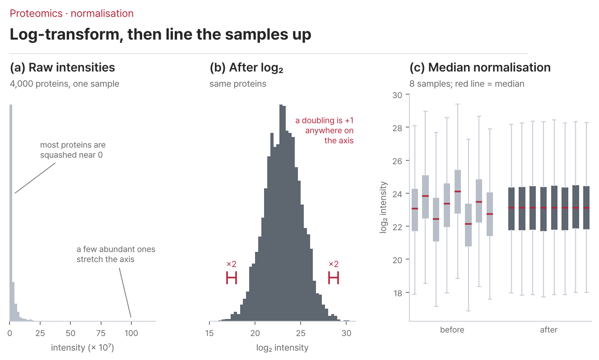{fig-align="center"}

## 6) Missing values {#w6-s3-6}

-   A proteomics matrix commonly has **20–50% missing entries** — shocking to RNA-seq analysts, normal to proteomics analysts
-   **The difference** — sequencing counts a zero; MS simply fails to record anything
-   💡 Usually a gap means "too little to detect" → filling the gaps carelessly inflates fold changes and manufactures false positives

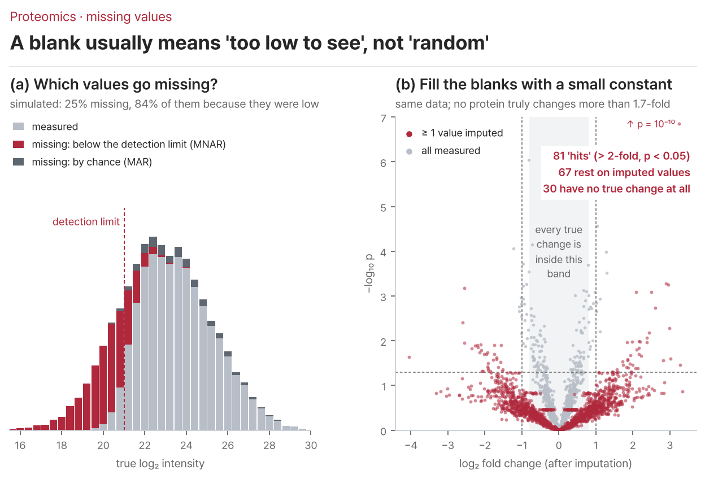{fig-align="center"}

### ① Two kinds of missing {#w6-s3-6-1}

-   **MNAR** (missing not at random) — the protein was below the limit of detection → the gap itself is **informative**: the abundance was low
-   **MAR / MCAR** (missing at random) — missed by chance: DDA happened not to select it, or the peptide had a poor retention time that run → uninformative
-   ⚠️ Real data = a mixture, and the proportion depends heavily on abundance — exactly what the left panel shows

### ② ⚠️ Imputation {#w6-s3-6-2}

-   **Imputation** = filling in missing values with estimated numbers
-   ⚠️ Fill them with a small constant → every protein near the detection limit gets an **inflated fold change**: a small real change looks large, and some proteins with no change at all become "highly significant" hits = **false positives**
-   ✅ Filter first, match the method to the kind of missingness, and check that top hits survive **without** imputation

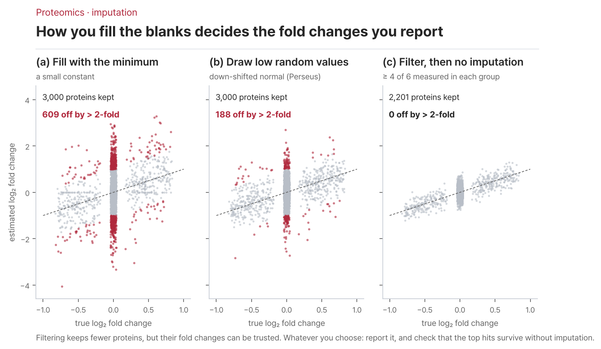{fig-align="center"}

::: {.callout-warning collapse="true"}
## The commonest way to manufacture a proteomics false positive

**The recipe:**

-   Replace missing values with a small constant, or the minimum observed value
-   → a protein detected in all controls and none of the cases now has a large, extremely significant fold change
-   → the size of that fold change is set by the constant you chose, not by the data
-   → **for every protein sitting near the detection limit**

**The signature** — a volcano plot with a suspicious cloud of "highly significant" hits, all at large fold changes, mostly driven by imputed values rather than measurements

**Better practice:**

-   ✅ **Filter first** — require detection in, say, ≥70% of samples in at least one group before testing
-   ✅ **Match the method to the mechanism** — MNAR needs left-censored imputation (QRILC, MinProb); MAR needs something like kNN. Perseus's "replace missing from normal distribution" is a **MNAR** method → do not apply it indiscriminately
-   ✅ **Or do not impute** — MSstats and `limma` handle missingness in the model rather than filling it in
-   ✅ **Always report** how much was missing, how you filtered, what you imputed → then check whether your top hits survive **without** imputation
:::

------------------------------------------------------------------------

# 4. Statistical Analysis: Differential Abundance 📊 {#w6-s4}

> 🔑 **Core idea** — the same logic as RNA-seq differential expression (🔗 [W4 §4](w4_transcriptomics.qmd#w4-s4)), on continuous log intensities, with fewer proteins and small n → a linear model per protein, with variance borrowed across proteins

## 1) Differences from RNA-seq {#w6-s4-1}

-   **① Continuous intensities** — log₂ intensities are roughly normal → a linear model (t-test family), not the negative binomial ([§3.5](#w6-s3-5))
-   **② Fewer features** — typically **3,000–9,000 proteins**, not 20,000 genes → FDR correction still essential, but the burden is lighter
-   **③ Small n, high variability** → `limma` (moderated t-statistic) and **MSstats** are the standard tools

::: {.callout-note collapse="true" icon=false}
## 🔍 Going further — small n, high variability

-   Proteomics experiments are usually smaller than RNA-seq experiments, and technical variability is larger
-   → a protein's variance from 3 vs. 3 samples is a noisy guess. By chance some look tiny, and tiny variances make huge t-statistics
:::

## 2) limma and MSstats {#w6-s4-2}

-   **`limma`** — fits a linear model to each protein's log intensities, then shrinks each protein's variance toward the typical value across all proteins = the **moderated t-statistic**
-   The same borrowing-across-features idea as DESeq2's dispersion shrinkage (🔗 [W4 §4.3④](w4_transcriptomics.qmd#w4-s4-3-4))
-   ✅ Variances that look tiny by chance are pulled up → fewer spurious hits and more real ones
-   **MSstats** — starts from **peptide-level** intensities: summarises them ([§3.4](#w6-s3-4)) and models the peptide-to-protein structure explicitly

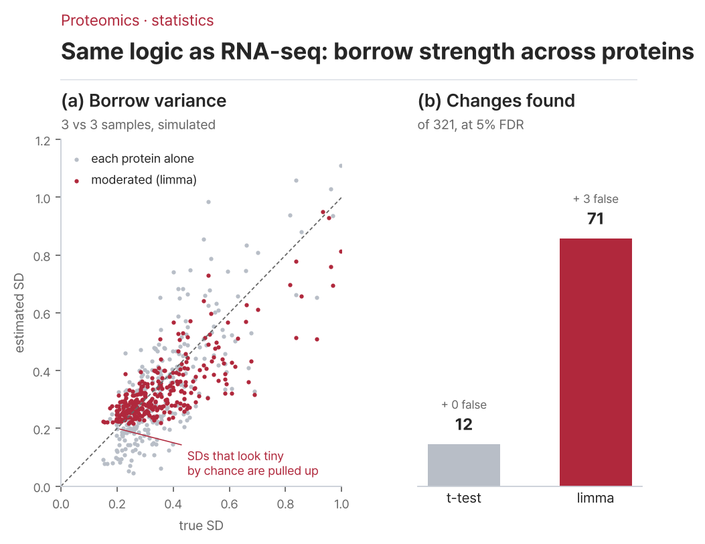{fig-align="center"}

## 3) Batches and design {#w6-s4-3}

-   An 18-plex TMT experiment analysing 90 samples requires **5 sets** (batches); a DIA cohort runs over weeks → drift with run order
-   ⚠️ Cases and controls unevenly distributed across batches → 🔗 [W1 §4.3](w1_intro.qmd#w1-s4-3)'s confounding problem, reproduced exactly
-   ✅ **Before** the experiment — randomise samples across sets and run order; include a **common reference channel** in every TMT set and a pooled QC sample through the run
-   ✅ **In the model** — put batch in the design (`~ batch + group`), as in RNA-seq (🔗 [W4 §4.4](w4_transcriptomics.qmd#w4-s4-4))

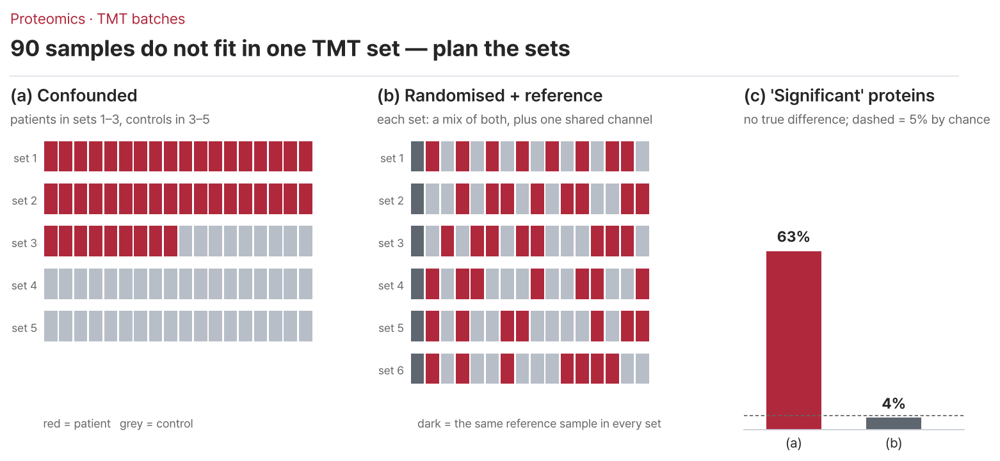{fig-align="center"}

::: {.callout-tip collapse="true"}
## What to look for when reading a proteomics paper

-   How many proteins were quantified — and **in what fraction of samples**?
-   How were missing values handled?
-   DDA or DIA? If TMT — how many batches, and how were samples allocated?
-   How many **unique peptides** support the headline protein?
-   Was anything validated orthogonally — western blot, ELISA, targeted MS?
:::

------------------------------------------------------------------------

# 5. Downstream Analysis: From a Protein List to Biology 🧠 {#w6-s5}

> 🔑 **Core idea** — a list of changed proteins → pathways, signalling and drug targets. Each step has a proteomics-specific trap: the background, the protein under a phosphosite, the epitope under a pQTL

## 1) Enrichment analysis and its background {#w6-s5-1}

-   The same tools as RNA-seq — ORA and GSEA (🔗 [W4 §5](w4_transcriptomics.qmd#w4-s5))
-   ⚠️ MS sees **abundant proteins first** — ribosomes, metabolism, the proteasome. Receptors and transcription factors are rarely detected
-   → against the whole genome, *any* list of detected proteins looks "enriched" for ribosomes and glycolysis
-   ✅ **Background = all proteins quantified in this experiment**, not the genome
-   💡 Proteins in one complex often change together → complex-level (CORUM) and interaction-network (STRING) views suit proteomics well

{fig-align="center"}

## 2) Phosphorylation and signalling {#w6-s5-2}

-   **Phosphoproteomics** — the main clinical example. Signalling is regulated by phosphorylation, and total protein abundance says nothing about it
-   Phosphopeptides are a small fraction of the total → the workflow adds an **enrichment step** (TiO₂, IMAC) before MS
-   ⚠️ A phosphopeptide can rise simply because the protein rose → interpreting phosphorylation as *signalling* requires knowing the protein level too
-   💡 Which kinases were active? → test whether the known substrates of each kinase moved together (kinase activity inference)

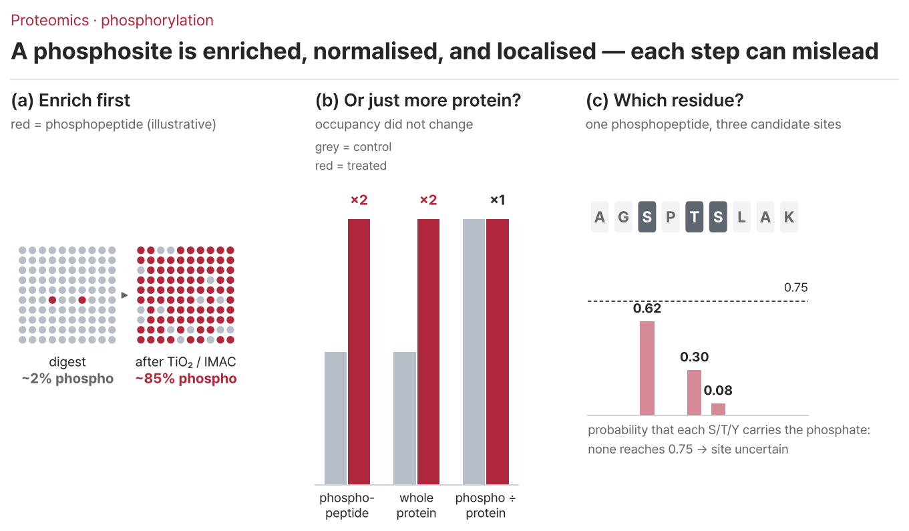{fig-align="center"}

::: {.callout-note collapse="true" icon=false}
## 🔍 Going further — which site? (site localisation)

-   ⚠️ A peptide may contain several possible sites, and the spectrum may not distinguish them
-   Search engines report a localisation probability → treat sites below \~0.75 as uncertain
:::

## 3) 💊 pQTLs and drug targets {#w6-s5-3}

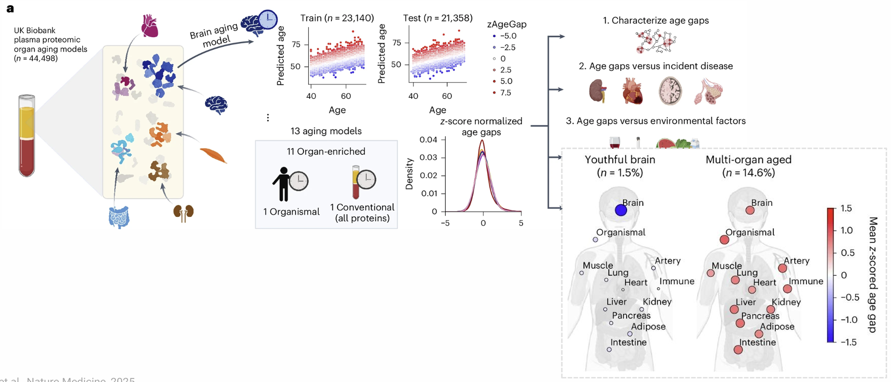{fig-align="center"}

-   **pQTL** — a genetic variant associated with a protein's abundance. The protein analogue of an eQTL (🔗 [W2 §4.4](w2_genomics.qmd#w2-s4-4), 🔗 [W4 §6.4](w4_transcriptomics.qmd#w4-s6-4))
-   Population-scale plasma proteomics on tens of thousands of biobank participants → pQTLs now available at scale
-   💊 This closes a loop that runs through the whole course: GWAS hit → pQTL → which protein → causal? → a **genetically validated, druggable target**

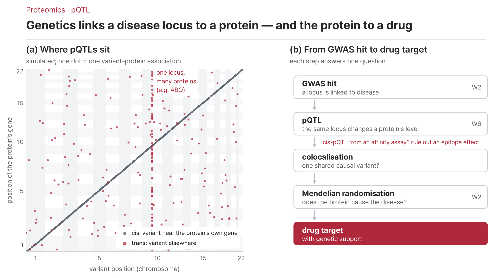{fig-align="center"}

::: {.callout-note collapse="true" icon=false}
## 🔍 Going further — from GWAS hit to drug target, step by step

```
GWAS hit (W2)        → points to a locus
pQTL (W6)            → which protein's level that locus controls
Colocalization       → do the two signals share a causal variant?
Mendelian rand. (W2) → does that protein causally affect disease?
        ↓
a genetically validated, druggable target (🔗 W2 §6.3)
```
:::

::: {.callout-note collapse="true" icon=false}
## 🔍 Going further — *cis*- vs. *trans*-pQTL

⚠️ Distinguish:

-   ***cis*****-pQTL** — variant near the protein's own gene. Strong evidence, **but check for epitope effects** ([§2.5②](#w6-s2-5-2))
-   ***trans*****-pQTL** — variant elsewhere. Biologically interesting (a regulator, a clearance mechanism), harder to interpret
:::

------------------------------------------------------------------------

# 6. Beyond Abundance 🔭 {#w6-s6}

> 🔑 **Core idea** — a bulk abundance table leaves out shape, single cells and place in the tissue. Each has its own technology — and its own limits

## 1) Structure in the AlphaFold era {#w6-s6-1}

-   Accurate structure prediction has changed what a protein list can support — variant effect interpretation, docking, cross-linking MS interpretation
-   ⚠️ A prediction is a **model** — not evidence of a conformation *in vivo*

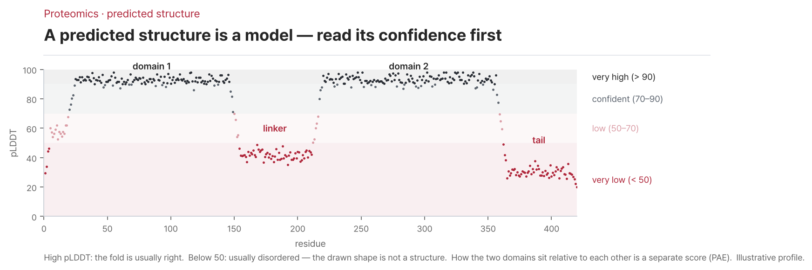{fig-align="center"}

::: {.callout-note collapse="true" icon=false}
## 🔍 Going further — reading a predicted structure

-   Confidence scores (pLDDT) matter
-   Disordered regions are predicted poorly
:::

## 2) Single-cell and spatial proteomics {#w6-s6-2}

-   **Single-cell MS** (SCoPE2, plexDIA) — hundreds to a few thousand proteins per cell. Far fewer cells per run than single-cell RNA-seq (🔗 [W5](w5_singlecell.qmd))
-   **Antibody-based, per cell** — flow and mass cytometry (CyTOF): tens of proteins in millions of cells. CITE-seq: DNA-barcoded antibodies read alongside RNA
-   **Spatial** — imaging mass cytometry and CODEX: 40+ proteins on a tissue section at cellular resolution. MALDI imaging MS: untargeted, coarser resolution
-   ⚠️ Antibody-based methods = a **predefined panel** that measures **binding** — the same caveat as affinity assays ([§2.5](#w6-s2-5))

------------------------------------------------------------------------

# 📝 Summary

-   Across genes, mRNA explains roughly a fifth of protein abundance → **if the claim is about protein, measure protein**
-   Bottom-up MS measures **peptides** and infers proteins; the MS2 fragment ladder encodes the sequence
-   DDA picks the most intense peptides → misses things stochastically. DIA fragments everything → far less missingness. Targeted MS is for validation
-   LFQ, TMT and SILAC differ in *when* samples are combined. ⚠️ TMT compresses ratios, and its batches must be randomised
-   Plasma spans \>10 orders of magnitude; the top 20 proteins are \~99% of the mass. ⚠️ Affinity platforms (Olink, SomaScan) measure **binding** → cross-reactivity and epitope-altering variants matter
-   Pre-processing = database search → target–decoy FDR → protein groups → protein values → log₂ and normalisation. Check QC **step by step**, against the other runs
-   ⚠️ **Protein inference is genuinely ambiguous** → check unique peptide counts and whether your protein is a group
-   ⚠️ Missing values are mostly MNAR → filter before you impute, and check that hits survive without imputation
-   Statistics = RNA-seq logic, adapted to continuous intensities and small n → `limma`, MSstats. Put batch in the design
-   ⚠️ Enrichment against the whole genome favours abundant housekeeping proteins → use the **detected proteome** as background
-   pQTLs complete the chain from GWAS hit to genetically validated drug target

------------------------------------------------------------------------

# 🔑 Key terms

| Term | One-line meaning |
|-------------------------|------------------------------------------------|
| Bottom-up proteomics | Digest to peptides, then measure |
| Tryptic peptide | Fragment produced by cutting after K/R |
| MS1 / MS2 | Precursor survey scan / fragment scan |
| PSM | Peptide–spectrum match: one spectrum matched to one peptide |
| Protein inference | Deciding which proteins the peptides came from |
| Protein group | Indistinguishable proteins reported together |
| DDA / DIA | Data-dependent / data-independent acquisition |
| PRM / MRM | Targeted acquisition of a predefined list |
| LFQ | Label-free quantification |
| TMT / iTRAQ | Isobaric chemical labels, multiplexed in one run |
| SILAC | Metabolic labelling with heavy amino acids |
| Pooled QC sample | A mix of all samples, run repeatedly to measure technical noise |
| MNAR / MAR | Missing because low abundance / missing by chance |
| Dynamic range | Span between most and least abundant protein |
| pQTL | Variant associated with a protein's level |
| Phosphoproteomics | Enrichment and measurement of phosphopeptides |

::: {.callout-note collapse="true" icon=false}
## 🔍 Going further — advanced terms

| Term | One-line meaning |
|-------------------------|------------------------------------------------|
| b ion / y ion | N-terminal / C-terminal fragment series |
| Target–decoy | FDR estimation using a reversed database |
| Missed cleavage | A K/R site that trypsin failed to cut |
| MaxLFQ | Label-free protein values built from peptide ratios between samples |
| Ratio compression | Co-isolation pulling TMT ratios toward 1 |
| PEA | Olink's dual-antibody DNA readout |
:::

------------------------------------------------------------------------

# ➕ References

### Overviews

Aebersold R, Mann M. [*Mass-spectrometric exploration of proteome structure and function.*](https://pubmed.ncbi.nlm.nih.gov/?term=Mass-spectrometric+exploration+of+proteome+structure+and+function) Nature. 2016.\
Sinitcyn P, Rudolph JD, Cox J. [*Computational methods for understanding mass spectrometry-based shotgun proteomics data.*](https://pubmed.ncbi.nlm.nih.gov/?term=Computational+methods+for+understanding+mass+spectrometry-based+shotgun+proteomics+data) Annu Rev Biomed Data Sci. 2018.\
Liu Y, Beyer A, Aebersold R. [*On the dependency of cellular protein levels on mRNA abundance.*](https://pubmed.ncbi.nlm.nih.gov/?term=On+the+dependency+of+cellular+protein+levels+on+mRNA+abundance) Cell. 2016.

### Acquisition and quantification

Ludwig C, et al. [*Data-independent acquisition-based SWATH-MS for quantitative proteomics: a tutorial.*](https://pubmed.ncbi.nlm.nih.gov/?term=Data-independent+acquisition-based+SWATH-MS+for+quantitative+proteomics%3A+a+tutorial) Mol Syst Biol. 2018.\
Demichev V, et al. [*DIA-NN: neural networks and interference correction enable deep proteome coverage in high throughput.*](https://doi.org/10.1038/s41592-019-0638-x) Nat Methods. 2020.\
Ting L, et al. [*MS3 eliminates ratio distortion in isobaric multiplexed quantitative proteomics.*](https://pubmed.ncbi.nlm.nih.gov/?term=MS3+eliminates+ratio+distortion+in+isobaric+multiplexed+quantitative+proteomics) Nat Methods. 2011.\
Cox J, et al. [*Accurate proteome-wide label-free quantification by delayed normalization and maximal peptide ratio extraction, termed MaxLFQ.*](https://pubmed.ncbi.nlm.nih.gov/?term=Accurate+proteome-wide+label-free+quantification+by+delayed+normalization+and+maximal+peptide+ratio+extraction%2C+termed+MaxLFQ) Mol Cell Proteomics. 2014.

### QC, statistics and missing values

Bielow C, Mastrobuoni G, Kempa S. [*Proteomics quality control: quality control software for MaxQuant results.*](https://pubmed.ncbi.nlm.nih.gov/?term=Proteomics+quality+control%3A+quality+control+software+for+MaxQuant+results) J Proteome Res. 2016. (PTXQC)\
Choi M, et al. [*MSstats: an R package for statistical analysis of quantitative mass spectrometry-based proteomic experiments.*](https://doi.org/10.1093/bioinformatics/btu305) Bioinformatics. 2014.\
Lazar C, et al. [*Accounting for the multiple natures of missing values in label-free quantitative proteomics data sets.*](https://pubmed.ncbi.nlm.nih.gov/?term=Accounting+for+the+multiple+natures+of+missing+values+in+label-free+quantitative+proteomics+data+sets) J Proteome Res. 2016.\
Nesvizhskii AI, Aebersold R. [*Interpretation of shotgun proteomic data: the protein inference problem.*](https://pubmed.ncbi.nlm.nih.gov/?term=Interpretation+of+shotgun+proteomic+data%3A+the+protein+inference+problem) Mol Cell Proteomics. 2005.

### Plasma and affinity proteomics

Geyer PE, et al. [*Revisiting biomarker discovery by plasma proteomics.*](https://pubmed.ncbi.nlm.nih.gov/?term=Revisiting+biomarker+discovery+by+plasma+proteomics) Mol Syst Biol. 2017.\
Sun BB, et al. [*Plasma proteomic associations with genetics and health in the UK Biobank.*](https://doi.org/10.1038/s41586-023-06592-6) Nature. 2023.\
Katz DH, et al. [*Proteomic profiling platforms head to head: comparison of Olink and SomaScan.*](https://pubmed.ncbi.nlm.nih.gov/?term=Proteomic+profiling+platforms+head+to+head%3A+comparison+of+Olink+and+SomaScan) Cell Rep Med. 2022.

### Single-cell proteomics

Specht H, et al. [*Single-cell proteomic and transcriptomic analysis of macrophage heterogeneity using SCoPE2.*](https://pubmed.ncbi.nlm.nih.gov/?term=Single-cell+proteomic+and+transcriptomic+analysis+of+macrophage+heterogeneity+using+SCoPE2) Genome Biol. 2021.

### Resources

[PRIDE](https://www.ebi.ac.uk/pride/) · [Human Protein Atlas](https://www.proteinatlas.org/) · [AlphaFold DB](https://alphafold.ebi.ac.uk/) · [PeptideAtlas](http://www.peptideatlas.org/)
