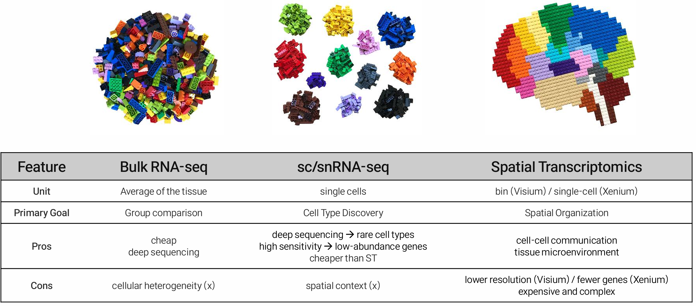
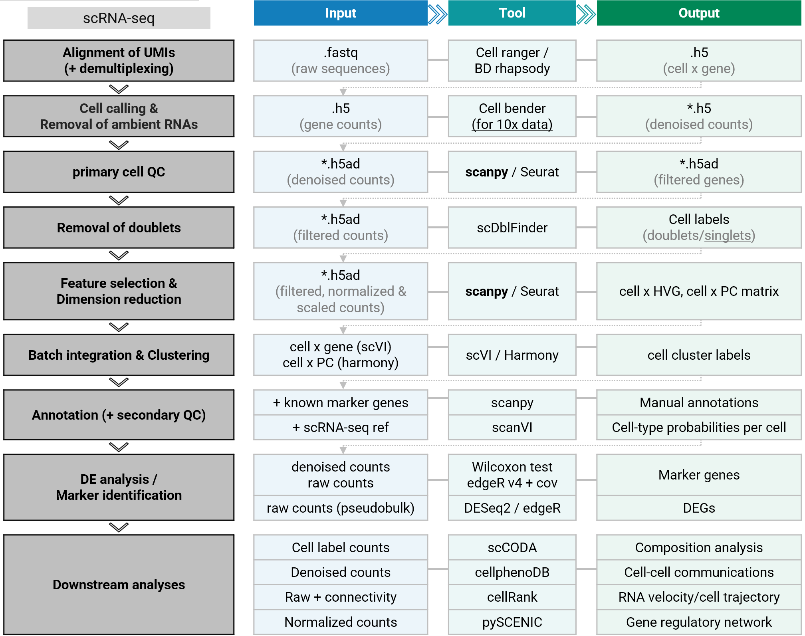
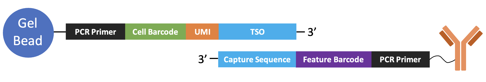
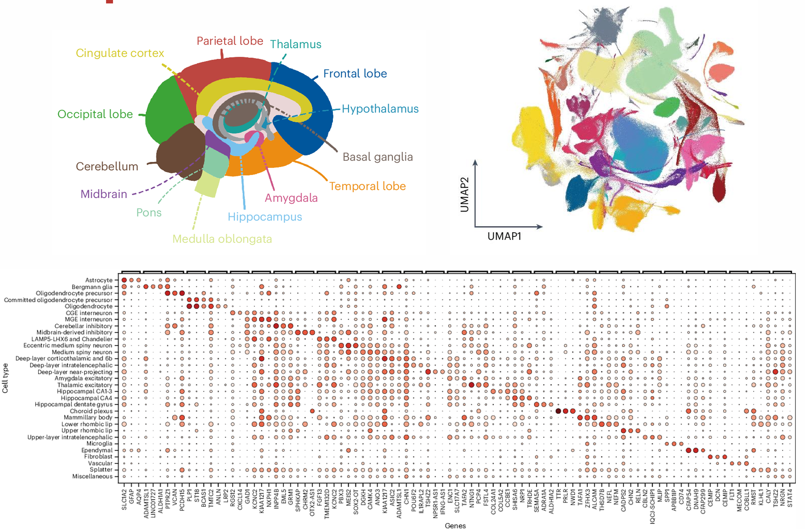

::: {.callout-note collapse="true"}
## 🎯 학습목표

이 장을 마치면:

-   Bulk와 single cell이 각각 답할 수 있는 질문 구분
-   시료 준비 단계에서 내려야 하는 결정 (세포 vs 핵, 기증자 수)
-   Count matrix가 만들어지는 과정과 QC가 걸러내는 것
-   Clustering과 UMAP이 보여주는 것과 보여주지 않는 것
-   ⚠️ 조건 비교에서 n = 기증자 수인 이유 (pseudobulk)
-   Trajectory·세포 간 소통 결과를 가설로 읽기
:::

> 🤔 **출발 질문**
>
> Bulk RNA-seq에서 뚜렷한 2배 증가, *p* = 0.001
>
> → 모든 세포가 조금씩 변했나? 세포의 5%만 크게 변했나? 아니면 어떤 세포도 변하지 않았나?

{fig-align="center"}

💡 각 절의 본문 = 꼭 알아야 할 기초. **🔍 더 알아보기**는 관심 있을 때 펼쳐 보는 심화 내용

------------------------------------------------------------------------

# 1. 단일세포 분석이 필요한 이유 🔬 {#w5-s1}

> 🔑 **핵심** — Bulk = 평균. 같은 평균 뒤에 전혀 다른 생물학이 숨어 있을 수 있음

## 1) 평균을 내면 사라지는 것 {#w5-s1-1}

{fig-align="center"}

-   **① 모든 세포가 조금씩 변함** — 모두가 암묵적으로 가정하는 경우
-   **② 일부 세포만 크게 변함** — 보통 가장 흥미로운 경우. Bulk에서는 희석되어 안 보일 수도
-   **③ 세포 구성만 변함** — 어떤 세포도 변하지 않음. 발현이 높은 세포 유형이 많아졌을 뿐

→ Bulk는 셋을 구분 못 함, single cell은 구분 가능

::: {.callout-note collapse="true" icon=false}
## 🔍 더 알아보기 — ③ 조성 변화는 생각보다 흔함

-   ⚠️ 염증·섬유화·침윤 조직 — 임상에서 주로 연구하는 바로 그 조직 — 에서 흔함. 그런데 논문에는 흔히 ①처럼 기술됨
-   같은 문제의 다른 모습: bulk 조직 deconvolution(🔗 [W4 §7.2](w4_transcriptomics.qmd#w4-s7-2)), 후성유전체(🔗 [W3 §5.3②](w3_epigenomics.qmd#w3-s5-3-2))
:::

## 2) 언제 single cell을 쓰나 {#w5-s1-2}

| ✅ Single cell이 적합 | ✅ Bulk가 적합 |
|------------------------------------|------------------------------------|
| 새로운·드문 세포 집단 찾기 | 균질한 시료(cell line, sorting한 세포) 비교 |
| 세포 구성 비율의 변화 | Isoform, 저발현 유전자 같은 깊은 분석 |
| 세포 유형마다 다른 반응 | 환자 수가 많은 cohort (비용) |

💡 Single cell은 비쌈 → bulk로 충분하면 bulk

::: {.callout-note collapse="true" icon=false}
## 🔍 더 알아보기 — 연속적인 상태, 그리고 sorting 후 bulk

-   **연속적인 상태**(분화, 활성화, 탈진)처럼 불연속 범주로 나누기 어려운 과정도 single cell의 강점
-   **세포 유형 특이적 효과** — 한 유형에서는 증가, 다른 유형에서는 감소 → bulk에서는 상쇄되어 안 보임
-   관심 세포 유형을 이미 안다면 → FACS로 sorting 후 deep bulk RNA-seq. 흔히 **더 싸고, 더 깊고, 통계적으로 더 깔끔함**. 같은 예산으로 환자를 훨씬 많이 넣을 수 있음 — 실제 검정력은 거기서 나옴(§6.2)
-   💡 "Single cell을 했다" ≠ 더 강한 설계. 검정력이 부족한 연구를 더 비싸게 한 것일 수도
:::

------------------------------------------------------------------------

# 2. 장비에 넣기 전에 내리는 결정 🧫 {#w5-s2}

> 🔑 **핵심** — 분석으로 되돌릴 수 없는 결정은 전부 시료 수집과 실험 설계 단계에서 내려짐

## 1) Platform {#w5-s2-1}

-   현재 기본 = **droplet 방식(10x Genomics)**: 세포 하나를 barcode bead 하나와 함께 기름방울에 가둠
-   한 번에 세포 수천~수만 개. 대신 세포당 유전자의 일부만 검출
-   모든 platform = **세포 수 vs 세포당 깊이**의 맞교환

::: {.callout-note collapse="true" icon=false}
## 🔍 더 알아보기 — platform 비교

{fig-align="center"}

| Platform | 원리 | 세포 수 | 깊이 | 언제 |
|-------------------|-------------------|-----------|-------------------|-------------------|
| **Droplet (10x Genomics)** | 세포 하나 + barcode bead 하나를 기름방울에 | 10³–10⁵ | 세포당 유전자 수천 개, 3′ 또는 5′ 말단만 | 현재의 기본 선택 |
| **Plate (Smart-seq2/3)** | well 하나에 세포 하나 | 10² | full-length, 깊음 | isoform, 매우 민감한 검출 |
| **Combinatorial indexing (sci-, SPLiT-seq)** | 물리적 분리 없이 split-pool을 반복해 barcode 조합 | 10⁶ | 매우 얕음 | 전 개체 atlas |
:::

## 2) 3′ vs 5′ {#w5-s2-2}

-   Droplet kit은 transcript 전체가 아니라 **한쪽 끝**만 읽음 → 유전자 세기엔 충분
-   대부분 **3′ kit**. T/B cell 수용체(TCR/BCR) 서열이 필요하면 **5′ kit**

::: {.callout-note collapse="true" icon=false}
## 🔍 더 알아보기 — 왜 한쪽 끝만 읽히나

{fig-align="center"}

-   Barcode가 붙는 쪽 끝 = 읽히는 쪽 끝
-   ✅ **3′** — 공개 atlas 대부분. ✅ **5′** — 종양면역, 자가면역, 백신 반응처럼 clonotype이 필요할 때
-   ⚠️ 유전자 count만 보면 둘은 대체로 비슷. 하지만 **한 비교 안에서 섞어 쓰기 x** — 3′/5′ 시료가 섞인 연구 = 설계 단계의 batch effect
-   💡 고정·FFPE 시료: probe 기반 kit(10x Flex) — poly(A) tail을 잡는 대신 probe를 hybridise
:::

## 3) ⚠️ 세포 vs 핵 {#w5-s2-3}

⚠️ 분석이 아니라 **시료 수집 시점에 결정됨**

-   **scRNA-seq** — **신선한** 조직을 효소로 풀어 온전한 세포로 만들어야 함 (해리, dissociation)
-   **snRNA-seq** — 세포 대신 **핵**을 분석. 냉동 조직도 가능, 신경세포·지방세포·심근세포처럼 해리가 어려운 세포도 가능

{fig-align="center"}

⚠️ 해리 과정 자체가 결과를 바꿈: 스트레스 유전자 유도, 약한 세포는 소실 → 측정한 조성 = **살아남은 세포의 조성**

::: {.callout-warning collapse="true"}
## 해리 = 의도하지 않았지만 수행하게 된 실험

**일어나는 일:**

-   37 °C에서 30–60분 효소 해리. 세포는 그동안 살아서 반응 → 스트레스 반응 유전자 유도
-   ⚠️ 더 큰 문제: **해리가 균일하지 않음.** 신경세포, 지방세포처럼 크거나 약한 세포가 선택적으로 파괴

**연구 설계 회의에 가져갈 두 가지:**

-   ⚠️ **Immediate-early gene = 대표적인 위양성.** *FOS*, *JUN*, *EGR1*로 정의된 cluster는 "활성화" 상태가 아니라 해리 artifact인 경우가 많음. 한 조건의 시료가 bench에 더 오래 있었다면 그 조건이 더 "활성화"된 것처럼 보임
-   ⚠️ **감소 주장은 의심해 볼 것.** "질환에서 세포 유형 X 감소"와 "질환 조직에서 세포 유형 X를 해리하기 더 어려움"은 똑같은 데이터를 만듦

✅ 완화: 저온 활성 protease로 낮은 온도에서 해리, 조건 간 protocol 동일하게, 가능하면 핵 사용
:::

::: {.callout-note collapse="true" icon=false}
## 🔍 더 알아보기 — scRNA-seq vs snRNA-seq 비교

|   | scRNA-seq | snRNA-seq |
|------------------------|:----------------------:|:----------------------:|
| 냉동 / 보관 조직 | ❌ 신선한 시료 필요 | ✅ |
| 크거나 약한 세포(신경세포, 지방세포, 근섬유, 심근세포) | ❌ 해리 과정에서 소실 | ✅ |
| 해리 스트레스 반응 | ⚠️ 있음 — protocol 자체가 *FOS*, *JUN*, heat shock 유전자 유도 | ✅ 최소 |
| 세포질 transcript | ✅ 포획 | ❌ 놓침 |
| Intron read 비율 | 낮음 | 높음 — 핵에는 splicing 전 pre-mRNA가 많음 |
:::

## 4) 연구 설계: 반복 단위는 기증자 {#w5-s2-4}

-   ⚠️ 통계에서 n = **기증자(환자) 수**, 세포 수가 아님 (§6)
-   💡 예산이 고정이라면 → 세포를 많이 읽기보다 **기증자를 많이**
-   ⚠️ 환자 시료는 하루, 대조군은 다른 날 처리 → 분석으로 복구 불가 (§5)

::: {.callout-note collapse="true" icon=false}
## 🔍 더 알아보기 — 여러 기증자를 한 번에 돌리기 (pooling)

-   여러 기증자를 한 lane에 섞어 loading → genotype(`demuxlet`, `souporcell`, `vireo`)이나 hashtag antibody로 다시 분리(demultiplexing)
    -   lane 간 batch effect가 특정 조건과 엮이지 않음
    -   서로 다른 기증자의 세포로 된 doublet은 직접 식별 가능(§3.3)
:::

------------------------------------------------------------------------

# 3. Droplet에서 count matrix까지 🧮 {#w5-s3}

> 🔑 **핵심** — Count matrix(세포 × 유전자 표)는 측정값 그 자체가 아님. 빈 droplet, 떠다니는 RNA, 두 세포가 섞인 droplet, 죽어가는 세포를 걸러낸 **판단의 결과물**

💡 이 수업의 초점 = 도구 사용법이 아니라 **각 단계가 무엇을 판단하는지**. 직접 분석은 다음 학기 실습 수업에서

::: {.callout-note collapse="true" icon=false}
## 🔍 더 알아보기 — 전체 분석 흐름 한눈에 보기

{fig-align="center"}
:::

## 1) Barcode와 UMI {#w5-s3-1}

모든 read에 두 가지 꼬리표가 붙음:

-   **Cell barcode** — 어느 세포에서 왔나
-   **UMI** — 원래 mRNA 분자 중 어느 것인가 → PCR로 불어난 read를 분자 하나로 셈

→ Count matrix = 세포 × 유전자별 **분자 수**

::: {.callout-note collapse="true" icon=false}
## 🔍 더 알아보기 — bead 구조와 UMI의 한계

{fig-align="center"}

-   **Cell barcode** — bead 하나의 모든 oligo에 똑같이 붙음 → 그 droplet에서 잡힌 모든 분자에 "이 세포에서 왔음" 표시
-   **UMI** — oligo마다 다른 무작위 서열 → 증폭 **전** 원래 분자 하나하나에 표시. 같은 UMI의 read를 하나로 합침 → 증폭 편향 제거
-   ⚠️ UMI로도 못 고치는 것: 애초에 포획되지 않은 분자는 UMI도 없음 → 다음의 0들
:::

## 2) Matrix의 90% 이상이 0인 이유 {#w5-s3-2}

-   세포 하나에서 약 20,000개 유전자 중 1,000–5,000개만 검출
-   0의 두 가지 의미: **실제로 발현 x**, 또는 **있었지만 못 잡음(dropout)** — droplet 포획 효율 약 10–30%
-   ⚠️ **한 세포에서 0 하나 → 유전자가 꺼졌다는 결론 x**

::: {.callout-note collapse="true" icon=false}
## 🔍 더 알아보기 — "zero inflation"이라는 말

💡 요즘은 "zero inflation"이라고 잘 안 부름. UMI 자료의 0은 대부분 별도의 과정이 아니라, 발현이 낮을 때 단순 표본추출 model이 예측하는 결과
:::

## 3) 품질 관리 (QC) {#w5-s3-3}

QC로 걸러내는 네 가지:

| 문제 | 무엇인가 |
|------------------------|------------------------------------------------|
| **빈 droplet** | 세포 없이 bead만 들어간 droplet — 전체 droplet의 대부분 |
| **Ambient RNA** | 터진 세포에서 나온 RNA("soup")가 모든 droplet에 섞여 들어감 |
| **Doublet** | 한 droplet에 세포 둘 → 세포 하나처럼 보임 |
| **죽어가는 세포** | 세포막이 깨져 미토콘드리아 유전자 비율(mito %)이 높아짐 |

{fig-align="center"}

⚠️ **모든 QC threshold는 실제 세포 집단도 함께 지움** → 기준값은 조직마다 다르게, 사용한 값은 보고

::: {.callout-important collapse="true"}
## 예: threshold별로 함께 지워지는 세포

-   Mito cutoff 5%는 흔하지만 미토콘드리아가 실제로 많은 **심근세포에는 틀린 기준** → 조직·세포 유형마다 다르게
-   최소 유전자 수 500개는 잔해뿐 아니라 **혈소판, 일부 granulocyte처럼 작고 RNA가 적은 세포**도 제거
-   유전자 수 상한은 doublet뿐 아니라 **실제로 크고 전사가 활발한 세포**도 제거

→ QC 자동화는 불가. 분포를 그려 보고, cutoff 밖에 무엇이 있는지 확인한 뒤 결정
:::

::: {.callout-note collapse="true" icon=false}
## 🔍 더 알아보기 — ① 빈 droplet 걸러내기 (knee plot, EmptyDrops)

-   Droplet 방식은 세포를 일부러 묽게 loading → 대부분의 droplet = bead만 있고 세포는 없음 (그래도 barcode는 붙음)
-   **Knee plot (barcode rank plot)** — 모든 barcode를 총 UMI 순으로 줄 세워 log–log로 그린 그림

{fig-align="center"}

-   ① **높고 평평한 plateau** — 진짜 세포 / ② **급경사 (knee)** — 전이 구간 / ③ **길고 낮은 꼬리** — 빈 droplet
-   ⚠️ Knee에서 단순 cutoff → RNA가 적을 뿐인 진짜 세포까지 삭제 (작거나 휴지기인 세포, neutrophil)
-   ✅ **EmptyDrops**: "총량이 많은가?"가 아니라 "이 barcode의 **profile**이 빈 droplet과 다른가?"를 물음 → 작아도 profile이 뚜렷한 세포는 살아남음
-   💡 빈 droplet까지 포함된 **raw matrix는 꼭 보관** — ambient RNA 보정에 필요
:::

::: {.callout-note collapse="true" icon=false}
## 🔍 더 알아보기 — ② Ambient RNA

해리·loading 중 터진 세포 → mRNA가 용액으로 흘러나옴. 이 **"soup"**이 모든 droplet에 들어감 → 모든 세포의 profile = 자기 RNA + soup 약간

{fig-align="center"}

-   **어떻게 보이나** — 가장 많거나 가장 약한 세포 유형의 marker가 **모든** cluster에서 낮게 검출. 예: 혈액이 많은 시료 → 모든 세포에 hemoglobin 유전자, 간 → 면역세포에 *ALB*
-   **왜 문제** — 가짜 co-expression, 흐려진 cluster 경계, ⚠️ 한 조건에 soup이 더 많으면 가짜 DE (질환·괴사 조직이 보통 더 많음)
-   **보정** — 빈 droplet에서 soup profile을 추정해 각 세포에서 뺌: `SoupX`, `CellBender`, `DecontX`
-   ⚠️ **snRNA-seq이 가장 심함** (핵을 분리하면서 모든 세포가 터지므로). Well 기반 platform(BD Rhapsody, Smart-seq)은 훨씬 적지만 0은 아님
:::

::: {.callout-note collapse="true" icon=false}
## 🔍 더 알아보기 — ③ 죽어가는 세포: 세 가지 숫자

| 지표 | 너무 낮으면 → | 너무 높으면 → |
|------------------------|------------------------|------------------------|
| 총 UMI 수 | 빈 droplet, 잔해, 깨진 세포 | doublet — 또는 크고 전사가 활발한 세포 |
| 검출 유전자 수 | 위와 같음 | 위와 같음 |
| 미토콘드리아 비율(mito %) | — | 죽어가는 세포 — 또는 원래 미토콘드리아가 많은 세포 |

**Mito %가 높으면 왜 죽어가는 세포?** 세포막이 깨지면 세포질 mRNA는 새어 나가지만, 미토콘드리아 안의 transcript는 미토콘드리아 막에 보호되어 남음 → **비율**이 올라감 (더 많이 만든 게 아님)

-   ⚠️ **함께 볼 것.** Mito 높음 **+** 유전자 수 적음 = 깨진 세포. 유전자 수가 정상이면 원래 미토콘드리아가 많은 세포일 수 있음 (심근세포, 간세포, 신세뇨관)
-   ⚠️ **snRNA-seq**: 핵에는 미토콘드리아 x → mito read ≈ 0이 정상
-   ✅ **데이터 기반 cutoff, 시료별로** — median에서 몇 MAD(median absolute deviation) 이상 벗어난 세포를 표시. 고정값 x
:::

::: {.callout-note collapse="true" icon=false}
## 🔍 더 알아보기 — ④ Doublet 찾기

-   Loading할수록 ↑: 표준 10x에서 회수 세포 1,000개당 약 0.8% → **10,000개 회수 시 약 8%**

|   | **Heterotypic** | **Homotypic** |
|-------------------|------------------------|------------------------|
| 구성 | 서로 다른 세포 유형 (T cell + monocyte) | 같은 유형의 세포 둘 |
| 보이는 모습 | 두 유형의 marker가 동시에; 가짜 "중간" cluster | count가 약 2배인 세포 하나 |
| 발현으로 검출 | ✅ 가능 | ❌ 거의 불가 |
| 피해 | ⚠️ 없는 세포 유형·전이 상태를 만들어냄 | 경미 |

**핵심 아이디어** — 어떤 barcode가 doublet인지 직접 볼 방법은 없음 → 가짜 doublet을 **만들어 놓고**, 진짜 세포 중 누가 그걸 닮았는지 확인

{fig-align="center"}

1.  **만들기** — 진짜 세포 두 개의 profile을 무작위로 섞어 가짜 doublet 수천 개 생성
2.  **함께 배치** — 진짜 + 가짜 세포를 같은 공간에
3.  **이웃 세기** — 진짜 세포의 이웃 중 가짜 doublet 비율(pANN)이 높으면 → 아마 doublet

-   도구: `scDblFinder`(현재 흔한 기본값), `DoubletFinder`. 시료(capture)마다 따로 실행
-   ⚠️ Homotypic doublet은 발현 기반 방법으로 다 못 잡음
-   ⚠️ Doublet cluster는 두 부모 cluster 사이에 놓임 → 전이 상태로 착각하기 쉬움
-   💡 **설계가 algorithm보다 나음** — 기증자 pooling + demultiplexing(§2.4)이면 기증자 간 doublet은 직접 식별
:::

## 4) 정규화와 차원 축소 {#w5-s3-4}

-   세포마다 잡힌 RNA 총량이 다름 → **정규화**로 맞춤
-   변이가 큰 유전자 약 2,000개만 골라 → **PCA**로 수십 개 축으로 요약
-   PC 하나 = 함께 움직이는 유전자 묶음(program) → 이후 모든 단계가 이 요약값 위에서 진행

::: {.callout-note collapse="true" icon=false}
## 🔍 더 알아보기 — 단계별로 하는 일

| 단계 | 하는 일 | 이유 |
|-------------------|------------------------|------------------------|
| **정규화** | 세포의 총 UMI로 나누고 × 10,000 → log(1 + x) | 포획 효율이 기술적 이유로 세포마다 몇 배씩 다름; log로 소수의 큰 값을 눌러줌 |
| **HVG 선택** | 평균에 비해 분산이 큰 유전자 약 2,000개만 남김 | 대부분의 유전자는 평평하거나 noise; 세포 유형 신호는 HVG에 |
| **Scaling** | 유전자마다 평균 빼고 SD로 나눔 | 발현량이 크다는 이유만으로 PCA를 지배하지 않게 |
| **PCA** | HVG 2,000개 → principal component 10–50개 | 아래 |

-   **Denoising** — 유전자 하나는 noisy, 상관된 program은 안정적. 상위 PC = 생물학, 뒤쪽 PC = 대부분 noise
-   ✅ **상위 PC를 움직이는 게 무엇인지 확인.** PC1이 총 UMI나 mito %를 따라가면 → 주된 변이 축이 기술적인 것 → QC로 복귀
-   ⚠️ 이제 같은 matrix의 버전이 여러 개: raw count, log-정규화 값, scaled 값 (+ 나중에 batch 보정값) → 검정은 raw count로 (§6)
:::

------------------------------------------------------------------------

# 4. 세포 유형 찾기 🗺️ {#w5-s4}

> 🔑 **핵심** — 발현이 비슷한 세포끼리 묶고(clustering), 2D 그림으로 보여주고(UMAP), 이름을 붙임(annotation). 셋 다 판단이 들어간 결과물

**이웃 연결 → 묶기(clustering) → 그림(UMAP) → 이름 붙이기(annotation)**

⚠️ UMAP은 보여주기용 그림일 뿐. Clustering은 UMAP 그림이 아니라 그 전 단계의 데이터에서 수행

## 1) 이웃 graph {#w5-s4-1}

-   세포마다 발현이 가장 비슷한 세포 몇 개(*k*개)를 찾아 연결 → 세포 간 "이웃 지도"
-   💡 Clustering과 UMAP 모두 이 graph에서 출발. 유전자를 직접 보지 않음

::: {.callout-note collapse="true" icon=false}
## 🔍 더 알아보기 — 이웃 graph 만들기

{fig-align="center"}

-   **kNN graph** — 세포 = 점, 각 세포를 PC 공간에서 가장 가까운 *k*개 이웃과 연결. Seurat은 두 세포가 이웃을 얼마나 **공유**하는지로 연결 강도를 다시 매김(SNN graph) → outlier 영향 감소
-   **왜 graph?** — 세포 집단은 동그란 덩어리인 경우가 드묾. Graph는 길쭉하거나 갈라지거나 연속적인 모양을 그대로 따라감
-   ⚠️ *k*가 scale을 정함. *k* 작음 → 세밀한 구조, 조각 많음. *k* 큼 → 매끄러운 graph, *k*보다 작은 집단은 주변에 흡수됨
:::

## 2) Clustering과 resolution {#w5-s4-2}

-   Clustering = 이웃 graph에서 서로 촘촘히 연결된 세포 덩어리 찾기
-   **Resolution** 값에 따라 cluster 수가 달라짐

{fig-align="center"}

⚠️ **정답 resolution은 없음** → marker 유전자와 알려진 생물학으로 확인, 사용한 값 보고

::: {.callout-warning collapse="true"}
## Cluster ≠ 세포 유형

Cluster에 반영될 수 있는 것:

-   세포 **상태** (활성 vs 휴지)
-   세포주기 단계
-   스트레스 반응 (해리, §2.3)
-   Ambient 오염, doublet (§3.3)
-   **기증자 정체성**

→ 가장 높은 marker 이름을 붙이고 세포 유형으로 취급 → 문헌에 **실제로 존재하지 않는 세포 유형**이 쌓임. "Novel cell type" 주장은 특히 신중하게
:::

::: {.callout-note collapse="true" icon=false}
## 🔍 더 알아보기 — Clustering algorithm과 resolution 고르기

{fig-align="center"}

-   **Community detection** — 우연히 기대되는 것보다 서로 더 촘촘히 연결된 그룹으로 graph를 자름
-   **Louvain vs Leiden** — Leiden = Louvain의 결함(내부가 끊긴 cluster)을 고친 개선판. 생물학적 결론은 거의 안 바뀜

💡 Resolution 값 자체를 고민하는 대신 확인할 것:

-   **안정성** — 다른 resolution, 다른 seed, subsampling한 dataset에서도 유지되나?
-   높은 resolution에서 생긴 "새" cluster가 고유한 marker를 가지나, 같은 marker의 정도 차이일 뿐인가?
:::

## 3) ⚠️ UMAP 읽는 법 {#w5-s4-3}

-   UMAP = 고차원 데이터를 2D로 펼친 **그림**
-   ✅ 가까이 붙은 세포끼리 비슷하다는 것은 비교적 믿을 만함
-   ❌ Cluster 사이 **거리**, cluster **크기**, 사이를 잇는 가느다란 **다리**는 해석 x
-   → 중요한 주장은 UMAP 그림이 아니라 숫자로

::: {.callout-note collapse="true" icon=false}
## 🔍 더 알아보기 — UMAP이 기본이 된 이유, PCA·t-SNE와 비교

{fig-align="center"}

-   UMAP은 clustering과 **같은 kNN graph를 펼침** → island가 대개 cluster와 일치. 빠름
-   **PCA** — 선형, 거리에 의미 있음. 이후 모든 단계의 input이지만 cluster를 *보기*엔 너무 거침
-   **t-SNE** — 국소 이웃 보존, island 배치는 임의. UMAP 이전의 표준
-   ⚠️ 다리 = doublet, ambient RNA, parameter artifact인 경우가 많음. Parameter와 random seed(`n_neighbors`, `min_dist`)에 따라 배치가 바뀜
-   💡 t-SNE와 UMAP의 차이는 대부분 algorithm이 아니라 **설정** 차이. 2D 거리를 측정값으로 만들어 주는 방법은 없음
:::

## 4) Annotation {#w5-s4-4}

-   **Marker 기반** — 알려진 marker 유전자로 cluster에 이름 붙임
-   **참조 기반** — 이미 이름이 붙은 atlas에 맞춰 봄 (Azimuth, SingleR)
-   💡 두 방법을 함께. 둘이 다르면 → 새로운 집단이거나 artifact

::: {.callout-note collapse="true" icon=false}
## 🔍 더 알아보기 — 두 방법의 장단점

-   **Marker 기반** — ✅ 투명함. ⚠️ 순환적 — 찾으려던 세포 유형만 찾게 됨
-   **참조 기반** (Azimuth, SingleR, scANVI) — ✅ 빠르고 일관됨. ⚠️ 참조의 용어를 그대로 물려받고, 참조에 없는 것은 이름 붙일 수 없음
-   🗺️ 참조 기반 annotation = 단일세포판 **참조 편향**(🔗 [W1 §2.3③](w1_intro.qmd#w1-s2-3-3)). Atlas에 없는 세포 유형은 안 보이거나 가장 가까운 이웃으로 잘못 분류됨
:::

------------------------------------------------------------------------

# 5. Batch effect와 integration 🔗 {#w5-s5}

> 🔑 **핵심** — Integration은 "batch 간 차이는 전부 기술적"이라고 가정함. 생물학이 흥미로운 바로 그 순간 이 가정이 깨짐

-   여러 환자 시료를 합치면 세포가 세포 유형보다 **환자(batch)별로** 먼저 뭉치는 경우가 많음
-   **Integration**(Harmony, scVI 등) = 환자가 달라도 같은 세포 유형끼리 모이도록 맞추는 과정
-   ⚠️ 너무 세게 맞추면 **진짜 차이(질환 특이적 세포)까지 지움** → 항상 batch와 세포 유형으로 **각각** 색칠해 확인

{fig-align="center"}

⚠️ 환자는 하루, 대조군은 다른 날 처리 → **어떤 integration 방법으로도 분리 불가** (🔗 [W1 §4.3](w1_intro.qmd#w1-s4-3))

::: {.callout-warning collapse="true"}
## 과보정 (over-correction)

⚠️ Integration의 가정이 깨지는 경우 = 생물학적으로 흥미로운 경우:

-   질환 특이적 세포 상태
-   한 조건에만 있는 집단
-   치료로 유도된 program

→ 공격적인 integration이 이 집단을 합쳐 없애버림. 그런데 결과 UMAP은 **아름답게 섞여 보임**

**진단:**

-   ✅ Batch와 세포 유형으로 **각각** 색칠. 둘 다 논문에 실을 것
-   ✅ Integration 후에도 알려진 marker가 서로 구분되는지 확인
-   ✅ 한 조건에만 있는 집단이 **살아남았는지** 확인

⚠️ 대부분의 논문은 batch 색칠만 보여줌 — 방법이 작동했음을 보여주는 그림이자, 실패는 절대 드러낼 수 없는 그림
:::

::: {.callout-note collapse="true" icon=false}
## 🔍 더 알아보기 — integration은 어떻게 작동하나

-   보정은 count가 아니라 **embedding(PC 등)**에서 → 이웃 graph, clustering, UMAP에 사용
-   ✅ **필요한지부터 확인** — 보정 전 UMAP을 시료별로 색칠. 이미 세포 유형이 시료 간에 섞여 있으면 생략
-   ⚠️ **보정된 값은 세포를 묶는 용도, 유전자 검정용 x.** DE는 raw count로 돌아가서(§6.2)
-   ✅ **scIB** 같은 benchmark = batch 제거 vs 생물학 보존의 trade-off를 점수화
-   💡 "환자·대조군이 완벽하게 섞인 UMAP"과 "질환 특이적 세포 상태 발견"이 한 논문에 함께 있다면 → 서로 긴장 관계. 세포 유형 색칠을 반드시 확인
:::

------------------------------------------------------------------------

# 6. 통계 검정 📊 {#w5-s6}

> 🔑 **핵심** — n = 세포 수가 아니라 **기증자 수**. 세포를 많이 읽으면 해상도가 늘 뿐, 검정력은 늘지 않음

## 1) ⚠️ 세포별 검정이 잘못된 이유 {#w5-s6-1}

{fig-align="center"}

-   세포 수천 개를 각각 독립 시료로 검정 → 같은 사람의 세포는 독립 x → p-value가 비현실적으로 작아짐
-   세포를 더 넣을수록 p-value가 계속 작아짐 → 사람 수가 아니라 **loading한 세포 수**를 측정한 셈

::: {.callout-important collapse="true"}
## 한 기증자에서 나온 세포 ≠ 독립적인 시료

-   기증자 6명의 세포 5,400개에 Wilcoxon test·t-test → 세포를 5,400개의 독립 관측값으로 취급
-   **실제로는 독립 x** — 같은 사람의 세포는 유전적 배경, 환경, 약물, batch, 처리 과정을 공유
-   → p-value가 여러 자릿수만큼 과도하게 작아짐

⚠️ Seurat의 기본 `FindMarkers`가 이 방식

-   ✅ 한 dataset 안에서 *cluster marker 찾기* — 기술적 목적으로는 OK
-   ❌ **조건 간 비교** — 무효
:::

## 2) Pseudobulk {#w5-s6-2}

-   **기증자 × 세포 유형**별로 세포들의 count를 합침 → bulk RNA-seq처럼 DESeq2·edgeR로 분석 (🔗 [W4 §5](w4_transcriptomics.qmd#w4-s5))
-   환자 3명 vs 대조군 3명 = 세포를 3,000개 읽든 300,000개 읽든 **n = 3**

::: {.callout-tip collapse="true"}
## 연구 설계에 미치는 영향

반복 단위 = 기증자 → **기증자 수가 n** (§2.4)

→ 단일세포 실험의 비용 배분을 바꿈. 많은 출판 연구가 두세 명에게서 엄청난 수의 세포를 profiling:

-   ✅ 어떤 세포 유형이 존재하는지 **기술**하는 데는 매우 좋음
-   ❌ 조건 간 **차이를 주장**하기엔 정보 부족
:::

::: {.callout-note collapse="true" icon=false}
## 🔍 더 알아보기 — 근거와 대안

-   반복된 benchmark: pseudobulk가 세포별 검정보다 위양성을 훨씬 잘 통제
-   기증자를 random effect로 둔 **mixed model**도 합리적 대안 — 검정력은 더 유지, 계산량은 많음
-   Pseudobulk는 raw count에서 시작 → 정규화·보정된 값을 넣지 않음
:::

## 3) Differential abundance {#w5-s6-3}

-   질문: 세포 유형의 **비율**이 늘거나 줄었는가?
-   ⚠️ 비율은 서로 연결됨 — 하나가 늘면 나머지는 저절로 줄어듦 → 전용 방법 필요 (세포 수에 χ² test x)
-   ⚠️ 실제 변화가 아니라 해리 효율 차이일 수도 (§2.3)

::: {.callout-note collapse="true" icon=false}
## 🔍 더 알아보기 — 조성 자료(compositional data)

-   비율 = **조성 자료**. 한 세포 유형이 늘면 생물학적 변화가 없어도 산술적으로 나머지 비율이 모두 줄어듦
-   같은 문제: 🔗 [W4 §4.2](w4_transcriptomics.qmd#w4-s4-2), 다른 형태로 🔗 [W7 §6](w7_metagenomics.qmd#w7-s6)
-   ✅ 이를 다루는 방법: `scCODA`, `miloR`, `propeller`, Dirichlet-multinomial model
-   n은 여기서도 기증자 수
:::

------------------------------------------------------------------------

# 7. 동역학, 기전 추론, 공간과 atlas 🌈 {#w5-s7}

> 🔑 **핵심** — 해리한 세포의 **snapshot 한 장**에서 시간·조절·상호작용을 추론하는 방법들. 출력은 그럴듯하지만 전부 **가설**

## 1) Trajectory와 pseudotime {#w5-s7-1}

-   분화 중인 세포가 여러 단계에서 잡혔다면 → 비슷한 순서대로 줄 세우기 = **pseudotime**
-   ⚠️ **Pseudotime ≠ 실제 시간**
-   ⚠️ 실제 과정이 없는 데이터에서도 algorithm은 항상 trajectory를 그려냄

{fig-align="center"}

::: {.callout-warning collapse="true"}
## 분명히 짚고 갈 세 가지

-   ⚠️ **Trajectory algorithm은 항상 trajectory를 반환** — "trajectory 없음"이라는 출력은 없음
-   ⚠️ **Pseudotime ≠ 시간.** 속도도 기간도 측정 x. Pseudotime상 멀리 떨어진 두 세포가 실제로는 몇 분 차이일 수도, 몇 달 차이일 수도
-   ⚠️ **시작점(root)은 내가 고름.** Root를 뒤집으면 순서도 뒤집힘 → 결과처럼 보이지만 사전지식이 들어간 것

✅ 검정하려면 **time course** 또는 **lineage tracing**
:::

::: {.callout-note collapse="true" icon=false}
## 🔍 더 알아보기 — 도구와 RNA velocity

-   예: stem cell → progenitor → 분화 세포 / naive T → activated → effector → exhausted
-   도구: Monocle3, Slingshot, PAGA
-   **RNA velocity** (scVelo) — 유전자별로 unspliced(새로 만든) vs spliced(성숙) read를 비교해 **방향** 추가

{fig-align="center"}

-   ⚠️ Splicing·분해 속도에 대한 가정은 **논쟁 중**, 일부 유전자·system에서는 안 맞음
-   ⚠️ 화살표가 UMAP 위에 그려짐 → §4.3의 왜곡을 전부 물려받음
:::

## 2) Co-expression으로 기전 추론하기 {#w5-s7-2}

-   "어떤 TF가 이 상태를 켜나?"(regulon), "어떤 세포가 어떤 세포에 신호를 보내나?"(세포 간 소통) → 모두 **함께 발현되는가(co-expression)**만 보고 추론
-   ⚠️ 함께 발현 ≠ 조절, 함께 발현 ≠ 상호작용 → **가설**로만 쓰고 실험으로 검증

::: {.callout-note collapse="true" icon=false}
## 🔍 더 알아보기 — 세포 안: regulon과 gene program

|   | 세포 안 (within cell) | 세포 사이 (between cells) |
|-------------------|------------------------|------------------------|
| 짝 | 유전자 ↔ 유전자 | ligand ↔ receptor |
| 결과 | **Regulon**(TF 중심) / **gene program**(함께 움직이는 유전자 묶음) | **세포–세포 소통** |
| 대표 도구 | SCENIC, decoupleR / cNMF | CellPhoneDB, CellChat, NicheNet |
| 한계 | co-expression ≠ 조절 | co-expression ≠ 상호작용 |

-   **Regulon** — TF와 함께 발현되는 유전자 중 promoter에 그 TF의 motif가 있는 것만 남긴 묶음 (SCENIC)
-   **Gene program** — TF 목록 없이, 함께 움직이는 유전자 묶음을 데이터에서 찾음 (NMF 계열). 세포 하나 = 여러 program의 혼합 (세포 유형 정체성 + 세포주기, IFN 반응, hypoxia 등)

⚠️ 해석 시 주의:

-   **TF mRNA ≠ TF 활성** — 인산화, 핵 이동, ligand 결합 같은 번역 후 조절은 RNA에 안 보임 (🔗 W6)
-   **Motif가 있다 ≠ 실제로 결합** — chromatin이 닫혀 있으면 못 붙음 (🔗 [W3](w3_epigenomics.qmd))
-   **Program에 붙인 pathway 이름은 해석일 뿐.** 조건 비교는 기증자 단위로 (§6)

✅ 검증: 결합은 ChIP-seq·CUT&RUN, 기능은 TF knockout·CRISPR·Perturb-seq
:::

::: {.callout-note collapse="true" icon=false}
## 🔍 더 알아보기 — 세포 사이: 세포–세포 소통

CellPhoneDB, CellChat, NicheNet = cluster 쌍 사이에서 함께 발현되는 ligand–receptor 쌍에 점수. Cluster A에서 ligand mRNA가 높고 cluster B에서 receptor mRNA가 높은가? → 그게 전부

{fig-align="center"}

⚠️ Ligand와 receptor가 함께 발현 ≠ **두 세포가 상호작용한다는 증거**

-   두 세포가 서로 인접하지 않았을 수 있음 (해리로 공간 정보 소실, §7.3)
-   단백질이 아예 만들어지지 않았을 수 있음 (🔗 W6)
-   Database는 이미 잘 연구된 쌍 쪽으로 편향 → 결과가 이미 아는 문헌을 재발견

**적절한 사용법:**

-   ✅ **가설 생성기로** — "어떤 TF / program / 신호 축을 검정해 볼 만한가?"
-   ✅ **공간적 검증**(§7.3), **기능적 검증**(blocking antibody, receptor knockout, ligand 자극)
-   ❌ **단독 결과로 x** — "Macrophage가 TNF로 T cell에 신호를 보낸다"는 co-expression만으로는 입증 불가
:::

## 3) 공간전사체학 — 다음 단계 {#w5-s7-3}

-   해리하면 세포가 *어디에* 있었는지 사라짐 → 공간전사체학은 위치를 보존
-   **Spot 기반 (Visium)** — 전체 유전자, 대신 spot 하나에 여러 세포
-   **Imaging 기반 (MERFISH, Xenium, CosMx)** — 세포 이하 해상도, 대신 정해진 유전자 panel만

→ 이 장의 다른 모든 방법과 같은 trade-off: **해상도 vs 범위**

## 4) 참조 atlas {#w5-s7-4}

{fig-align="center"}

| 자료원 | 제공하는 것 |
|------------------------------------|------------------------------------|
| [**Human Cell Atlas**](https://www.humancellatlas.org/) | 사람 조직 전반의 단일세포 참조 |
| [**CELLxGENE**](https://cellxgene.cziscience.com/) | 출판된 수백 개 dataset을 대화형으로 탐색, subset 선택, 다운로드 |
| [**Tabula Sapiens**](https://tabula-sapiens.sf.czbiohub.org/) | 같은 기증자에게서 얻은 다장기 atlas |
| [**Azimuth**](https://azimuth.hubmapconsortium.org/) | 브라우저에서 수행하는 참조 기반 annotation |

💡 **자료를 만들기 전에 atlas가 이미 답하는지 확인.** "어떤 세포 유형이 내 유전자를 발현하나?"에는 보통 이미 답이 있음

::: {.callout-tip collapse="true"}
## ✅ 해보기: 코딩 없이 CELLxGENE에서 내 유전자 찾기

[**CELLxGENE**](https://cellxgene.cziscience.com) → 관심 유전자 검색

-   ① 어떤 조직의 어떤 세포 유형에서 발현?
-   ② 발현이 넓게 퍼져 있나, 한 집단에 국한되나?
-   ③ 관심 질환의 dataset 찾기 → 세포 수가 아니라 **기증자가 몇 명**인지 확인
-   ④ 💡 Atlas가 이미 답한다면 → 연구비를 아낀 것
:::

## 5) 결과별 근거의 강도 {#w5-s7-5}

-   ✅ **견고한 결과** — marker로 확인한 cluster, 기증자 단위 pseudobulk DE
-   ⚠️ **가설** — pseudotime, RNA velocity, regulon, 세포 간 소통 → "consistent with"로 쓰고, 검증 실험과 함께

::: {.callout-note collapse="true" icon=false}
## 🔍 더 알아보기 — 결과별로 어디에 쓰나

| 결과 | 근거의 강도 | 들어갈 위치 |
|------------------------------------|------------------------|------------------------|
| 검증된 marker가 있는 cluster | ✅ 기술적(descriptive), 견고 | Results |
| 기증자 단위 pseudobulk DE | ✅ 추론적(inferential), 견고 | Results |
| 조성 자료 방법을 쓴 differential abundance | ⚠️ n이 기증자라면 견고 | Results, 단서 포함 |
| Pseudotime 순서 | ⚠️ 가설 | Results, "consistent with"로 |
| RNA velocity 방향 | ⚠️ 가설, 논쟁 중인 방법 | Supplementary 또는 가설 |
| Regulon / TF 활성 / gene program | ⚠️ 가설 | Results, "consistent with"로 |
| Ligand–receptor 예측 | ❌ 가설일 뿐 | Discussion 또는 연구계획서 aim |
:::

::: {.callout-tip collapse="true"}
## 논문을 곤란하게 만드는 문장

*"Trajectory analysis revealed that fibroblasts differentiate into myofibroblasts, and cell–cell communication analysis showed that macrophage-derived TGF-β drives this transition."*

→ 이 문장은 아무것도 revealed하거나 showed하지 않음. 해리된 세포 snapshot 하나에서 algorithm 두 개가 순서 두 개를 만든 것뿐

✅ 정직한 버전: *"Pseudotime ordering은 fibroblast-to-myofibroblast transition과 일치하며, ligand–receptor 분석은 macrophage TGF-β를 후보 driver로 제시한다. 이를 \[spatial validation / receptor blockade\]로 검정 중이다."*

→ 두 번째 버전이 연구비 받을 만한 다음 단계로 읽히기도 함
:::

------------------------------------------------------------------------

# 📝 요약

-   하나의 bulk 결과 = 모든 세포의 작은 변화, 일부 세포의 큰 변화, **세포 구성 변화** 모두 가능 → single cell이 구분
-   ⚠️ **신선 vs 냉동은 시료 수집 때 결정** → scRNA-seq vs snRNA-seq 선택도 그때 고정. 해리 과정 자체가 결과를 바꿈
-   ⚠️ 반복 단위 = **기증자** → 예산은 세포 수보다 기증자 수에
-   UMI는 read가 아니라 분자를 셈. Matrix의 90% 이상이 0, 0 하나로는 거의 아무것도 알 수 없음
-   QC = 빈 droplet, ambient RNA, doublet, 죽어가는 세포 제거. ⚠️ **모든 threshold는 실제 세포 집단도 함께 지움**
-   Cluster 수는 resolution이 정함, 정답 없음 → marker로 확인. ⚠️ UMAP의 거리·크기·다리는 **해석 불가**
-   ⚠️ Integration은 진짜 차이도 지울 수 있음 → batch와 세포 유형으로 **각각** 색칠
-   ⚠️ **조건 간 세포별 검정은 무효.** Pseudobulk 사용, n = **기증자 수**
-   Trajectory, 세포 간 소통 = 결과가 아니라 **가설**
-   자료를 만들기 전에 atlas 확인

------------------------------------------------------------------------

# 🔑 핵심 용어

| 용어 | 한 줄 설명 |
|-------------------------|------------------------------------------------|
| scRNA-seq / snRNA-seq | 세포 / 핵 단위로 RNA를 읽는 방법 |
| Droplet | 세포 하나와 barcode bead 하나를 가두는 기름방울 |
| Cell barcode | Read가 어느 세포에서 왔는지 식별하는 서열 |
| UMI | 원래 mRNA 분자 하나를 표시하는 tag |
| Count matrix | 세포 × 유전자별 분자 수 표 |
| Dropout | 발현되었지만 포획되지 않은 transcript, 즉 기술적 0 |
| Ambient RNA | 모든 droplet을 오염시키는 떠다니는 RNA("soup") |
| Doublet | 하나의 droplet에 포획된 두 세포 |
| Clustering | 발현이 비슷한 세포끼리 묶는 과정 |
| Resolution | 얻는 cluster 수를 조절하는 parameter |
| UMAP | 시각화만을 위한 2차원 그림 |
| Annotation | Cluster에 세포 유형 이름을 붙이는 과정 |
| Integration | 여러 시료의 같은 세포 유형이 함께 모이도록 맞추는 과정 |
| Pseudobulk | 검정 전에 기증자 × 세포 유형별로 count를 합하는 방법 |
| Pseudotime | 추론한 과정에 따라 세포를 배열한 순서 — 시간 아님 |

::: {.callout-note collapse="true" icon=false}
## 🔍 더 알아보기 — 심화 용어

| 용어 | 한 줄 설명 |
|-------------------------|------------------------------------------------|
| 3′ / 5′ kit | Transcript의 어느 쪽 끝을 읽는지; 5′는 TCR/BCR 서열까지 |
| Dissociation artifact | 생물학이 아니라 조직 해리 과정이 유도한 유전자 발현 |
| Knee plot | UMI count의 순위 그림, 세포와 빈 droplet 구분에 사용 |
| Cell calling | 어떤 barcode가 세포인지 판정하는 과정 (예: EmptyDrops) |
| Homotypic / heterotypic doublet | 같은 유형끼리(거의 검출 불가) / 다른 유형끼리(혼합 profile) |
| MAD | 중앙값 절대 편차 — 시료별 데이터 기반 QC cutoff의 기준 |
| HVG | PCA 전에 선택하는 highly variable gene |
| PCA | 함께 움직이는 유전자 묶음(program)으로 차원을 줄이는 선형 방법 |
| kNN / SNN graph | PC 공간에서 각 세포를 가장 가까운(또는 이웃을 공유하는) 세포와 연결한 graph |
| Leiden / Louvain | kNN graph에서 수행하는 community detection; Leiden은 연결된 cluster 보장 |
| Over-correction | 실제 생물학적 차이까지 제거해 버린 integration |
| Differential abundance | 세포 유형 비율의 변화를 검정하는 분석 |
| Compositional data | 합이 1이라 각 비율이 독립적으로 변할 수 없는 자료 |
| Root cell | Pseudotime의 시작점으로 사용자가 고른 세포 |
| RNA velocity | Splicing 전후 read로 추론한 변화 방향 |
| Regulon | TF와, 그 TF의 motif로 뒷받침되는 표적 유전자 묶음 |
| Gene program | 함께 움직이는 유전자 묶음 — 세포마다 사용 정도가 다름 |
| Ligand–receptor 분석 | Ligand·receptor co-expression으로 세포 간 소통을 추정하는 방법 |
:::

------------------------------------------------------------------------

# ➕ 참고문헌

### 종설과 모범 사례

Heumos L, et al. [*Best practices for single-cell analysis across modalities.*](https://doi.org/10.1038/s41576-023-00586-w) Nat Rev Genet. 2023.\
[Single-cell best practices (online book)](https://www.sc-best-practices.org/) — 무료, 계속 갱신됨\
Luecken MD, Theis FJ. [*Current best practices in single-cell RNA-seq analysis: a tutorial.*](https://doi.org/10.15252/msb.20188746) Mol Syst Biol. 2019.

### 기술, QC, artifact

Svensson V, Vento-Tormo R, Teichmann SA. [*Exponential scaling of single-cell RNA-seq in the past decade.*](https://pubmed.ncbi.nlm.nih.gov/?term=Exponential+scaling+of+single-cell+RNA-seq+in+the+past+decade) Nat Protoc. 2018.\
van den Brink SC, et al. [*Single-cell sequencing reveals dissociation-induced gene expression in tissue subpopulations.*](https://doi.org/10.1038/nmeth.4437) Nat Methods. 2017. **← 해리 protocol을 설계하기 전에 읽을 논문**\
Denisenko E, et al. [*Systematic assessment of tissue dissociation and storage biases in single-cell and single-nucleus RNA-seq workflows.*](https://doi.org/10.1186/s13059-020-02048-6) Genome Biol. 2020.\
Lun ATL, et al. [*EmptyDrops: distinguishing cells from empty droplets in droplet-based single-cell RNA sequencing data.*](https://doi.org/10.1186/s13059-019-1662-y) Genome Biol. 2019.\
Young MD, Behjati S. [*SoupX removes ambient RNA contamination.*](https://doi.org/10.1093/gigascience/giaa151) GigaScience. 2020.\
Fleming SJ, et al. [*Unsupervised removal of systematic background noise from droplet-based single-cell experiments using CellBender.*](https://doi.org/10.1038/s41592-023-01943-7) Nat Methods. 2023.\
McGinnis CS, Murrow LM, Gartner ZJ. [*DoubletFinder: doublet detection in single-cell RNA sequencing data using artificial nearest neighbors.*](https://doi.org/10.1016/j.cels.2019.03.003) Cell Syst. 2019.\
Germain PL, et al. [*Doublet identification in single-cell sequencing data using scDblFinder.*](https://doi.org/10.12688/f1000research.73600.2) F1000Research. 2021.

### Embedding, clustering, integration

Becht E, et al. [*Dimensionality reduction for visualizing single-cell data using UMAP.*](https://doi.org/10.1038/nbt.4314) Nat Biotechnol. 2019.\
Chari T, Pachter L. [*The specious art of single-cell genomics.*](https://doi.org/10.1371/journal.pcbi.1011288) PLoS Comput Biol. 2023. **← 2D embedding에 대한 날카로운 비판**\
Kobak D, Linderman GC. [*Initialization is critical for preserving global data structure in both t-SNE and UMAP.*](https://doi.org/10.1038/s41587-020-00809-z) Nat Biotechnol. 2021.\
Traag VA, Waltman L, van Eck NJ. [*From Louvain to Leiden: guaranteeing well-connected communities.*](https://doi.org/10.1038/s41598-019-41695-z) Sci Rep. 2019.\
Korsunsky I, et al. [*Fast, sensitive and accurate integration of single-cell data with Harmony.*](https://doi.org/10.1038/s41592-019-0619-0) Nat Methods. 2019.\
Luecken MD, et al. [*Benchmarking atlas-level data integration in single-cell genomics.*](https://doi.org/10.1038/s41592-021-01336-8) Nat Methods. 2022. (scIB)

### 통계

Squair JW, et al. [*Confronting false discoveries in single-cell differential expression.*](https://doi.org/10.1038/s41467-021-25960-2) Nat Commun. 2021.\
Zimmerman KD, Espeland MA, Langefeld CD. [*A practical solution to pseudoreplication bias in single-cell studies.*](https://doi.org/10.1038/s41467-021-21038-1) Nat Commun. 2021.\
Murphy AE, Skene NG. [*A balanced measure shows superior performance of pseudobulk methods.*](https://doi.org/10.1038/s41467-022-35519-4) Nat Commun. 2022.\
Büttner M, et al. [*scCODA is a Bayesian model for compositional single-cell data analysis.*](https://doi.org/10.1038/s41467-021-27150-6) Nat Commun. 2021.

### Trajectory, 조절, 세포 간 소통

Saelens W, et al. [*A comparison of single-cell trajectory inference methods.*](https://doi.org/10.1038/s41587-019-0071-9) Nat Biotechnol. 2019.\
Bergen V, Soldatov RA, Kharchenko PV, Theis FJ. [*RNA velocity — current challenges and future perspectives.*](https://doi.org/10.15252/msb.202110282) Mol Syst Biol. 2021. **← Figure에 velocity를 넣기 전에 읽을 논문**\
Aibar S, et al. [*SCENIC: single-cell regulatory network inference and clustering.*](https://doi.org/10.1038/nmeth.4463) Nat Methods. 2017.\
Kotliar D, et al. [*Identifying gene expression programs of cell-type identity and cellular activity with single-cell RNA-Seq.*](https://doi.org/10.7554/eLife.43803) eLife. 2019. (cNMF)\
Dimitrov D, et al. [*Comparison of methods and resources for cell-cell communication inference from single-cell RNA-Seq data.*](https://doi.org/10.1038/s41467-022-30755-0) Nat Commun. 2022. **← 도구와 database에 따라 답이 얼마나 달라지는지**

### Atlas와 공간 분석

[Human Cell Atlas](https://www.humancellatlas.org/) · [CELLxGENE](https://cellxgene.cziscience.com/) · [Azimuth](https://azimuth.hubmapconsortium.org/) · [Tabula Sapiens](https://tabula-sapiens.sf.czbiohub.org/)\
Moses L, Pachter L. [*Museum of spatial transcriptomics.*](https://pubmed.ncbi.nlm.nih.gov/?term=Museum+of+spatial+transcriptomics) Nat Methods. 2022.
